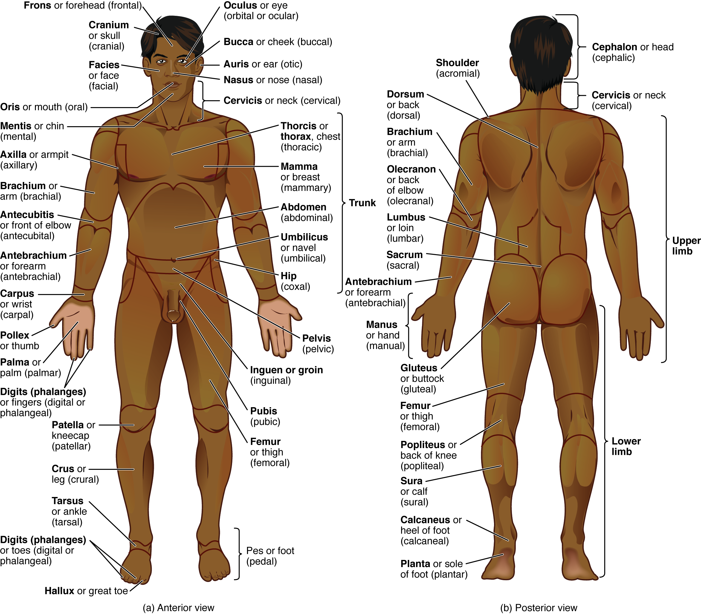
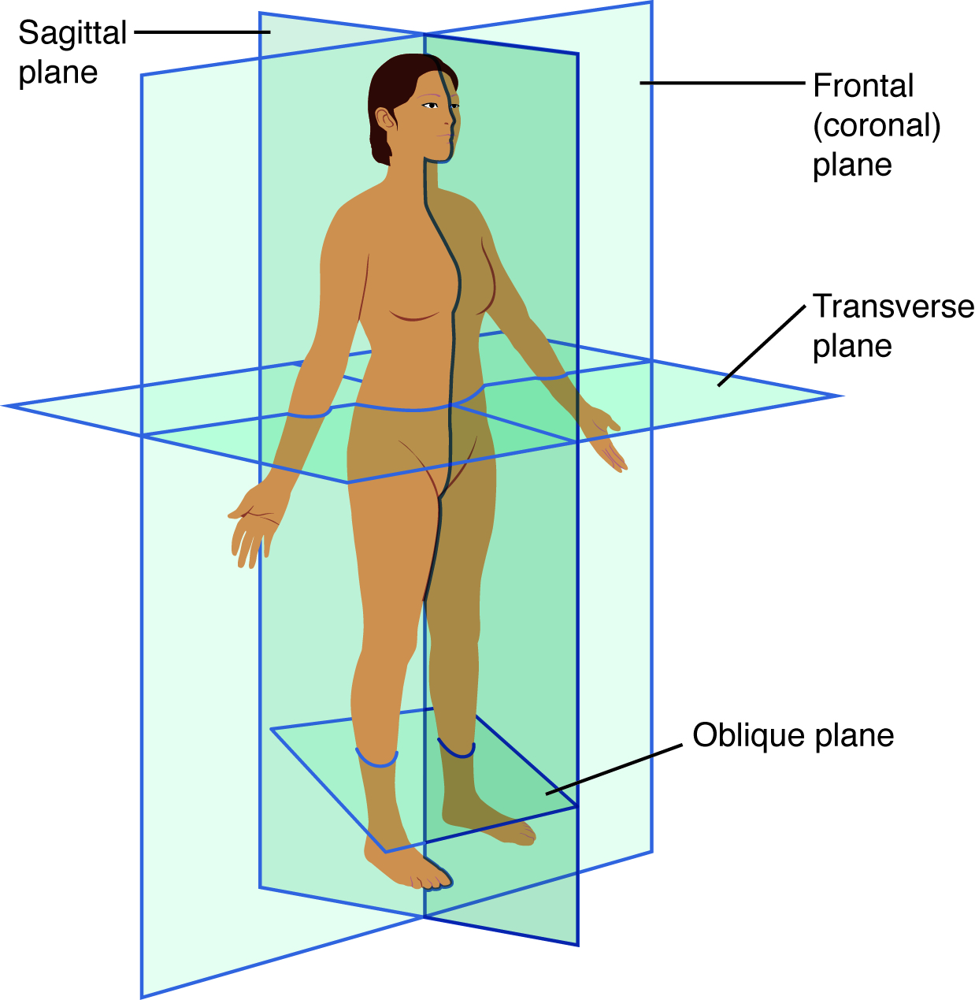
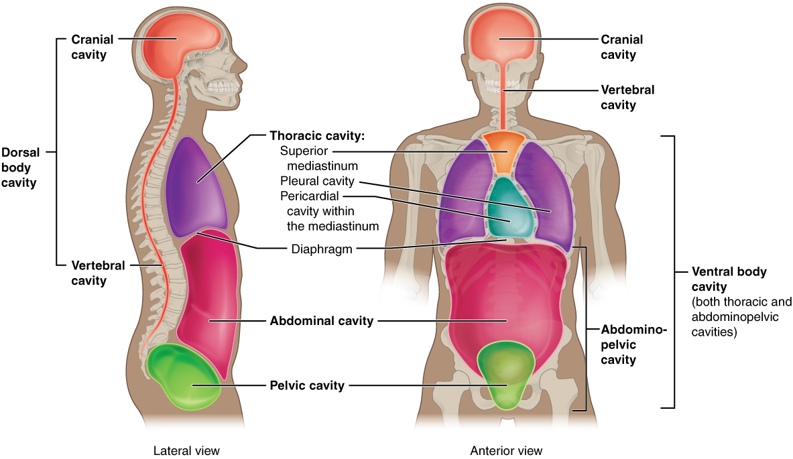

# 第1章 先会定位：体表、方向与切面

在人体图上找到一块肌肉或一个器官之前，先要确定自己正在从哪一面看、图中是谁的左侧，以及哪些结构已经被移走。同一个肾，在正面器官图中可能被肠道遮住，在背面图中又显得十分突出。这些图可以同时正确，区别在于观察位置和显示层次。

## 给身体建立共同坐标

解剖学使用约定的标准姿势：身体直立，面向前，双眼平视，上肢位于躯干两侧，手掌朝前，足尖朝前。这叫**解剖学姿势**。书中“前、后、内、外”的含义以它为依据；一个人把手翻过来，解剖学上的掌侧与背侧不会随观察者的视线改变。左右始终指被描述者自身的左右。正面图里，人体的右侧通常位于读者的左边。[来源：OpenStax，§1.6 Anatomical Terminology](https://openstax.org/books/anatomy-and-physiology-2e/pages/1-6-anatomical-terminology)

先把全身分成头、颈、躯干、上肢和下肢，就能建立第一张位置地图。躯干还可分为胸、腹、盆部及背部。日常语言里的“胳膊”“腿”比较宽泛，解剖名称更细：肩到肘是上臂，肘到腕是前臂；髋到膝是大腿，膝到踝是小腿。后续章节会不断借助这些分区，说明一条神经从哪里经过、一块肌肉跨越哪个关节。

| 方向词 | 比较的依据 | 具体例子 |
| --- | --- | --- |
| 上、下 | 沿身体头端与足端的方向 | 胸腔在腹腔上方 |
| 前、后 | 面向腹面或背面 | 胸骨在心脏前方 |
| 内侧、外侧 | 靠近或远离身体正中面 | 解剖学姿势下，拇指位于小指外侧 |
| 近端、远端 | 靠近或远离肢体与躯干的连接处 | 肘比腕更靠近上肢近端 |
| 浅、深 | 靠近或远离体表 | 皮肤位于骨骼浅面 |

“内侧”不等于“身体内部”。一块位于体表附近的肌肉也可以在另一块肌肉内侧。“深”同样是相对关系：某条血管可以在皮肤深面，又在肌肉浅面。读书时，最好把每一个方向词还原为“相对于谁”。

### 图 01-01｜从前后两面认识体表分区

**读图：** 先把头、躯干和四肢分开，再在前后视图中寻找同一关节。图的左右不等于人体自身的左右。

**标注对应：** anterior 前；posterior 后；thoracic 胸部；abdominal 腹部。

*来源：[OpenStax《Anatomy and Physiology 2e》原图 1.12](https://openstax.org/books/anatomy-and-physiology-2e/pages/1-6-anatomical-terminology)；OpenStax, Anatomy and Physiology 2e; J. Gordon Betts et al.; Rice University；[CC BY-NC-SA 4.0](https://creativecommons.org/licenses/by-nc-sa/4.0/)。*

## 三种切面，回答三类空间问题

**矢状面**把身体分为左、右两部分；经过身体中线的叫正中矢状面。侧面剖开的头部图常用它显示鼻腔、口腔、咽与脑之间的前后关系。**冠状面**把身体分为前、后两部分，适合比较双侧肺、肾或肩部的位置。**横断面**把身体分为上、下两部分，能显示某一高度上从体表到深部的结构。[来源：OpenStax，§1.6](https://openstax.org/books/anatomy-and-physiology-2e/pages/1-6-anatomical-terminology)

切面不是把不同结构都压在一张图上。某个横断面只穿过有限高度：在肝脏上部能看到的结构，到了肚脐高度可能已经消失。因此，遇到一个不认识的横断面时，应依次确认切面高度、人体前后、左右标记，再寻找脊柱等稳定参照物。没有方位标记的图片，不能仅凭摆放方向猜测左右。实际影像还需结合扫描方式和显示约定阅读，本书中的示意图不能代替影像判读。

把一根香蕉横切、纵切，切口形状差异很大；人体里弯曲、分叉的管道更复杂。同一根管道可能在一张切片上呈圆形，在另一张上呈长条，甚至出现多个分离的截面。看到分开的圆环，不能立即认定它们属于几个不同器官。

### 图 01-02｜三个基本切面

**读图：** 矢状面分左右，冠状面分前后，横断面分上下。切面是观察方向，不是身体中天然存在的隔板。

**标注对应：** sagittal 矢状；frontal 冠状；transverse 横断。

*来源：[OpenStax《Anatomy and Physiology 2e》原图 1.14](https://openstax.org/books/anatomy-and-physiology-2e/pages/1-6-anatomical-terminology)；OpenStax, Anatomy and Physiology 2e; J. Gordon Betts et al.; Rice University；[CC BY-NC-SA 4.0](https://creativecommons.org/licenses/by-nc-sa/4.0/)。*

## 身体内部怎样分隔

颅腔容纳脑，椎管容纳脊髓及相关结构，它们由骨性结构提供保护。躯干前部的胸腔与腹盆腔之间有**膈**分隔；腹腔与盆腔则彼此连续，没有一张完整的隔膜把两者封开。胸腔内，两肺分别位于两侧，心脏及多种重要结构位于两肺之间的纵隔内。[来源：OpenStax，§1.6](https://openstax.org/books/anatomy-and-physiology-2e/pages/1-6-anatomical-terminology)

“腔”这个字容易让人想到空盒子。人体中的腔隙往往被器官、液体或组织紧密占据。胸膜腔、心包腔和腹膜腔尤其需要区分：它们指相关浆膜层之间的潜在间隙，正常情况下只有少量液体，并不是让肺、心脏或肠管自由漂浮的大水池。贴近器官的一层叫脏层，衬在腔壁侧的一层叫壁层；两层之间的润滑作用，让呼吸、心跳和消化活动不至于产生过大摩擦。

胸部还展示了“一个区域包含几个系统”的特点：胸廓由骨、软骨和肌肉等构成，围护内部器官；呼吸系统、循环系统、消化道的一段以及神经血管却共同经过这个区域。按系统分章有助于理解功能，按区域分层有助于理解位置。两种阅读方式需要交替使用，任何一种都无法单独替代另一种。

腹部常用的四象限，是以通过肚脐的水平线和垂直线划分出的右上、左上、右下、左下区域。它们是沟通位置的坐标，不是四个器官盒；一个器官可以跨越分界，位置也会随呼吸及充盈改变。九区法提供更细的分区，本书在进入腹部时再结合器官说明。记住划分的用途，就不会误把图上的辅助线当作真实隔膜。

对照图也要留意“拿掉”与“切开”的区别。移去前方肌肉，可以显露后面的骨或器官；剖开某个器官，才会出现器官壁与内部腔隙。图上同时显示外形与内部时，通常使用了局部切除或透明化手法。读图时先辨认这一手法，能够避免误以为正常器官表面本来就有一个窗口。

### 图 01-03｜体腔与分隔

**读图：** 从颅腔沿椎管向下，再看膈如何把胸腔和腹盆腔隔开。腹腔与盆腔之间没有同样完整的横向隔膜。

**标注对应：** cranial cavity 颅腔；vertebral cavity 椎管；diaphragm 膈。

*来源：[OpenStax《Anatomy and Physiology 2e》原图 1.15](https://openstax.org/books/anatomy-and-physiology-2e/pages/1-6-anatomical-terminology)；OpenStax, Anatomy and Physiology 2e; J. Gordon Betts et al.; Rice University；[CC BY-NC-SA 4.0](https://creativecommons.org/licenses/by-nc-sa/4.0/)。*

## 从体表读进去

锁骨、胸骨、肋弓、髂嵴等骨性轮廓，为体表观察提供参照，但体表只能提示深部位置。肚脐是表面标志，不能当作所有人腹内结构的固定中心；呼吸、姿势、胃肠充盈和个体差异都会改变器官的相对位置。人体图通常呈现典型安排，不能把它理解成每个人精确相同的内部地图。

读本书时可以遵循一个简单顺序：先看完整外形，接着辨认体表标志，再理解移去皮肤后显露的浅层，最后进入局部剖面。每换一张图，都重新确认“观察方向、切开位置、保留结构”。这三步能避免把胸前肌肉、肋骨和肺看成摆在同一个平面上的零件。

一次安全的观察就能练习这种方法：自然放松地看自己的前臂与手，认出肘、腕、掌和手背；再把手掌缓慢转向上方。骨、肌肉和皮肤会随动作移动，名称却保持稳定。无需触压深部结构，单靠方向和运动，就能开始把表面与内部组织联系起来。
