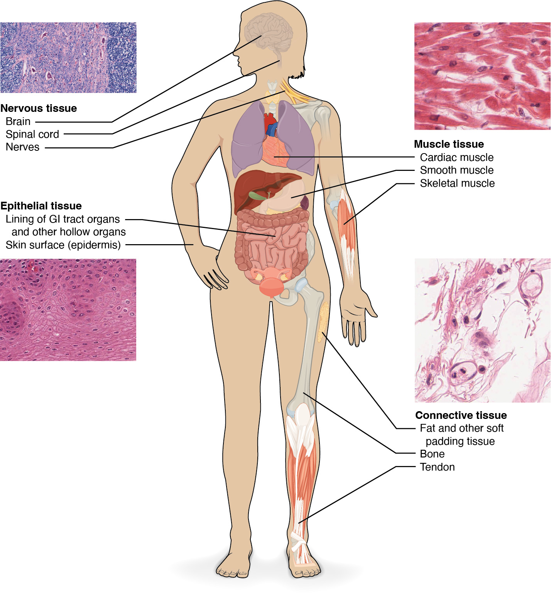
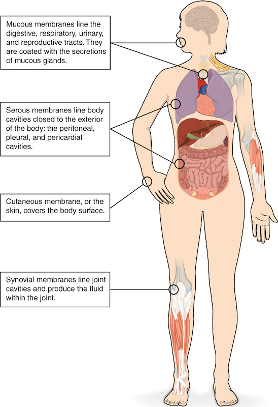

# 第2章 放大一层：组织如何组成身体

把皮肤、心脏、骨和脑并排放在一起，它们的形态与触感差别很大。但再向下观察，会发现它们反复使用几类基本组织。组织不是大小介于细胞和器官之间的一块“材料”，而是细胞及其周围成分按一定方式组合，承担相互关联的工作。

## 四类组织，四种主要任务

人体基本组织通常分为上皮组织、结缔组织、肌组织和神经组织。一个器官常由多类组织共同组成；“心脏是肌肉”“骨头是硬材料”都只指出了最显眼的成分。[来源：OpenStax，§4.1 Types of Tissues](https://openstax.org/books/anatomy-and-physiology-2e/pages/4-1-types-of-tissues)

**上皮组织**的细胞排列紧密，形成表面、衬里或腺体。皮肤最外部的表皮是上皮；胃肠道内表面的上皮则面对食物、消化液及微生物。上皮常有朝向表面或管腔的一侧，以及与深部组织连接的一侧。这种有方向的安排，让吸收、分泌和屏障功能能够在恰当的位置发生。

**结缔组织**分布广泛，连接、支撑、填充并保护其他组织。它包括疏松结缔组织、脂肪、肌腱中的致密结缔组织，以及软骨、骨和血液等特殊类型。它们外观悬殊，却都需要结合细胞与细胞外成分来理解。**肌组织**通过收缩产生力；骨骼肌、心肌和平滑肌分别参与身体运动、泵血和多种内脏活动。**神经组织**接收、处理与传递信息，由神经元和多种支持它们的胶质细胞构成。

| 基本组织 | 观察时的重点 | 在一个器官里能做什么 |
| --- | --- | --- |
| 上皮 | 细胞是否连续成层，朝向哪里 | 分隔环境、吸收、分泌 |
| 结缔 | 纤维、基质及细胞怎样分布 | 承力、连接、输送、免疫防御 |
| 肌 | 收缩细胞怎样排列 | 改变形状或产生张力 |
| 神经 | 信息从哪里来，传向哪里 | 感知、协调和调节 |

### 图 02-01｜四类基本组织

#### 中文读图说明

中央人体图用引线把四类组织连接到代表位置，四周照片则显示不同组织的显微外观。先看左上神经组织与右上肌组织，再看左下紧密成层的上皮和右下含较多细胞间成分的结缔组织。

同一类组织可以出现在多个位置：上皮既覆盖体表，也衬在消化管等空腔器官内面；肌组织分心肌、平滑肌和骨骼肌。右上的照片是心肌实例，并不是三类肌组织同时出现在同一照片里。

骨、肌腱、脂肪都被列入结缔组织，是按组织构成和关系分类，而非只看软硬。引线表示举例定位，不是神经或血管路线；染色照片的粉紫色也不是组织在活体中的自然颜色。

#### 图中英文标注逐项对照

| 图中英文 | 中文名称 | 在图中怎样理解 |
| --- | --- | --- |
| Nervous tissue | 神经组织 | 左上照片及脑脊髓神经位置示例 |
| Brain | 脑 | 人体头颅内的中枢神经结构 |
| Spinal cord | 脊髓 | 位于椎管内并与脑连接的结构 |
| Nerves | 神经 | 图中颈肩部黄色周围神经示例 |
| Muscle tissue | 肌组织 | 右上以心肌照片示收缩组织 |
| Cardiac muscle | 心肌 | 引线指向胸部中央心脏位置 |
| Smooth muscle | 平滑肌 | 引线指向胃等内脏肌性结构 |
| Skeletal muscle | 骨骼肌 | 引线指向上肢可随意活动的肌肉 |
| Epithelial tissue | 上皮组织 | 左下照片显示细胞紧密成层 |
| Lining of GI tract organs and other hollow organs | 消化道及其他空腔器官的衬里 | GI为胃肠道缩写，指向肠内面 |
| Skin surface (epidermis) | 皮肤表面（表皮） | 人体外缘指线表示覆盖性上皮 |
| Connective tissue | 结缔组织 | 右下照片示细胞与细胞外成分 |
| Fat and other soft padding tissue | 脂肪及其他软性缓冲组织 | 引线表示肢体内的缓冲组织示例 |
| Bone | 骨 | 引线指向肢体内骨性支架结构 |
| Tendon | 肌腱 | 引线指向肌肉与附着处间索带 |

*来源：[OpenStax《Anatomy and Physiology 2e》原图 4.2](https://openstax.org/books/anatomy-and-physiology-2e/pages/4-1-types-of-tissues)；OpenStax, Anatomy and Physiology 2e; J. Gordon Betts et al.; Rice University；[CC BY-NC-SA 4.0](https://creativecommons.org/licenses/by-nc-sa/4.0/)。*

*原图显微照片署名：Micrographs provided by the Regents of University of Michigan Medical School © 2012。*

## 细胞之间也有结构

显微图常把注意力引向细胞核，但很多组织的性能来自细胞之间的**细胞外基质**。它包括纤维和基质成分，其含量、排列与化学组成决定了组织能否承受拉伸、压缩或形变。结缔组织中的成纤维细胞能够合成多种基质成分，组织因此处在持续维护之中。[来源：OpenStax，§4.3 Connective Tissue Supports and Protects](https://openstax.org/books/anatomy-and-physiology-2e/pages/4-3-connective-tissue-supports-and-protects)

胶原纤维善于承受拉力，弹性纤维允许一定程度的伸展并帮助回弹，网状纤维则形成细密的支持网络。肌腱中胶原束大体沿受力方向排列，因此能有效传递肌肉牵拉；真皮中的纤维方向较复杂，适应来自不同方向的拉扯。骨的基质中沉积矿物质，使它具有硬度；软骨的基质则帮助关节面承受压力。不能只看“胶原含量”就预测所有组织的性质，还要看它如何组织。

血液说明了组织分类的一处重要特点：分类依据不只是软硬和外形。血细胞悬浮在液态血浆中，血浆构成它的液态细胞外环境。血液虽然会流动，仍被归入结缔组织。脂肪也不是无生命的填料，它由活细胞和周围血管、结缔组织共同组成。

## 器官是一组协作关系

以胃为例，朝向胃腔的上皮参与保护和分泌；其下的结缔组织提供支持并容纳血管；平滑肌层使胃壁运动；神经结构协调这些活动。把胃理解为“装食物的袋子”，会遗漏袋壁本身的主动工作。血管也有上皮衬里、结缔组织和不同程度的平滑肌，管壁的组织安排与它承担的压力、交换或回流任务有关。

反过来看，一种组织也不会只属于一个器官。结缔组织可以位于皮肤下面、肌肉之间、神经周围和器官外侧。它把局部分开，也把局部联系起来。本书后面出现的膜、鞘、囊和隔，很多都需要借助这种空间与材料关系理解。

组织怎样组合还决定了物质交换的距离。表面的一层细胞若要保持活性，就必须与能够供应氧和营养的环境保持足够联系。上皮虽然通常没有自身血管，仍依赖下方结缔组织的供应；结缔组织里的血管不是给一种“填料”添上的装饰，而是支持整个局部工作的重要通道。

软骨与肌腱又提醒我们，不能把结缔组织一律理解为血供丰富。不同类型的细胞密度、基质和血供存在明显差别，损伤后的修复条件也不相同。认识组织时，应同时问三个问题：主要细胞是什么，细胞外是什么，营养和信息怎样进来。仅凭“软”或“硬”不足以回答它们。[来源：OpenStax，§4.3](https://openstax.org/books/anatomy-and-physiology-2e/pages/4-3-connective-tissue-supports-and-protects)

同一器官里的组织也并非边界完全分明的四块拼图。肌肉内穿行着神经与血管，神经外包裹着结缔组织，血管最内面又有上皮。组织分类回答“这部分主要是什么”，器官解剖回答“这些部分如何组织起来”。如果一张图只用一种颜色概括整个器官，需要记得它省略了内部复杂性。

## 膜不是一种统一材料

“膜”描述薄层外形，不保证组织构成一致。皮肤、黏膜与浆膜都有上皮及其下方的支持性结缔组织；关节内的滑膜则属于结缔组织膜，没有典型的上皮层。黏膜多衬在与外界相通的通道里，例如消化道与呼吸道；浆膜则与胸腹部某些封闭腔隙有关。它们的湿润表面服务于不同任务，不能互换名称。[来源：OpenStax，§4.1，Tissue Membranes](https://openstax.org/books/anatomy-and-physiology-2e/pages/4-1-types-of-tissues)

读显微图时，先看比例尺，再找组织边界。大片粉红区域未必全是肌肉，也可能是染色后的胶原；一排深色小点通常是细胞核，不代表每一个小点都对应完整可见的细胞。教学图中的清晰边界、统一颜色和整齐排列，是为了突出关系；真实组织通常更复杂，切面方向也会改变它的样子。把示意图与显微照片对照，才能同时理解“组织如何工作”与“组织实际怎样出现”。

### 图 02-02｜膜也有不同组成

#### 中文读图说明

图中从上到下有四个英文说明框，圆圈在人体上标出例子。上框连向口与呼吸道附近，表示黏膜衬在与外界相通的管道内；这里展示的是位置，没有单独放大上皮与结缔组织的层次。

第二框指向胸部与腹部，说明浆膜与胸膜腔、心包腔和腹膜腔等空间有关。第三框指向手表面，把皮肤称为皮膜；最下框指向膝部，说明滑膜衬在滑膜关节内面并参与形成滑液。

四种膜的共同点是覆盖或衬里任务，组织组成却不全相同，滑膜不属于典型上皮膜。图中引线不是液体流动路线，也不表示所有黏膜都有同样分泌量；器官颜色仅用于区分位置。

#### 图中英文标注逐项对照

| 图中英文 | 中文名称 | 在图中怎样理解 |
| --- | --- | --- |
| Mucous membranes | 黏膜 | 最上方框指向口及呼吸道附近 |
| Digestive, respiratory, urinary, and reproductive tracts | 消化道、呼吸道、泌尿道及生殖道 | 上框列举与外界相通的管道 |
| Secretions of mucous glands | 黏液腺分泌物 | 上框说明黏膜表面可有黏液覆盖 |
| Serous membranes | 浆膜 | 第二说明框指向胸腹部体腔界面 |
| Peritoneal, pleural, and pericardial cavities | 腹膜腔、胸膜腔和心包腔 | 第二框列出相关浆膜腔隙名称 |
| Cutaneous membrane, or the skin | 皮膜，即皮肤 | 第三框圈出手部的身体外表面 |
| Synovial membranes | 滑膜 | 最下说明框圈出膝部关节位置 |
| Joint cavities | 关节腔 | 最下框所述滑膜关节内部空间 |
| Fluid within the joint | 关节内的滑液 | 最下框说明滑膜参与形成滑液 |

*来源：[OpenStax《Anatomy and Physiology 2e》原图 4.4](https://openstax.org/books/anatomy-and-physiology-2e/pages/4-1-types-of-tissues)；OpenStax, Anatomy and Physiology 2e; J. Gordon Betts et al.; Rice University；[CC BY-NC-SA 4.0](https://creativecommons.org/licenses/by-nc-sa/4.0/)。*

