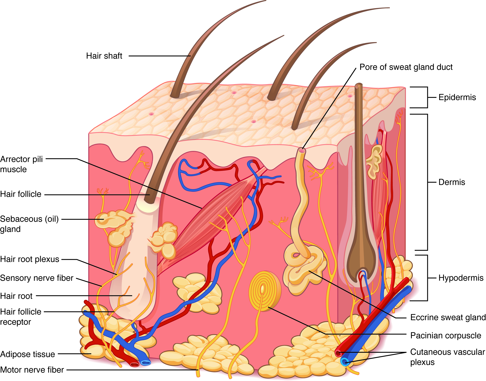
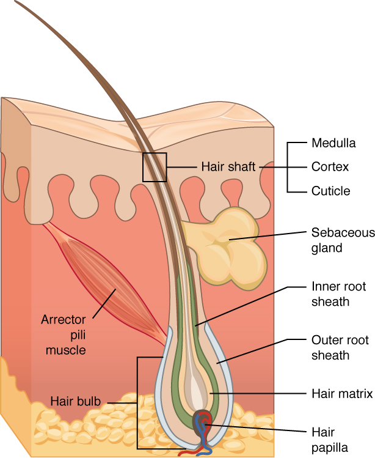

# 第3章 皮肤：屏障、感觉与散热

皮肤是身体与外界接触的连续器官。它承受摩擦、限制水分散失、参与感觉和体温调节，也需要从内部获得营养和信息。沿一张皮肤剖面从上向下看，能找到细胞层、纤维网络、血管、神经、毛囊与腺体；这些结构并不是均匀地撒在一块薄片中。

## 表皮与真皮：两层承担不同任务

严格说，皮肤包括**表皮**和**真皮**。更深的皮下组织与皮肤密切相连，但不属于狭义皮肤本身。表皮是角化复层鳞状上皮，细胞紧密排列；真皮是含胶原和弹性纤维的结缔组织，为上方提供支持，容纳血管、神经及多种附属结构。[来源：OpenStax，§5.1 Layers of the Skin](https://openstax.org/books/anatomy-and-physiology-2e/pages/5-1-layers-of-the-skin)

表皮本身没有血管，深层活细胞主要依赖真皮方向的物质扩散获取营养。越靠近表面，角质形成细胞越扁平并发生角化，最终构成外面的角质层。角质层内多数细胞已经失去细胞核，却仍是屏障结构的重要部分。它与细胞间脂质共同限制水分散失，也抵挡一定程度的摩擦和外来侵入。所谓“死细胞层”并不等于没有功能、应该尽量去除的废物层。

在真皮浅部，乳头状突起与表皮相互嵌合，增加接触并增强连接。较深的真皮网状层含有较粗的胶原纤维束。皮肤因此能随关节运动产生形变，同时保留一定抗拉能力。这里的“网状层”是解剖层次名称，不表示它只由网状纤维构成。

### 图 03-01｜皮肤与皮下组织的连续层次

**读图：** 从表面向下依次找表皮、真皮和皮下组织，随后追踪毛囊、汗腺与血管。皮下组织与皮肤紧密相接，但严格说并非皮肤本体的一层。

**标注对应：** epidermis 表皮；dermis 真皮；hypodermis 皮下组织。

*来源：[OpenStax《Anatomy and Physiology 2e》原图 5.2](https://openstax.org/books/anatomy-and-physiology-2e/pages/5-1-layers-of-the-skin)；OpenStax, Anatomy and Physiology 2e; J. Gordon Betts et al.; Rice University；[CC BY-NC-SA 4.0](https://creativecommons.org/licenses/by-nc-sa/4.0/)。*

## 厚皮与薄皮，要看具体含义

解剖学中的**厚皮**主要见于手掌和足底等部位，突出特点是表皮尤其角质层较厚，并有透明层。**薄皮**覆盖身体大部分表面。这个分类说的是组织学特点，不能简单等同于捏起来厚不厚；皮下脂肪很多的地方，整层软组织可以很厚，仍可能属于薄皮。[来源：OpenStax，§5.1](https://openstax.org/books/anatomy-and-physiology-2e/pages/5-1-layers-of-the-skin)

| 比较点 | 手掌、足底的厚皮 | 多数部位的薄皮 |
| --- | --- | --- |
| 表皮 | 角化较厚，有透明层 | 通常较薄，无明显透明层 |
| 毛发与皮脂腺 | 无毛囊和皮脂腺 | 多数部位可见毛囊、皮脂腺 |
| 主要适应 | 摩擦、承重和抓握 | 不同部位承担多样任务 |

手掌皮纹容易看见，但皮肤表面的皱褶不全是一回事：指纹与表皮和真皮连接处的结构有关，关节附近较大的屈曲纹还与反复活动及局部固定关系有关。观察自己手掌和手背的差异，可以先注意有无毛发、纹理及活动时皱褶如何改变，不必通过用力摩擦来验证组织性质。

## 毛发、指甲与腺体怎样连接表面

露在外面的毛干由角化细胞构成，毛囊则向深部延伸，毛根周围仍有活组织。毛球内的生发细胞产生新细胞，推动毛发向外生长；毛乳头携带的血管为生长提供支持。皮脂腺多与毛囊相连，把分泌物送入毛囊，帮助润滑毛发和皮肤。竖毛肌收缩会牵拉毛囊，形成熟悉的“鸡皮疙瘩”。[来源：OpenStax，§5.2 Accessory Structures of the Skin](https://openstax.org/books/anatomy-and-physiology-2e/pages/5-2-accessory-structures-of-the-skin)

小汗腺的分泌部常呈卷曲状，导管穿过真皮和表皮，开口到皮肤表面。汗液蒸发时带走热量，所以散热效果与环境湿度、空气流动等条件有关；汗留在表面而不易蒸发时，并不能按同样效率降温。大汗腺主要分布于腋部等特定区域，常与毛囊相关，不能把所有汗腺都画成同一种开口方式。

指甲的甲板是坚硬的角化结构，覆盖指趾末端；甲根附近的甲母质参与生成新甲。剪到自由缘时通常没有痛觉，不等于整个甲结构都没有感觉；甲床及周围组织具有神经和血供。读附属器图时，要把“表面看到的部分”和“产生它的活组织”分开寻找。

皮肤附属器还揭示了“起源层次”和“所在层次”的区别。毛囊和腺体从表皮来源的结构发展而来，但可以深入真皮甚至皮下组织；因此，它们不能仅凭在剖面中画得很深，就被归为肌肉或脂肪的一部分。沿导管或毛囊向表面追踪，比只看一个截面更容易辨明连接关系。

一张只截取很小范围的皮肤显微图，可能没有碰巧切中毛囊或汗腺。没有看到某结构，不一定意味着这个部位完全没有它；还要知道样本来自哪里、截面朝哪个方向、视野有多大。相反，一张综合示意图可能把多种感受器、血管和附属器集中画在一起，以便教学，真实皮肤并不会在每一平方毫米都具备相同配置。

皮肤屏障还包括一条由外向内的连续关系：角质层负责直接面对环境，其下的活细胞维持更新，真皮提供承力和供应，更深的皮下组织提供连接与缓冲。任何一层都不能独自承担全部任务。理解这一点，能解释为什么“最外面的一层没有活细胞核”与“皮肤是活的器官”并不矛盾。

### 图 03-02｜毛囊及其附属结构

**读图：** 顺着毛干向下找毛根，再辨认旁侧腺体和立毛肌。图中呈现的是有毛皮肤，并不能代表掌跖厚皮。

**标注对应：** hair shaft 毛干；hair follicle 毛囊；sebaceous gland 皮脂腺。

*来源：[OpenStax《Anatomy and Physiology 2e》原图 5.11](https://openstax.org/books/anatomy-and-physiology-2e/pages/5-2-accessory-structures-of-the-skin)；OpenStax, Anatomy and Physiology 2e; J. Gordon Betts et al.; Rice University；[CC BY-NC-SA 4.0](https://creativecommons.org/licenses/by-nc-sa/4.0/)。*

## 感觉与温度：皮肤一直在交换信息

皮肤内不同感受结构对机械刺激、温度变化和有害刺激的响应不同，分布也不均匀。指尖的精细触觉与背部大范围触觉感受并不相同。图中的神经末梢通常被放大绘制，不能根据图上大小推算它们在真实皮肤中的占比。

真皮血管还能通过血流变化参与散热调节。皮肤颜色除了黑色素，还受血流、血红蛋白及其他因素影响。黑色素由黑色素细胞产生并向周围角质形成细胞转移，它能提供一定紫外线防护，但任何肤色都不能理解成完全不受紫外线影响。[来源：OpenStax，§5.1](https://openstax.org/books/anatomy-and-physiology-2e/pages/5-1-layers-of-the-skin)

阅读完整剖面时，可以沿三条线分别追踪：从表面进入深层，辨认层次；从毛干或汗孔向下，找到附属器来源；从真皮血管和神经向上，理解表面如何获得营养与感觉。这样，皮肤就不再只是覆盖身体的一张外包装，而成为有自身组织分工、又与全身相连的器官。
