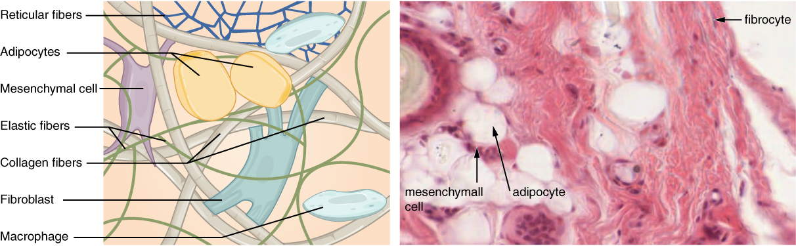
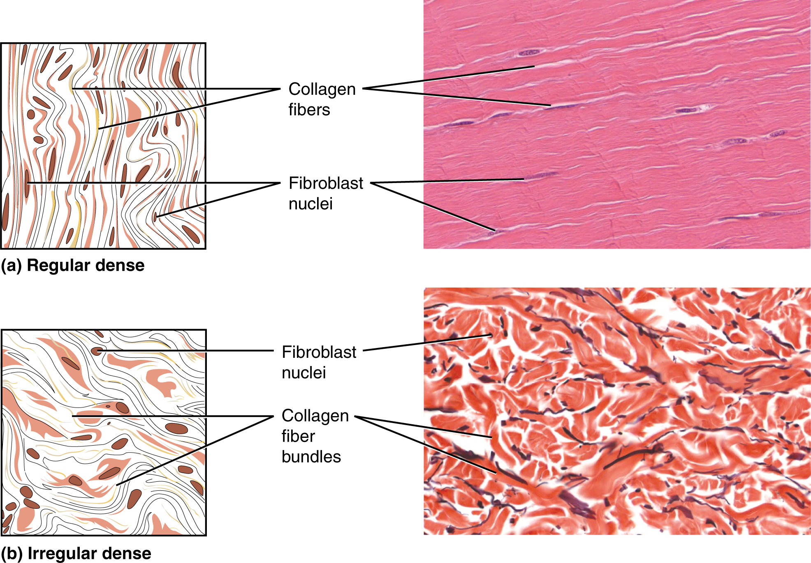

# 第4章 皮下脂肪与筋膜：形体之间的连接

从皮肤进入身体，首先遇到的往往不是一块轮廓清楚的肌肉，而是皮下组织。它把皮肤连接到深层，同时容纳脂肪、血管与神经，并允许不同程度的滑动。体表轮廓既与骨骼和肌肉有关，也受这一层的厚薄、分布和固定方式影响。单看外形，无法精确推算深部每块肌肉的大小。

## 皮下层不只有脂肪

皮下组织位于真皮深面，主要包含疏松结缔组织与脂肪组织。这里的纤维把皮肤与深部结构相连，形成支持与分隔；血管和神经穿行其间。皮下层厚度因部位和个体而异，年龄、激素及其他因素也会影响脂肪分布。皮肤与皮下组织的界限在实际组织中未必像教学剖面那样整齐。[来源：OpenStax，§5.1，Hypodermis](https://openstax.org/books/anatomy-and-physiology-2e/pages/5-1-layers-of-the-skin)

脂肪细胞能储存和释放脂质，脂肪组织还具有缓冲、保温及代谢调节功能。白色脂肪细胞通常以较大的脂滴储存能量；棕色脂肪细胞具有较多小脂滴和线粒体，与产热有关。日常解剖图里黄色区域是便于辨认的配色，并不意味着脂肪是一种完全同质、没有血供的油块。[来源：OpenStax，§4.3，Loose Connective Tissue](https://openstax.org/books/anatomy-and-physiology-2e/pages/4-3-connective-tissue-supports-and-protects)

**皮下脂肪**与**内脏脂肪**按位置区分。前者位于皮肤下面，后者位于体腔内、围绕部分内脏分布。二者不能靠观察腹部轮廓准确分量；一个外形特征也不能直接说明个人健康状况。本书利用这种区分建立空间概念，不把正常的体型差异简单排成优劣。

### 图 04-01｜疏松结缔组织中的纤维与细胞

**读图：** 把目光从细胞移到细胞之间：纤维与基质也是组织的重要部分。此图解释组织材料，不是全身筋膜的三维地图。

**标注对应：** collagen fiber 胶原纤维；elastic fiber 弹性纤维；fibroblast 成纤维细胞。

*来源：[OpenStax《Anatomy and Physiology 2e》原图 4.12](https://openstax.org/books/anatomy-and-physiology-2e/pages/4-3-connective-tissue-supports-and-protects)；OpenStax, Anatomy and Physiology 2e; J. Gordon Betts et al.; Rice University；[CC BY-NC-SA 4.0](https://creativecommons.org/licenses/by-nc-sa/4.0/)。*

*原图显微照片署名：Micrograph provided by the Regents of University of Michigan Medical School © 2012。*

## 筋膜提供连续关系，也形成局部分隔

“筋膜”在不同解剖学与研究语境中有宽窄不同的用法。入门时可以把它理解为分布于组织之间、包绕或连接结构的结缔组织层与网络。部分资料把皮下组织称为浅筋膜；较深、纤维更致密的筋膜则包覆肌群、形成肌间隔等结构。名称的差异需要结合具体部位阅读，不能假定所有书中“浅筋膜”或“筋膜系统”都指完全相同的范围。[来源：OpenStax，§5.1；§10.2 Skeletal Muscle](https://openstax.org/books/anatomy-and-physiology-2e/pages/10-2-skeletal-muscle)

结缔组织具有连续性，但连续并不表示整个人体是一张厚度、材料性质与功能都相同的膜。比如皮下疏松组织允许相对活动，肌腱的致密胶原束则适合沿主要受力方向传递张力。不同部位还可出现脂肪垫、滑囊或腱鞘等专门安排，分别适应缓冲、摩擦和活动需求。

在四肢，深筋膜与肌间隔能够把肌肉分成若干区域。神经、血管和肌肉常在这些区域内或区域之间共同经过。分隔有助于理解解剖空间，却不能把各区域想成与外界彻底隔绝的盒子：肌肉必须获得血供与神经支配，结构也会跨越边界。

## 肌膜、肌腱、腱膜和韧带怎样区分

一块骨骼肌内部还存在多级结缔组织：整块肌肉外有肌外膜，肌束周围有肌束膜，肌纤维周围有肌内膜。这些层次与肌肉两端的结缔组织相连续，使单个肌纤维产生的力能够汇合并传出。它们与局部深筋膜存在联系，但不能仅因都“包在外面”，就把所有名称互相替换。[来源：OpenStax，§10.2，The Three Connective Tissue Layers](https://openstax.org/books/anatomy-and-physiology-2e/pages/10-2-skeletal-muscle)

| 名称 | 主要形态或连接关系 | 阅读重点 |
| --- | --- | --- |
| 肌腱 | 常呈索带状，连接肌肉与其附着处 | 力从肌腹向哪里传递 |
| 腱膜 | 较宽而扁的腱性结构 | 多块肌肉怎样连接一片区域 |
| 韧带 | 多连接骨与骨，支持关节等结构 | 怎样限制或引导活动 |
| 筋膜 | 包绕、连接、分隔组织的结缔组织结构 | 层间关系与局部空间 |

以上是常用识别方式，不是单靠形状就能完成的命名规则。有的肌肉通过宽阔腱膜附着，有的肌腱很短，有些韧带也不属于典型的关节骨间连结。必须同时读位置和连接对象。

以肌腱为例，平行胶原束使它适合承受特定方向的牵拉；结缔组织若需要面对多个方向的拉力，纤维就可形成更交错的安排。因此，一张筋膜照片上的白色光亮外观，只是外观线索，不能替代组织学和力学信息。纤维的方向、厚度、连接范围及周围滑动界面，都可能改变它在局部的作用。[来源：OpenStax，§4.3](https://openstax.org/books/anatomy-and-physiology-2e/pages/4-3-connective-tissue-supports-and-protects)

另一个容易误解的词是“软组织”。临床与日常描述常用它概括皮肤、脂肪、肌肉、肌腱及其他非骨结构，但这些结构的力学性质并不相同。一根肌腱虽然属于软组织，却不一定容易被拉长；皮下脂肪可变形，也不表示其间没有纤维性分隔。读书时可以使用这个概括词，但分析结构时仍应回到具体组织。

人体轮廓里的凹凸也常来自多个层次叠加。一处隆起可能与骨性形态、肌腹大小、脂肪分布和姿势共同有关。不同体型的外表差异，不代表内部组织变换了基本类别。把个体差异与典型结构放在一起阅读，才能避免把某一种体型的解剖示意当成所有人的模板。

### 图 04-02｜致密结缔组织的纤维方向

**读图：** 比较平行排列与多方向交织的胶原纤维，理解组织为何适应不同受力方向。肌腱与真皮都富含胶原，但结构安排不同。

**标注对应：** dense regular 致密规则；dense irregular 致密不规则。

*来源：[OpenStax《Anatomy and Physiology 2e》原图 4.15](https://openstax.org/books/anatomy-and-physiology-2e/pages/4-3-connective-tissue-supports-and-protects)；OpenStax, Anatomy and Physiology 2e; J. Gordon Betts et al.; Rice University；[CC BY-NC-SA 4.0](https://creativecommons.org/licenses/by-nc-sa/4.0/)。*

*原图显微照片署名：Micrographs provided by the Regents of University of Michigan Medical School © 2012。*

## 从一张横断面看懂“软组织”

以前臂或小腿横断面为例，先找到皮肤外缘，再看其深面的皮下组织；接着辨认包绕肌群的深筋膜及内部肌间隔，最后寻找肌肉、骨与神经血管。脂肪通常填在特定空间里，筋膜沿结构边界延展，血管与神经则以束状或管状形态穿行，三者不能被画成彼此绝对分离的纯净图层。

同样重要的是保留“不知道”的边界。体表的凹陷或紧绷感不能自动定位到某一层筋膜，更不能仅凭一张轮廓图解释疼痛原因。术语“筋膜粘连”“筋膜释放”若离开具体组织、观察方法和证据，容易把复杂的活动与感觉简化成一张膜被“粘住”或“揉开”。理解筋膜的价值，在于看见组织怎样连接、承力与相对移动，而不是让一个名称包办所有身体解释。
