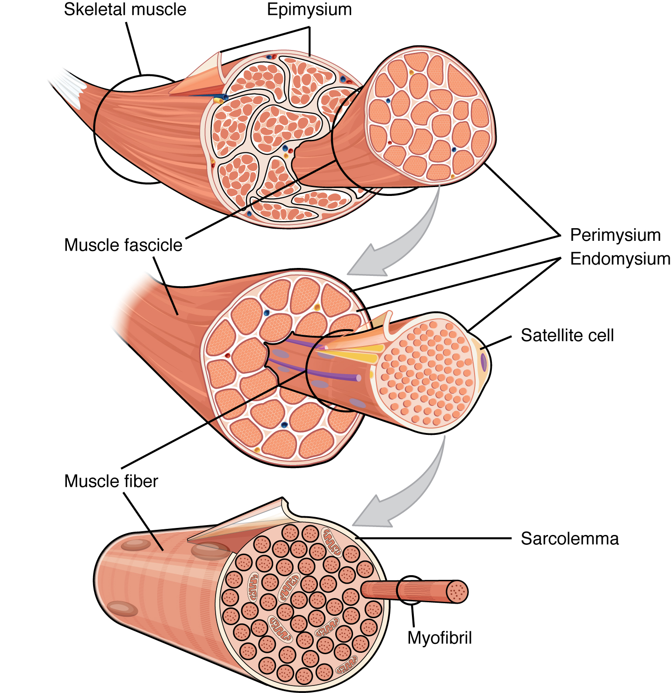
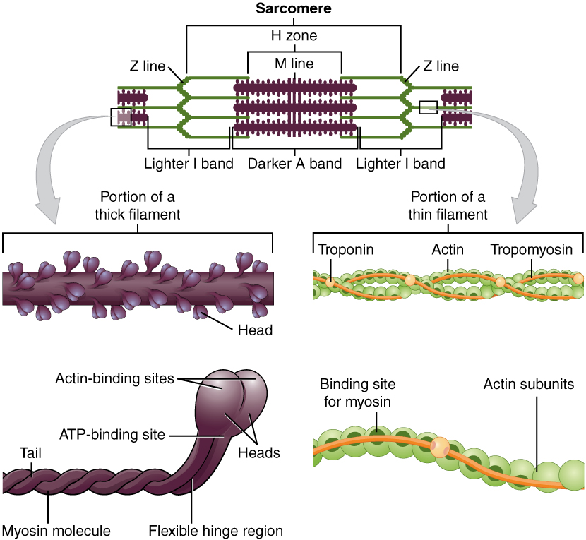
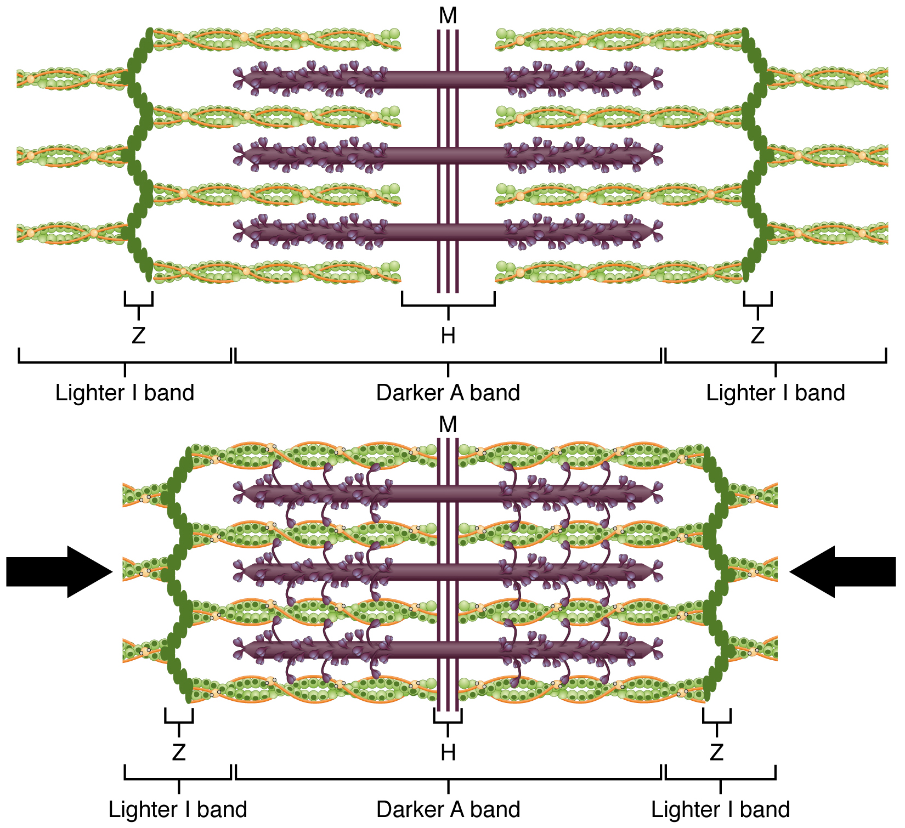

# 第5章 肌肉：从轮廓走向收缩

抬手、吞咽、站立和眨眼都与肌肉有关，但并非所有肌肉都会在体表形成明显隆起。浅层肌肉与脂肪、皮肤共同塑造轮廓，深层肌肉则可能参与稳定、细微调整或呼吸。观察肌肉时，先找它位于哪里、两端连到哪里，再理解它能怎样产生力，比只记名称更有用。

## 一块肌肉内部还有层次

骨骼肌常有较厚的肌腹和与附着处相连的肌腱或腱膜。整块骨骼肌是器官，除肌细胞之外，还包含结缔组织、神经和血管。从大到小，它通常可依次看成整块肌肉、肌束、肌纤维、肌原纤维与肌节。这里的**肌纤维**指一条细长的肌细胞，不是胶原纤维，也不是肉眼看到的一切细丝。[来源：OpenStax，§10.2 Skeletal Muscle](https://openstax.org/books/anatomy-and-physiology-2e/pages/10-2-skeletal-muscle)

整块肌肉外面有肌外膜，肌束周围有肌束膜，肌纤维周围有肌内膜。它们提供支持和组织关系，也参与传递肌纤维产生的张力。神经血管进入这些层次，为肌纤维提供运动信号、氧和营养。肌肉可以主动产生力，但无法脱离连接结构独立工作。

读肌肉放大图时，要留意它把几个尺度放在同一画面里：一束从肌腹拉出的肌束，通常已经不是原来的比例；再拉出肌纤维和肌原纤维，是继续放大。图中“抽出来”的样式是解释结构的手法，不表示正常肌肉里存在一根松散、可自由拖出的绳子。

### 图 05-01｜一块肌肉内部的包裹层

**读图：** 沿整块肌肉、肌束、肌纤维三个尺度逐级放大；这些是包裹和连接关系，不能当成三种独立肌肉。

**标注对应：** epimysium 肌外膜；perimysium 肌束膜；endomysium 肌内膜。

*来源：[OpenStax《Anatomy and Physiology 2e》原图 10.3](https://openstax.org/books/anatomy-and-physiology-2e/pages/10-2-skeletal-muscle)；OpenStax, Anatomy and Physiology 2e; J. Gordon Betts et al.; Rice University；[CC BY-NC-SA 4.0](https://creativecommons.org/licenses/by-nc-sa/4.0/)。*

## 肌肉收缩怎样产生力

肌节是骨骼肌产生收缩的基本结构单位，由相互交错的细肌丝、粗肌丝及相关蛋白组成。细肌丝主要含肌动蛋白，粗肌丝主要含肌球蛋白。在适当信号与钙离子作用下，肌球蛋白头反复与细肌丝结合、牵拉并分离，使两类肌丝相对滑动。肌节可以缩短，而两种肌丝本身并不因此按同样比例缩成更短的丝。[来源：OpenStax，§10.3 Muscle Fiber Contraction and Relaxation](https://openstax.org/books/anatomy-and-physiology-2e/pages/10-3-muscle-fiber-contraction-and-relaxation)

神经信号到达神经肌接头后，引发肌纤维膜上的电活动，进而促使肌浆网释放钙离子。钙离子使调节蛋白的位置发生改变，让收缩循环得以进行。ATP既参与循环中的能量转换，也与肌球蛋白从肌动蛋白上分离及钙离子回收有关。因此，肌肉放松并不是一种完全不耗能的被动状态。

把“神经信号、钙离子、肌丝滑动、张力输出”连起来，就能理解宏观动作与微观结构之间的关系。神经没有像机械绳索一样直接拉短整块肌肉，它改变的是肌细胞活动状态；力最终来自细胞内蛋白结构的协同作用。

### 图 05-02｜肌节的基本结构

**读图：** 先找相邻两条Z线，把两线之间视为一个肌节，再比较粗细肌丝的位置。

**标注对应：** sarcomere 肌节；actin 肌动蛋白；myosin 肌球蛋白。

*来源：[OpenStax《Anatomy and Physiology 2e》原图 10.5](https://openstax.org/books/anatomy-and-physiology-2e/pages/10-2-skeletal-muscle)；OpenStax, Anatomy and Physiology 2e; J. Gordon Betts et al.; Rice University；[CC BY-NC-SA 4.0](https://creativecommons.org/licenses/by-nc-sa/4.0/)。*

### 图 05-03｜收缩时缩短的是肌节

**读图：** 对照收缩前后Z线距离与重叠区；肌丝彼此滑行，并非粗细肌丝本身同步变短。

**标注对应：** sliding filament 肌丝滑行；Z disc Z线。

*来源：[OpenStax《Anatomy and Physiology 2e》原图 10.10](https://openstax.org/books/anatomy-and-physiology-2e/pages/10-3-muscle-fiber-contraction-and-relaxation)；OpenStax, Anatomy and Physiology 2e; J. Gordon Betts et al.; Rice University；[CC BY-NC-SA 4.0](https://creativecommons.org/licenses/by-nc-sa/4.0/)。*

## 收缩不一定意味着缩短

生活里说“肌肉收缩”，常指肌肉变短并鼓起来。生理学中的收缩还包括产生张力但长度变化很小，或在有张力时被拉长的情形。

| 情形 | 肌肉整体表现 | 日常例子 |
| --- | --- | --- |
| 向心收缩 | 产生张力并缩短 | 用屈肘肌把轻物抬起 |
| 等长收缩 | 产生张力，长度近似不变 | 在一定姿势下端住轻物 |
| 离心收缩 | 有张力时被拉长 | 缓慢放下手中轻物时，屈肘肌控制下降 |

这些描述关注肌肉的整体力学行为。实际动作往往由多块肌肉共同参与，不能从关节是否移动直接判断每一块肌肉的长度变化。观察例子不需要加重负荷；自然动作足以说明，放下物体也需要肌肉控制，而不是单纯“松开所有肌肉”。[来源：OpenStax，§10.4 Nervous System Control of Muscle Tension](https://openstax.org/books/anatomy-and-physiology-2e/pages/10-4-nervous-system-control-of-muscle-tension)

肌肉张力还依赖有多少肌纤维被招募，以及神经刺激怎样在时间上组合。一个运动神经元及它所支配的肌纤维构成运动单位。需要精细控制的肌肉，与需要较大整体力量的肌肉，在运动单位安排上可以不同。日常动作中的力通常逐渐调整，不是整块肌肉里的所有细胞只能一起“开”或一起“关”。[来源：OpenStax，§10.4](https://openstax.org/books/anatomy-and-physiology-2e/pages/10-4-nervous-system-control-of-muscle-tension)

体表看见的肌腹形状，也不能独立预测其能做多大动作。肌纤维排列方向、肌肉跨越的关节、肌腱经过的位置，以及当时关节角度，都与输出有关。一些羽状肌的肌纤维斜向汇入肌腱；这类图中的斜线表示纤维方向，不能把它们误认作许多完全独立的小肌肉。

肌肉与骨骼的连接同样不是“肌腱在骨表面随意粘住”。附着部位具有适应传力的组织关系，骨表面相应的粗糙隆起常能提供识别线索。后续读四肢章节时，把肌腹、肌腱、附着点和关节作为一条连续路线追踪，就能从一个名称走向可解释的动作。

## 从附着点理解动作

肌肉产生的牵拉沿肌腱传到附着结构。若它跨越一个关节，力的方向和相对于关节的位置会影响动作。一块肌肉可能跨越两个关节；同一块肌肉在不同姿势、不同固定条件下，也未必只产生一个动作。所谓“起点”“止点”是描述附着的常用术语，不能理解为动作时一端永远绝对固定、另一端永远移动。

多块肌肉可以共同产生一个方向的动作，也可以通过相反方向的力协调速度和稳定性。缓慢屈伸手指时，手背附近的肌腱会随动作移动，而主要肌腹有不少位于前臂。这说明动作出现的位置与产生主要牵拉的肌腹位置并不一定相同。

最后还应区分三类肌组织：骨骼肌常受躯体运动神经控制，参与动作与姿势；心肌形成心脏主要泵血结构；平滑肌分布在消化管、血管及其他内脏结构中。后两者的调节和显微结构与骨骼肌不同。肌肉章建立的是共同的“主动产生力”概念，后面讨论心脏和消化时，还要回到各自的组织安排。[来源：OpenStax，§4.1 Types of Tissues](https://openstax.org/books/anatomy-and-physiology-2e/pages/4-1-types-of-tissues)
