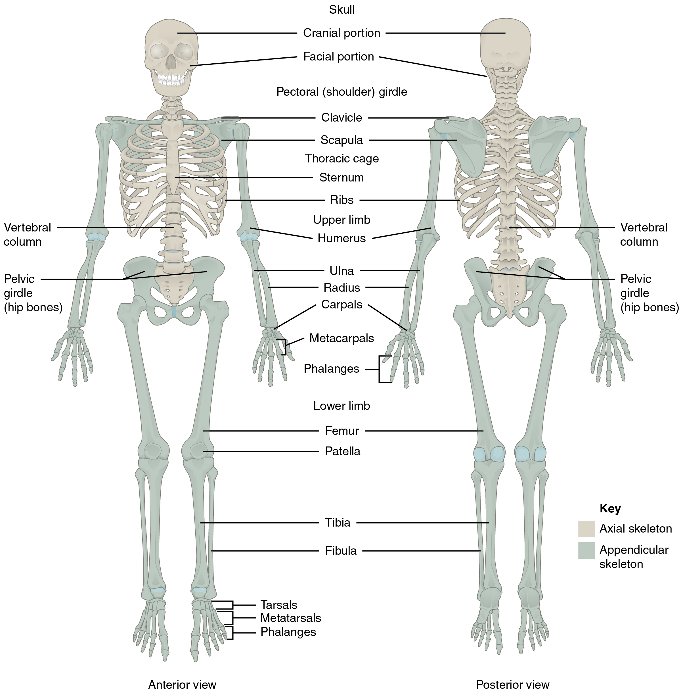
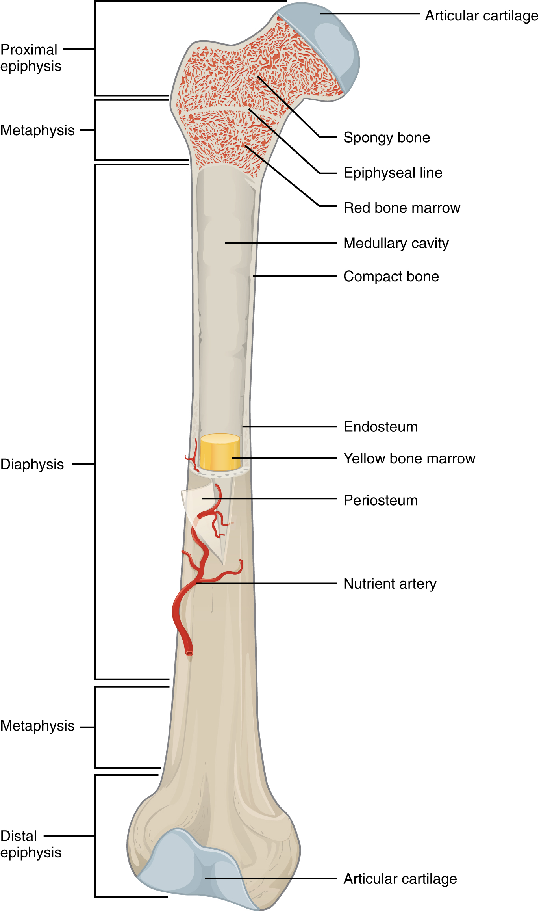
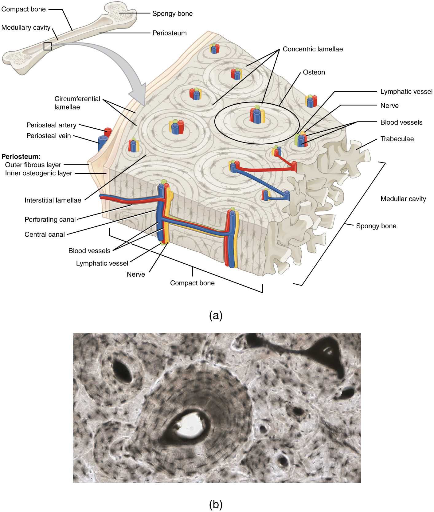

# 第6章 骨骼：有生命的支架

骨骼为身体提供支撑，构成肌肉产生动作的力学基础，也保护脑、脊髓和胸盆部器官。它还是矿物质储存与骨髓造血的重要场所。干燥骨标本适合观察外形，却容易让人忽略活体骨内的细胞、血管、神经和持续进行的组织更新。

## 从全身分区看支架

骨骼可分为**中轴骨骼**与**附肢骨骼**。中轴骨骼包括颅骨、脊柱与胸廓等结构，形成身体中央的支撑和保护框架；附肢骨骼包括上、下肢骨，以及把它们连接到中轴的肩带和骨盆带。锁骨、肩胛骨和髋骨因此不仅是局部骨块，也是肢体与躯干之间的连接结构。[来源：OpenStax，§7.1 Divisions of the Skeletal System](https://openstax.org/books/anatomy-and-physiology-2e/pages/7-1-divisions-of-the-skeletal-system)

成人常用的骨数是206块，这是典型计数方式，不能当作每个人都必须符合的精确数值。年龄、生长中的融合过程及个体变异都会影响计数。理解每一组骨的关系，比反复核对总数更重要。上肢的结构安排偏重灵活操作，下肢则在活动之外承担较多体重，两者不能仅因都有一根近端长骨、两根远端长骨，就认为它们是可以互换的机械部件。

体表容易观察到的锁骨、胫骨前缘等区域，是骨与皮肤距离较近的地方；在大腿或臀部，骨则被较多软组织覆盖。骨架并不是处处位于最深中央，例如胸部肋骨还构成器官外侧的围护结构。“从外到内”到达骨后，仍可能需要继续穿过胸壁和膜性结构，才能理解肺的位置。

### 图 06-01｜中轴骨与附肢骨

**读图：** 先看颅骨、脊柱、胸廓组成的中轴，再沿肩带和骨盆带连接四肢；骨骼不是独立散件的清单。

**标注对应：** axial skeleton 中轴骨；appendicular skeleton 附肢骨。

*来源：[OpenStax《Anatomy and Physiology 2e》原图 7.2](https://openstax.org/books/anatomy-and-physiology-2e/pages/7-1-divisions-of-the-skeletal-system)；OpenStax, Anatomy and Physiology 2e; J. Gordon Betts et al.; Rice University；[CC BY-NC-SA 4.0](https://creativecommons.org/licenses/by-nc-sa/4.0/)。*

## 长骨剖面：外壳、骨小梁与骨髓

典型长骨包括骨干与两端的骨骺，二者之间的干骺端在生长发育阶段具有重要意义。骨干外部以较厚的**密质骨**承力，内部有髓腔；骨端内部常有**松质骨**形成的骨小梁网络。多数骨同时含有密质骨和松质骨，分布与比例随位置及功能不同。[来源：OpenStax，§6.3 Bone Structure](https://openstax.org/books/anatomy-and-physiology-2e/pages/6-3-bone-structure)

| 结构 | 形态特点 | 不应混淆的概念 |
| --- | --- | --- |
| 密质骨 | 排列致密，形成坚实骨皮质 | 致密不等于没有血管和细胞 |
| 松质骨 | 骨小梁构成有间隙的网络 | 松质骨不是软骨，也不是脆弱泡沫 |
| 骨髓 | 位于髓腔和骨小梁间隙等处 | 骨髓不同于椎管内的脊髓 |
| 关节软骨 | 覆盖部分骨端的关节面 | 不属于骨膜，也不等于骨组织 |

松质骨中的间隙容纳骨髓和血管等结构，骨小梁本身仍是骨组织。红骨髓参与血细胞生成，黄骨髓含较多脂肪；二者分布会随年龄与部位改变，不能把“骨端全是红骨髓、骨干全是黄骨髓”作为适用于所有年龄和骨骼的硬规则。

### 图 06-02｜长骨的外形与内部

**读图：** 沿长轴观察骨干与两端，再看皮质骨、松质骨和髓腔；不要把松质骨理解为软骨。

**标注对应：** diaphysis 骨干；epiphysis 骨骺；medullary cavity 骨髓腔。

*来源：[OpenStax《Anatomy and Physiology 2e》原图 6.7](https://openstax.org/books/anatomy-and-physiology-2e/pages/6-3-bone-structure)；OpenStax, Anatomy and Physiology 2e; J. Gordon Betts et al.; Rice University；[CC BY-NC-SA 4.0](https://creativecommons.org/licenses/by-nc-sa/4.0/)。*

## 骨表面与内部都有工作界面

骨外表面多数区域被骨膜覆盖，关节软骨覆盖的部位例外。骨膜与血管、神经以及肌腱、韧带附着有关，内层还参与生长和修复。骨内部髓腔等表面衬有骨内膜。沿长骨剖面看，骨膜在外、骨内膜在内，两者是不同界面，不是简单包着骨的同一张薄纸。[来源：OpenStax，§6.3，Periosteum and Endosteum](https://openstax.org/books/anatomy-and-physiology-2e/pages/6-3-bone-structure)

骨的表面也不光滑。隆起、粗隆和嵴常与肌腱韧带附着相关；关节面适应相邻骨的接触；孔、沟和管则可能容纳血管、神经。观察骨标本时，不妨把这些形态当作功能线索：哪里需要传力，哪里需要活动，哪里需要让其他结构通过。单靠形状仍不足以判断名称，应结合位置和标准图谱。

生长中的长骨还要区分骨骺板与关节软骨。骨骺板位于骨骺与骨干之间的生长区域，与长骨纵向生长相关；关节软骨则位于部分骨端的接触面，承担降低摩擦和分散负荷的任务。骨骺板在成熟后发生骨化，具体时间因骨与个体而异，不能用一个年龄作为所有部位完全相同的界线。[来源：OpenStax，§6.3](https://openstax.org/books/anatomy-and-physiology-2e/pages/6-3-bone-structure)

长骨剖面是一种便于教学的典型，并不代表全部骨形态。颅顶的扁骨常呈外、内两层密质骨夹着松质骨的安排，椎骨则有适合承重与围护椎管的复杂外形。把长骨的“直管加两端”套到颅骨和椎骨上，反而会阻碍理解。每进入一个身体区域，都要重新看当地的结构任务。

骨标本上看似空着的孔道，在活体内常有重要结构通过。脊柱围成的椎管保护脊髓及相关结构，颅底孔洞让神经和血管穿行；这也是骨既提供保护、又必须允许连接的体现。识别一块骨，除了记住轮廓，还应留意它怎样给其他组织留下空间。

### 图 06-03｜皮质骨的骨单位

**读图：** 沿中央管看血管通道，再看围绕它排列的骨板。骨组织有细胞、血供和更新活动。

**标注对应：** osteon 骨单位；central canal 中央管；lamellae 骨板。

*来源：[OpenStax《Anatomy and Physiology 2e》原图 6.12](https://openstax.org/books/anatomy-and-physiology-2e/pages/6-3-bone-structure)；OpenStax, Anatomy and Physiology 2e; J. Gordon Betts et al.; Rice University；[CC BY-NC-SA 4.0](https://creativecommons.org/licenses/by-nc-sa/4.0/)。*

*原图显微照片署名：Micrograph provided by the Regents of University of Michigan Medical School © 2012。*

## 硬度来自基质，更新依赖细胞

骨基质中的胶原纤维与矿物质共同决定其力学性质。矿物质使骨具有硬度与承压能力，胶原网络则提供一定韧性。把骨理解成一块钙，或理解成被钙包住的软组织，都过于简单。密质骨的显微结构中可见围绕中央管排列的骨单位；骨细胞位于骨陷窝中，通过骨小管建立物质交换与联系。[来源：OpenStax，§6.3，Bone Cells and Tissue](https://openstax.org/books/anatomy-and-physiology-2e/pages/6-3-bone-structure)

成骨细胞参与形成新骨基质，骨细胞维持并感受局部环境，破骨细胞参与吸收骨组织。这些过程持续发生，使骨在一生中不断更新。骨并不是只有断裂后才开始修补的静态支架，重建活动始终与全身代谢和局部受力环境相联系。

读骨结构图时，最好分三次看：先找整块骨的近端、远端和关节面；再看剖面中密质骨、松质骨与髓腔的安排；最后进入骨单位和细胞层次。三个尺度连起来，才能解释为什么一块外形坚硬的骨，内部仍需要血流、信息与有组织的更新。
