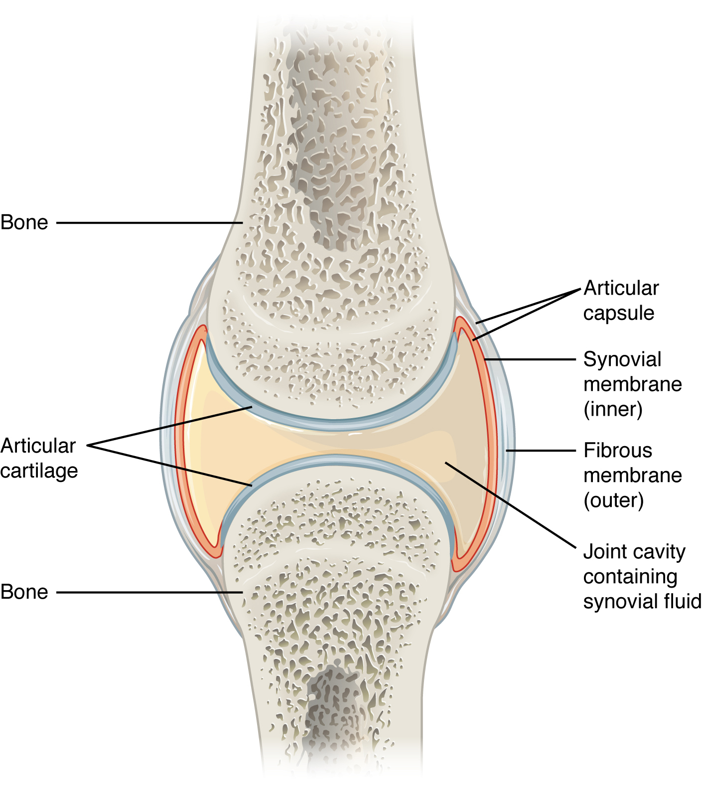
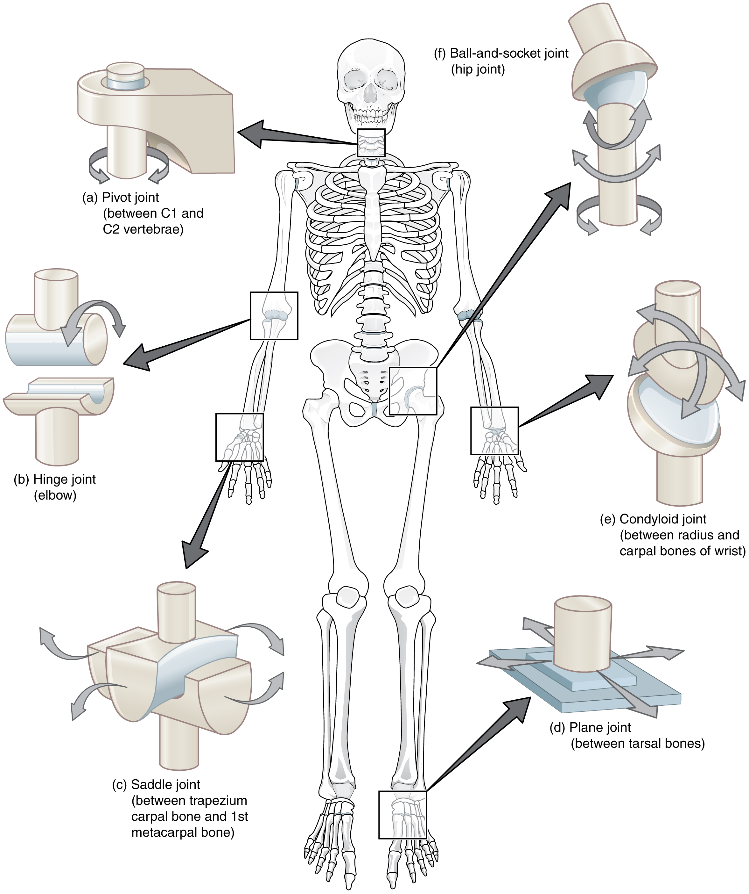

# 第7章 关节：稳定与活动的交换

站起、拿杯、转头都需要骨与骨之间保留一定活动。关节使坚硬的骨骼成为可以协调运动的整体，但关节并不都像门轴，也不都具有明显的空腔。颅骨间的骨缝、椎体间的软骨连接，与肩、肘、髋、膝的滑膜关节采用了不同连接方式。本章沿着最容易看懂运动关系的滑膜关节，观察身体如何同时保留活动与稳定。[来源：OpenStax，9.4 滑膜关节](https://openstax.org/books/anatomy-and-physiology-2e/pages/9-4-synovial-joints)

## 从外侧支持走进关节内部

以一处典型滑膜关节为例，从外向内可依次识别跨过关节的肌肉和肌腱、周围韧带、关节囊、囊内的关节腔，以及覆盖骨端的关节软骨。这是一条读图路线，各结构并非整齐同心分布：有的韧带并入关节囊，有的位于囊外，还有的位于囊内。

关节囊的外层以较坚韧的纤维组织为主，围出可活动的边界；内面的滑膜参与产生滑液。关节软骨通常是透明软骨，提供平滑的承载表面。两块骨端各有自己的软骨覆盖，它们没有长成把骨端粘在一起的一整块软骨。关节腔与滑液使相对运动得以发生，滑液还为缺少自身血管的关节软骨提供物质交换条件。

不要把教材中放大的关节间隙理解成骨端在一个大袋子里随意碰撞。真实间隙、软骨、囊和韧带共同限制了运动路径，周围肌肉也不断参与稳定。图中把一处骨端剖开，往往只是为了显露内部，并不表示关节本来就有这样的缺口。[来源：OpenStax，9.4，Structural Features](https://openstax.org/books/anatomy-and-physiology-2e/pages/9-4-synovial-joints)

### 图 07-01｜滑膜关节的包裹与间隙

#### 中文读图说明

这是一处滑膜关节的剖面示意。先看上下两块骨：蜂窝状部分表示内部骨组织，蓝灰色薄层只覆盖相对的骨端，代表关节软骨，不是把两骨粘在一起的整块软骨。

再沿右侧引线向外看，关节囊由外层纤维膜与内层滑膜共同构成。红色滑膜衬在囊的内面，抵达软骨边缘；它没有再覆盖整个关节软骨表面。

两骨端之间浅黄色区域为含滑液的关节腔，滑液参与润滑和软骨营养。图把间隙拉开以便辨认，不表示骨端能在大袋子内任意移动；周围肌肉和韧带在这幅简图中被省略。

#### 图中英文标注逐项对照

| 图中英文 | 中文名称 | 在图中怎样理解 |
| --- | --- | --- |
| Bone | 骨 | 上下两端骨组织构成关节的硬性支架 |
| Articular cartilage | 关节软骨 | 覆盖相对骨端表面以利承载和滑动 |
| Articular capsule | 关节囊 | 包绕关节外周并围定内部关节腔 |
| Synovial membrane (inner) | 滑膜（内层） | 衬在囊内面参与产生润滑所需滑液 |
| Fibrous membrane (outer) | 纤维膜（外层） | 构成囊外层并加强关节连接稳定性 |
| Joint cavity containing synovial fluid | 含滑液的关节腔 | 位于相对软骨之间并与囊内间隙相连 |

*来源：[OpenStax《Anatomy and Physiology 2e》原图 9.8](https://openstax.org/books/anatomy-and-physiology-2e/pages/9-4-synovial-joints)；OpenStax, Anatomy and Physiology 2e; J. Gordon Betts et al.; Rice University；[CC BY-NC-SA 4.0](https://creativecommons.org/licenses/by-nc-sa/4.0/)。*

## 几种容易混淆的“软结构”

肌腱主要传递肌肉的拉力，韧带主要连接和约束骨与骨之间的位置关系。二者都富含胶原纤维，名字相近，却不能互换。肌肉跨过关节后收缩，不仅使关节转动，也能通过共同收缩提高关节稳定性。

半月板和关节盘是另一些关节内部的纤维软骨结构。膝关节的半月板能改善接触与分配负荷，颞下颌关节的关节盘则参与适应其复杂运动。它们不是每一处滑膜关节都有的“标准配件”。关节软骨与半月板也不是同一种结构：前者覆盖骨的关节面，后者位于部分关节的相对关节面之间。

滑囊通常处在容易摩擦的结构之间，例如肌腱与骨面之间；腱鞘则像包绕部分肌腱的滑动通道。它们帮助邻近组织顺畅移动，不能一概视为关节腔向外延伸的大水袋。膝前的滑囊、骨端之间的关节腔与肌腱周围结构，在同一张图里可能相邻，却有不同边界。[来源：OpenStax，9.4，Additional Structures](https://openstax.org/books/anatomy-and-physiology-2e/pages/9-4-synovial-joints)

## 表面形状给运动设定方向

滑膜关节常按关节面形状分成六种基本类型。这套分类用于比较，不表示每个真实关节都能完全对应一个简单几何模型。

| 类型 | 容易理解的运动特点 | 代表位置 |
| --- | --- | --- |
| 铰链关节 | 主要沿一个方向屈伸 | 肱尺关节、指间关节 |
| 车轴关节 | 围绕轴旋转 | 桡尺近侧关节 |
| 椭圆关节 | 两个主要方向的运动 | 桡腕关节 |
| 鞍状关节 | 两个方向均可活动，关节面相互嵌合 | 拇指腕掌关节 |
| 平面关节 | 小幅滑动，受周围结构限制 | 部分腕骨间关节 |
| 球窝关节 | 多个方向的转动 | 肩关节、髋关节 |

肩和髋同为球窝关节，却并不具有相同的活动程度。肩关节的关节盂相对浅，允许上肢广泛定位；髋臼更深，周围支持结构也更强，适应承重。稳定性来自骨面、囊韧带、肌肉和神经控制的共同作用，不能只看“窝深不深”。[来源：OpenStax，9.4，Types of Synovial Joints](https://openstax.org/books/anatomy-and-physiology-2e/pages/9-4-synovial-joints)

### 图 07-02｜关节形状与活动方式

#### 中文读图说明

从中央骨架的黑框出发，沿粗黑箭头找到对应的放大模型；粗箭头只连接示例位置，模型旁灰色弧箭头才表示允许的运动。蓝色接触面是为了突出形状，模型不是骨端的真实外观。

左上(a)车轴关节示意绕轴转动，C1、C2指第一、第二颈椎；左中(b)铰链关节以肘为例，主要屈伸；左下(c)鞍状关节位于拇指根部，两个方向的曲面互相嵌合。

右下(d)平面关节示意小幅滑动，右中(e)椭圆关节以桡腕连接示例，右上(f)髋的球窝关节可向多方向转动。真实活动还受韧带、关节囊和肌肉约束，不能只根据模型箭头估计角度。

#### 图中英文标注逐项对照

| 图中英文 | 中文名称 | 在图中怎样理解 |
| --- | --- | --- |
| (a) Pivot joint (between C1 and C2 vertebrae) | 车轴关节（寰枢椎之间） | 左上示绕轴旋转并以第一二颈椎举例 |
| (b) Hinge joint (elbow) | 铰链关节（肘） | 左中示主要沿一个方向完成屈伸活动 |
| (c) Saddle joint (between trapezium carpal bone and 1st metacarpal bone) | 鞍状关节（大多角骨与第一掌骨间） | 左下示拇指腕掌关节相互嵌合的曲面 |
| (d) Plane joint (between tarsal bones) | 平面关节（跗骨之间） | 右下平面箭头示接触面的有限滑移 |
| (e) Condyloid joint (between radius and carpal bones of wrist) | 椭圆关节（桡骨与腕骨间） | 右中示桡腕关节可沿两个主要方向活动 |
| (f) Ball-and-socket joint (hip joint) | 球窝关节（髋关节） | 右上球头与窝相接并容许多方向转动 |

*来源：[OpenStax《Anatomy and Physiology 2e》原图 9.10](https://openstax.org/books/anatomy-and-physiology-2e/pages/9-4-synovial-joints)；OpenStax, Anatomy and Physiology 2e; J. Gordon Betts et al.; Rice University；[CC BY-NC-SA 4.0](https://creativecommons.org/licenses/by-nc-sa/4.0/)。*

## 用动作名称看清发生了什么

屈曲和伸展通常描述关节角度的减小与增大；外展和内收描述相对于规定中线的远离与靠近；旋转则是骨绕其长轴的转动。这些方向应放回解剖学姿势理解，不能只依据照片里的上下左右。

前臂旋前、旋后发生在桡尺关节系统，改变桡骨与尺骨的相对位置，因此手掌能够朝向不同方向。它不是手腕单独拧了一圈。足背向小腿靠近称背屈，足尖向下称跖屈；脚底朝向内侧或外侧，分别涉及内翻和外翻，不能全部叫作“踝关节屈伸”。

看一段自然拿杯动作，可以先只找肘部屈伸，再看前臂如何调整手掌朝向，最后看肩和肩胛骨如何共同定位。一个日常动作由多处关节叠加而成，不宜给整个动作只贴上一个关节名称。观察保持舒适范围即可，无须追求最大角度。[来源：OpenStax，9.5 身体运动类型](https://openstax.org/books/anatomy-and-physiology-2e/pages/9-5-types-of-body-movements)

## 用两套分类避免误读关节图

按连接材料和是否具有腔隙，可以把关节分为纤维关节、软骨关节与滑膜关节；按活动程度，又可以讨论不动、微动与活动较大的连接。这是两套观察角度，不宜把“有一点活动”直接等同于“具有滑膜腔”。例如椎体间的椎间盘属于软骨连接的一部分，而相邻椎骨的关节突之间又有滑膜关节。同一段脊柱同时使用两种结构协同活动。

辨认一张不熟悉的关节图时，先确认骨端是否隔着关节腔，再看软骨是在覆盖两个相对表面，还是作为连接结构把骨段相连。随后找关节囊和韧带的位置，最后沿着肌腱追踪到肌腹。这样的顺序能把“骨面”“连接”“动力”分开，而不是把所有浅蓝色结构都叫作软骨，把所有白色条带都叫作韧带。

同一种颜色也不是跨图通用的事实。教材用蓝色显示软骨，只是为了突出组织类型；真实软骨的外观与图中饱和的蓝色不同。若一幅膝图把半月板画得很厚，另一幅简图完全省去它，应先核对图的教学目的，不能推断这两个人具有不同数量的结构。模型的简化需要被看见，否则“更清楚”的图反而可能带来新的误解。[来源：OpenStax，9.4，Structural Features、Additional Structures](https://openstax.org/books/anatomy-and-physiology-2e/pages/9-4-synovial-joints)；[7.3，Intervertebral Discs](https://openstax.org/books/anatomy-and-physiology-2e/pages/7-3-the-vertebral-column)
