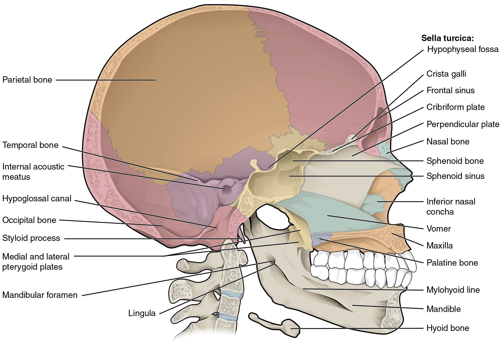
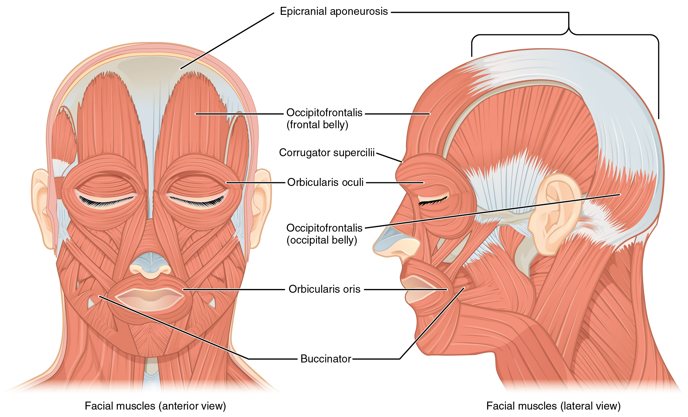
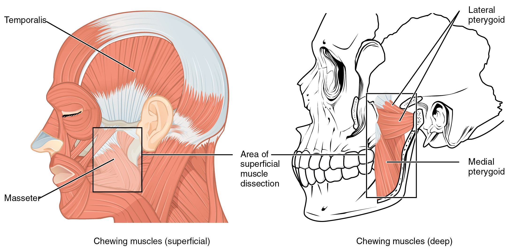

# 第8章 头面部：颅骨、表情与咀嚼

脸上的变化很容易看见，支撑这些变化的结构却分属不同层次。眉毛抬高，主要涉及皮肤和表情肌；咀嚼让下颌运动，主要涉及颞下颌关节和咀嚼肌；眼球转向，则由位于眼眶内的另一组肌肉完成。把头部视为一个覆盖皮肤的骨球，会漏掉许多重要的腔隙、通道与运动关系。[来源：OpenStax，11.3 头颈背部的中轴肌](https://openstax.org/books/anatomy-and-physiology-2e/pages/11-3-axial-muscles-of-the-head-neck-and-back)

## 从面部轮廓找到骨性支架

颅骨可以先分为保护脑的脑颅和构成面部支架的面颅。常用的成人计数为脑颅骨8块、面颅骨14块，共22块；这个计数不包括中耳听小骨和舌骨，也不意味着所有人的骨缝与附加小骨完全一样。大多数颅骨通过骨缝紧密连接，下颌骨则能通过左右颞下颌关节活动。

正面观察，先找额骨构成的前额、眼眶的骨性边界、颧骨形成的面颊支撑，以及上颌骨与下颌骨。上颌骨参与承托上牙，下颌骨承托下牙；牙齿不是颌骨自身长出的骨突，而是嵌在牙槽内的独立结构。

侧面观察，颧弓像一道骨性桥梁，从面颊通向颞部。它不只是面部外形的边界，也是咀嚼肌附着与穿行的重要参照。鼻根和鼻梁的一部分有骨性支撑，突出的鼻尖和鼻翼则主要依赖软骨与软组织。因而去除软组织后的颅骨图，不能直接当作完整人脸轮廓。[来源：OpenStax，7.2 颅骨](https://openstax.org/books/anatomy-and-physiology-2e/pages/7-2-the-skull)

## 颅骨不是实心外壳

眼眶容纳眼球、眼外肌、神经血管以及周围组织。眼球并没有填满整个眼眶，也不是直接贴在骨上转动。鼻腔位于面部中央，鼻中隔把它分成左右两侧，侧壁的鼻甲使内部表面更加曲折；表面还有黏膜覆盖，实际通气空间不能从裸骨图中完整判断。

硬腭构成口腔上方的坚硬部分，同时参与鼻腔底部。这个关系解释了鼻腔与口腔为什么在前部由一道骨性隔板分开，而向后又都与咽部相联系。部分颅骨内含与鼻腔相通的鼻旁窦，并非所有看起来厚的地方都由致密骨填满。

颅底还有许多孔和管，让脑神经、血管以及延续为脊髓的神经组织通过。枕骨大孔位于颅底，是颅腔与椎管之间的重要连接。读颅底图时，应先识别前后方向与大孔，再逐步辨认其他开口，避免一开始就陷入孔名清单。[来源：OpenStax，7.2，Cranial Fossae、Bony Openings](https://openstax.org/books/anatomy-and-physiology-2e/pages/7-2-the-skull)

### 图 08-01｜头颅矢状面：骨壳与腔隙

**读图：** 从颅腔向前下方看鼻腔与口腔，辨认硬腭的分隔作用；面部不是贴在一整块实心骨头上的软组织。

**标注对应：** cranial cavity 颅腔；nasal cavity 鼻腔；hard palate 硬腭。

*来源：[OpenStax《Anatomy and Physiology 2e》原图 7.11](https://openstax.org/books/anatomy-and-physiology-2e/pages/7-2-the-skull)；OpenStax, Anatomy and Physiology 2e; J. Gordon Betts et al.; Rice University；[CC BY-NC-SA 4.0](https://creativecommons.org/licenses/by-nc-sa/4.0/)。*

## 表情肌把拉力传给皮肤

许多表情肌起于骨或筋膜，止于皮肤或与其他肌肉交织。它们收缩后移动皮肤，形成闭眼、抿唇、微笑等外观变化。眼轮匝肌围绕眼裂，主要参与闭合眼睑；口轮匝肌围绕口裂，参与闭唇和改变唇形；颧部的肌肉能牵动口角。实际表情常是多块肌肉协同的结果，不能把某一种情绪严格对应到一块肌肉。

额部和枕部的枕额肌肌腹之间通过帽状腱膜相连。头顶大片区域因此并不是一层连续的厚肌肉。头皮本身也有多层软组织；从体表到骨面，应区分皮肤、皮下组织、腱膜及更深层连接，而不是统一称作“头皮肌肉”。

表情肌与咀嚼肌的神经支配也有重要区别：前者主要由面神经支配，后者主要由三叉神经下颌支的运动纤维支配。所谓“脸上的肌肉”，在功能与神经联系上并非同一组。[来源：OpenStax，11.3，Muscles of Facial Expression](https://openstax.org/books/anatomy-and-physiology-2e/pages/11-3-axial-muscles-of-the-head-neck-and-back)

### 图 08-02｜表情肌与面部软组织

**读图：** 比较眼口周围环形肌与向不同方向牵拉的肌肉；表情肌常止于皮肤，与跨关节牵动骨的典型四肢肌不同。

**标注对应：** orbicularis oculi 眼轮匝肌；orbicularis oris 口轮匝肌。

*来源：[OpenStax《Anatomy and Physiology 2e》原图 11.7](https://openstax.org/books/anatomy-and-physiology-2e/pages/11-3-axial-muscles-of-the-head-neck-and-back)；OpenStax, Anatomy and Physiology 2e; J. Gordon Betts et al.; Rice University；[CC BY-NC-SA 4.0](https://creativecommons.org/licenses/by-nc-sa/4.0/)。*

## 咀嚼依赖骨、关节和肌肉共同工作

咬肌跨在下颌支外侧，颞肌位于颞部并向下连接到下颌骨，两者都参与抬高下颌。更深处的翼肌参与下颌前移、侧向移动及复杂的咀嚼协调。颊肌压缩面颊，帮助食物维持在牙齿能够处理的位置，但它属于表情肌群，不能因为参与进食就直接归入主要咀嚼肌。

颞下颌关节位于耳前区域，有关节盘参与。张口不仅是下颌骨绕固定轴转动，还包括关节内部的滑动。左右关节又被同一块下颌骨连接起来，运动必须彼此协调。因此单看一侧铰链模型，难以解释真实咀嚼时的前移和侧移。

| 观察到的变化 | 主要需要区分的结构 |
| --- | --- |
| 眨眼或闭眼 | 眼睑与眼轮匝肌，不等同于眼球转动 |
| 眼球转向侧方 | 眼眶内的眼外肌及其神经控制 |
| 微笑时口角升高 | 表情肌对皮肤和口角的牵拉 |
| 张口与咀嚼 | 下颌骨、左右颞下颌关节及咀嚼肌 |

可以借助镜子观察自然微笑与轻轻张口的区别：先看皮肤移动，再看下颌位置改变。面部轮廓同时受骨、脂肪、肌肉、皮肤、年龄和个体差异影响，无法仅凭一条阴影确定深处某块骨或某条肌肉的形状。[来源：OpenStax，11.3，Muscles That Move the Lower Jaw、Muscles That Move the Eyes](https://openstax.org/books/anatomy-and-physiology-2e/pages/11-3-axial-muscles-of-the-head-neck-and-back)

### 图 08-03｜咀嚼肌如何移动下颌

**读图：** 顺着颞肌与咬肌寻找下颌骨附着位置，再注意深部翼肌。不要将所有面部运动都归给表情肌。

**标注对应：** temporalis 颞肌；masseter 咬肌；pterygoid 翼肌。

*来源：[OpenStax《Anatomy and Physiology 2e》原图 11.10](https://openstax.org/books/anatomy-and-physiology-2e/pages/11-3-axial-muscles-of-the-head-neck-and-back)；OpenStax, Anatomy and Physiology 2e; J. Gordon Betts et al.; Rice University；[CC BY-NC-SA 4.0](https://creativecommons.org/licenses/by-nc-sa/4.0/)。*

## 同一张脸需要三种深度来阅读

阅读头面部结构时，可把注意力在三个深度之间切换。第一层是皮肤与皮下组织，决定可见纹理、皱褶和部分轮廓；第二层是表情肌、咀嚼肌及其周围组织，解释哪些部分能主动移动；第三层是颅骨及其内部腔隙，解释支撑、保护与通道。它们共同构成头部，而不是相互独立的三张面具。

这种层次在各处并不一样：额部和头顶部的软组织较贴近骨面，面颊有更多可移动的软组织，耳廓与鼻尖又有明显软骨支架。眼眶下缘属于骨性标志，但下眼睑的形态不能只由这条骨边界推出。下颌角也在较深处，表面还覆盖肌肉、腺体附近组织与皮下层。因此一张照片中的阴影，可以提示表面变化，却不能直接显示全部深部边界。

儿童颅骨与成人颅骨的比例也不同。婴幼儿脑颅相对较大，部分骨间保留囟门和较宽连接区域，随后随发育逐渐改变；牙齿萌出和颌骨生长又影响面部比例。这些变化意味着，成人颅骨图适合解释成人的一般结构，不能不作说明地缩小后当作儿童图。读图时先确认年龄、观察方向和剥离深度，往往比立即寻找某一个拉丁名更有帮助。[来源：OpenStax，7.5 中轴骨骼的胚胎发育](https://openstax.org/books/anatomy-and-physiology-2e/pages/7-5-embryonic-development-of-the-axial-skeleton)；[11.3，Muscles of Facial Expression](https://openstax.org/books/anatomy-and-physiology-2e/pages/11-3-axial-muscles-of-the-head-neck-and-back)
