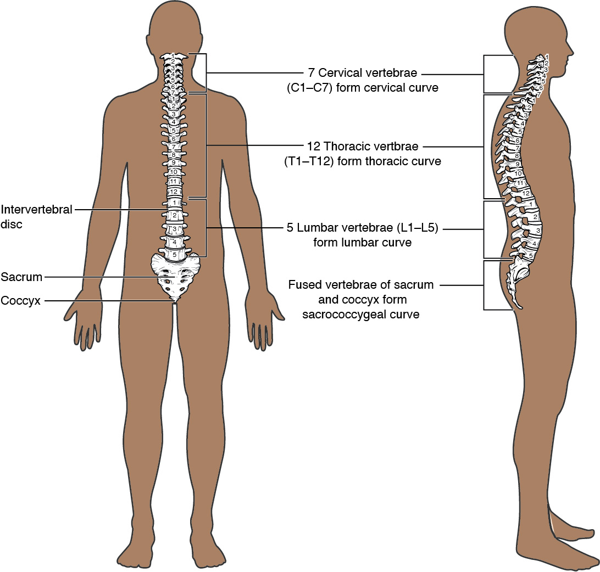
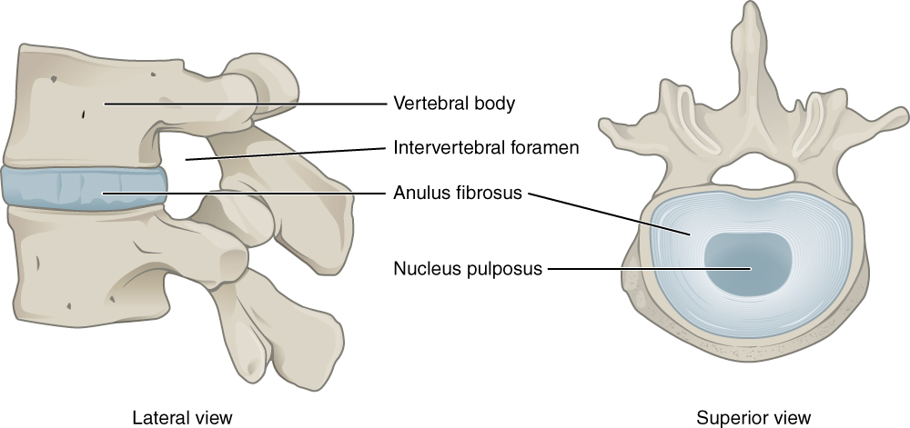

# 第9章 颈背与脊柱：支撑、通道和姿势

背部正中可以看到或轻易辨认的起伏，只是脊柱的一小部分。脊柱的承重主体在更前方，脊髓通道位于骨性围护之中，两侧还有肌肉、筋膜与神经。把背中线上的骨性突起想成一根实心“脊梁”，会同时弄错承重位置和神经位置。[来源：OpenStax，7.3 脊柱](https://openstax.org/books/anatomy-and-physiology-2e/pages/7-3-the-vertebral-column)

## 先从整体认出五个区域

脊柱自上而下分为颈椎、胸椎、腰椎、骶骨和尾骨。常见成人有7块颈椎、12块胸椎、5块腰椎；5块骶椎通常融合成骶骨，尾椎的数量与融合情况存在个体差异。颈椎支持头部并允许较多方向的活动，胸椎与肋骨共同构成胸廓，腰椎承担上方较大的负荷，骶骨则把脊柱与骨盆连接起来。

从侧面看，正常成人脊柱不是笔直的杆。颈部和腰部具有向前凸的曲度，胸部和骶部具有向后凸的曲度。这些曲度与承重和活动有关，也随生长、姿势与个体条件变化。不能把所有弯曲都叫作畸形，也不能仅凭一张侧面照片，把外形差异直接等同于疾病。

从后方看脊柱与从侧方看脊柱，回答的是不同问题：前者有助于理解左右排列，后者显示前后曲线。解剖图有时为了展示结构而将曲度减弱，应把整体侧观图与局部椎骨图分开阅读。[来源：OpenStax，7.3，Divisions、Curvatures](https://openstax.org/books/anatomy-and-physiology-2e/pages/7-3-the-vertebral-column)

### 图 09-01｜脊柱的分区与生理曲度

#### 中文读图说明

左图显示脊柱的正面排列，右图是侧面，右侧人物面朝画面右方。先按括线从上到下找颈、胸、腰三段；C、T、L分别是颈椎、胸椎和腰椎的英文编号前缀。

颈椎七块、胸椎十二块、腰椎五块，编号在每一段重新开始。浅色横带表示椎间盘，骶骨和尾骨位于腰段以下；图中骶尾区由融合骨段构成，不是又一串同样活动的腰椎。

再看右图曲度：颈腰段向前凸、胸骶段向后凸，是侧面正常空间安排。左图用于理解排列与分区，右图用于看前后弯曲，不能把侧面曲线误认作从正面观察到的脊柱侧弯。

#### 图中英文标注逐项对照

| 图中英文 | 中文名称 | 在图中怎样理解 |
| --- | --- | --- |
| 7 Cervical vertebrae (C1–C7) form cervical curve | 七块颈椎构成颈曲 | 上段编号从第一至第七并形成向前曲度 |
| 12 Thoracic vertbrae (T1–T12) form thoracic curve | 十二块胸椎构成胸曲 | 中段与肋骨相联系并形成向后曲度 |
| 5 Lumbar vertebrae (L1–L5) form lumbar curve | 五块腰椎构成腰曲 | 下腰段承担负荷并形成向前的曲度 |
| Intervertebral disc | 椎间盘 | 图中相邻椎体之间浅色带参与缓冲承载 |
| Sacrum | 骶骨 | 位于腰椎下方由通常五块骶椎融合形成 |
| Coccyx | 尾骨 | 位于骶骨以下由数量有变异的尾椎构成 |
| Fused vertebrae of sacrum and coccyx form sacrococcygeal curve | 融合的骶尾椎形成骶尾曲 | 最下段的向后曲线与颈腰段方向不同 |

*来源：[OpenStax《Anatomy and Physiology 2e》原图 7.20](https://openstax.org/books/anatomy-and-physiology-2e/pages/7-3-the-vertebral-column)；OpenStax, Anatomy and Physiology 2e; J. Gordon Betts et al.; Rice University；[CC BY-NC-SA 4.0](https://creativecommons.org/licenses/by-nc-sa/4.0/)。*

## 一块典型椎骨的前后分工

典型椎骨的前方是椎体，后方是椎弓，两者围出椎孔。上下排列的椎孔构成椎管，内有脊髓、神经根、被膜及相关组织。向后伸出的棘突、向两侧伸出的横突，则提供肌肉和韧带的附着位置。

相邻椎体之间通常以椎间盘连接。椎间盘外周为纤维环，中央为富含水分的髓核，两者共同参与承载和允许有限变形；它不是一块能够随意滑出的游离软垫。相邻椎弓上的关节突还形成小关节，与椎间盘一起限制并引导运动。

椎间孔位于相邻椎骨之间的两侧，是脊神经通过的重要开口。它与正中的椎孔不是同一个孔：一个主要是侧向出口，一个连成纵向通道。读横断面时，可以按“前方椎体—中央椎管—后方棘突”的顺序定向，再找两侧神经出口。

| 结构 | 位置与主要关系 |
| --- | --- |
| 椎体 | 位于前方，参与承重 |
| 椎间盘 | 位于相邻椎体之间，承载并允许变形 |
| 椎管 | 由上下椎孔连续形成，容纳神经组织 |
| 椎间孔 | 位于相邻椎骨两侧，供脊神经通过 |
| 棘突与横突 | 向后或向侧方突出，提供附着与杠杆位置 |

[来源：OpenStax，7.3，General Structure、Intervertebral Discs](https://openstax.org/books/anatomy-and-physiology-2e/pages/7-3-the-vertebral-column)

### 图 09-02｜椎间盘、椎体与神经通道

#### 中文读图说明

左图为侧面观，椎体在画面左方，棘突在右后方；两块椎体之间的蓝色结构是椎间盘。先辨认承重的椎体，再看其后方椎弓附近的开口，避免把骨间所有空白都称为椎间盘。

侧面引线指向椎间孔，它位于相邻椎骨之间，是脊神经出入椎管的侧向通道；它并不等于正中纵行椎管的横切面，椎间盘也没有填满神经通道。

右图改为从上方看，在椎体表面显露椎间盘内部：外周一圈圈纤维环围住中央髓核。两者共同承载并允许有限变形，中央蓝色不表示一个能够自由滚动或整体滑出的硬球。

#### 图中英文标注逐项对照

| 图中英文 | 中文名称 | 在图中怎样理解 |
| --- | --- | --- |
| Vertebral body | 椎体 | 侧面图前方较大的骨块承担轴向负荷 |
| Intervertebral foramen | 椎间孔 | 位于相邻椎骨之间为脊神经侧向出口 |
| Anulus fibrosus | 纤维环 | 椎间盘外周层状纤维组织围护中央髓核 |
| Nucleus pulposus | 髓核 | 椎间盘中央富含水分并参与压力分配 |
| Lateral view | 侧面观 | 左图从侧面比较椎体椎间盘和侧方孔隙 |
| Superior view | 上面观 | 右图从上向下看椎间盘中央与外周结构 |

*来源：[OpenStax《Anatomy and Physiology 2e》原图 7.24](https://openstax.org/books/anatomy-and-physiology-2e/pages/7-3-the-vertebral-column)；OpenStax, Anatomy and Physiology 2e; J. Gordon Betts et al.; Rice University；[CC BY-NC-SA 4.0](https://creativecommons.org/licenses/by-nc-sa/4.0/)。*

## 颈部、胸部和腰部不是同款零件

第一颈椎称寰椎，形似骨环，支持颅骨；第二颈椎称枢椎，有向上突出的齿突。颅骨与寰椎之间的关节主要参与点头，寰枢关节系统主要参与转头，但实际头颈动作会叠加其他颈椎的运动。不能把所有点头和转头都归给单独一节。

胸椎有与肋骨相连的关节面，胸廓使这一段的运动受到不同限制。腰椎的椎体通常较大，关节面方向也与颈胸段不同，使各方向活动能力存在差别。骶骨则由融合的骨段形成，与髋骨共同把上半身负荷传向下肢。

脊髓并不在成人椎管中一直延伸到尾骨。成人脊髓通常在第一至第二腰椎附近结束，更下方椎管内仍有下行的神经根，形成马尾。因此“脊柱到哪里，脊髓就到哪里”是不准确的理解；骨性长度与神经组织长度应分别认识。[来源：OpenStax，7.3，Regional Modifications](https://openstax.org/books/anatomy-and-physiology-2e/pages/7-3-the-vertebral-column)；[13.2 中枢神经系统](https://openstax.org/books/anatomy-and-physiology-2e/pages/13-2-the-central-nervous-system)

## 背部肌肉把支架变成可调系统

从后背向内，浅层的斜方肌与背阔肌主要联系肩带和上肢；更深层有控制脊柱运动与稳定的肌群。竖脊肌沿脊柱两侧纵行，多裂肌等更深的小肌群连接多个或相邻骨段。它们与韧带、关节和神经反馈共同工作，既能让躯干伸展，也能在保持姿势时提供持续而可调整的支持。

腹壁也参与躯干稳定。腹外斜肌、腹内斜肌、腹横肌的纤维方向不同，腹直肌沿前腹壁纵行；膈与盆底又共同构成躯干压力调节的边界。于是“保持姿势”不是背部某一块肌肉孤立用力，也不是让身体永远僵直。

阅读背部解剖图时，先看图有没有切除斜方肌或背阔肌，再辨认深部结构。不同层次的图如果直接并排而不说明切除关系，会让人误以为所有肌肉都同时暴露在皮下。日常观察只需比较坐、站、自然转身时身体如何分配动作，不必强行扳颈、压背或追求某条绝对笔直的身体线。[来源：OpenStax，11.3 头颈背肌](https://openstax.org/books/anatomy-and-physiology-2e/pages/11-3-axial-muscles-of-the-head-neck-and-back)；[11.4 腹壁与胸部肌](https://openstax.org/books/anatomy-and-physiology-2e/pages/11-4-axial-muscles-of-the-abdominal-wall-and-thorax)

## 从颈侧看见另一套空间安排

在颈部，脊柱位于相对后方，喉、气管和食管等则位于其前方或前外侧相关空间。表浅可辨的胸锁乳突肌从胸骨、锁骨区域斜向耳后乳突，连接了头与胸部的骨性参照。它与斜方肌等形成可见轮廓，但轮廓之间还有更深的肌肉、神经血管与内脏通道，不能把颈部侧面看成单纯两束肌肉夹着一根骨柱。

舌骨位于下颌下方的颈前部，不像多数骨那样直接与其他骨形成关节，而由肌肉和韧带悬系。舌骨上、下肌群参与调整舌骨和喉的位置，服务于吞咽、发声等动作。这里的肌肉既有姿势和头部活动任务，也有与呼吸、吞咽相关的任务；“颈肌”这个地理名称并不代表单一功能。

因此从正面、侧面和后面观察颈部，看到的是不同结构投影。后方的棘突排列不能告诉读者前方喉的位置，侧面的肌肉隆起也不能显示深处血管的全部走行。读局部剖面时，应先用椎体确认后方支架，再找气道、食管和周边软组织的位置，避免把画面上相邻的两个结构理解成在全长都相贴。教材中的一张横切面只对应某一高度，向上或向下移动一点，出现的组织组合就可能改变。[来源：OpenStax，11.3，Muscles of the Anterior Neck、Muscles That Move the Head](https://openstax.org/books/anatomy-and-physiology-2e/pages/11-3-axial-muscles-of-the-head-neck-and-back)
