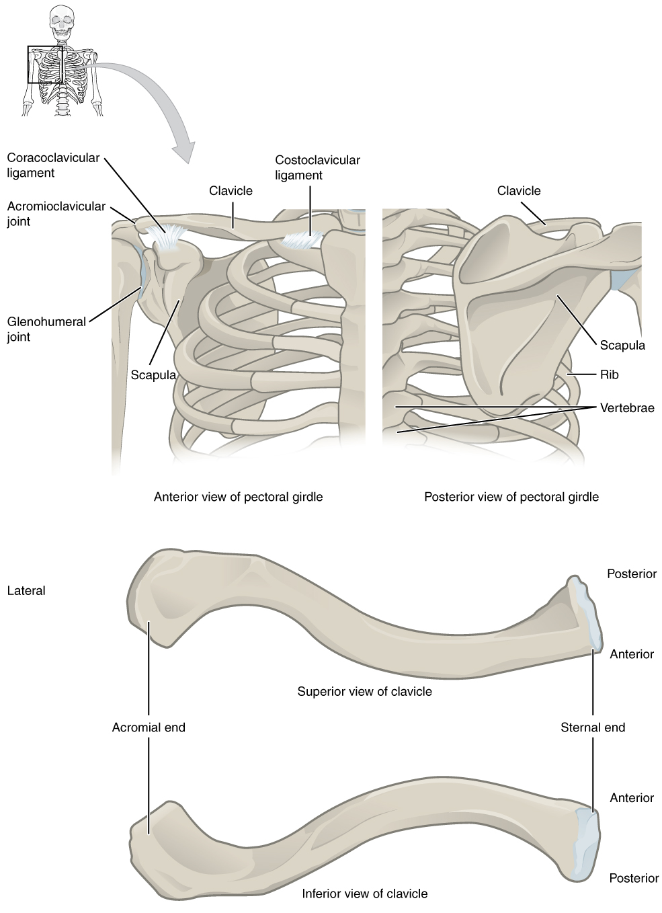
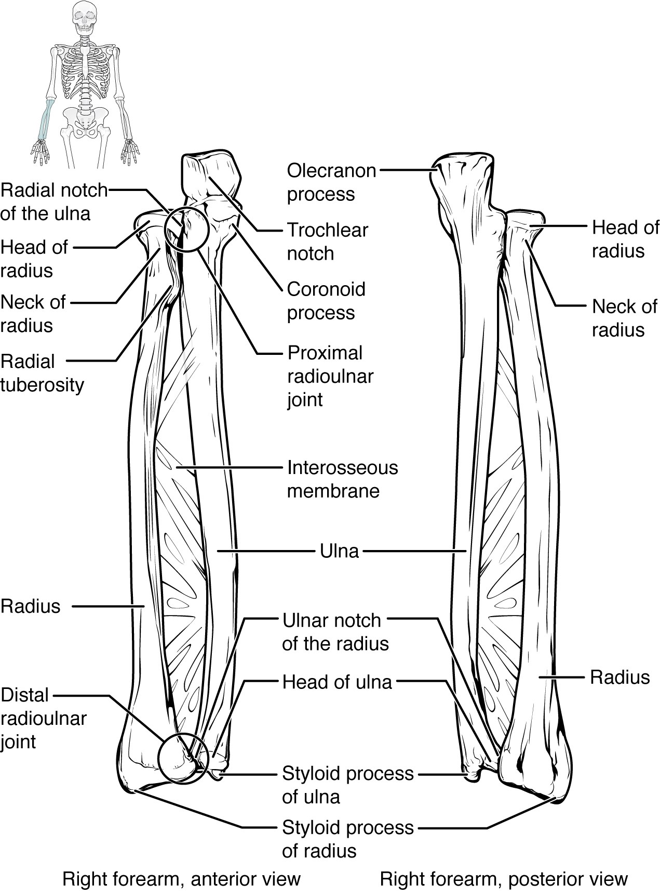
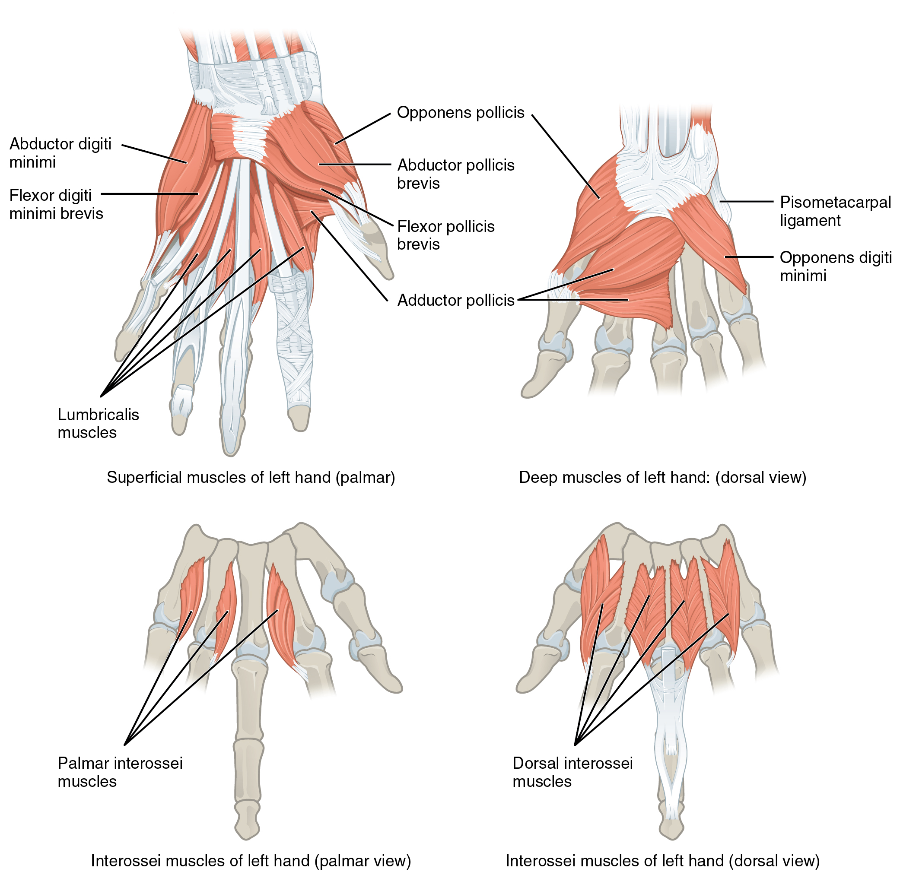

# 第10章 肩到手：把力量送到指尖

手能够伸到头顶、背后或身体前方，不只是因为肩关节灵活。锁骨、肩胛骨、肱骨、前臂骨和手骨构成一条连续的活动链，肌肉在不同位置提供力量，肌腱把一部分力量送向远端，神经则让感觉与动作不断配合。沿着上肢向下看，比单独背一张肌肉名称表更容易理解“手为什么能这样动”。[来源：OpenStax，8.1 肩带](https://openstax.org/books/anatomy-and-physiology-2e/pages/8-1-the-pectoral-girdle)；[11.5 肩带与上肢肌](https://openstax.org/books/anatomy-and-physiology-2e/pages/11-5-muscles-of-the-pectoral-girdle-and-upper-limbs)

## 肩带先把上肢安放到躯干旁边

肩带由锁骨和肩胛骨组成，肱骨属于自由上肢骨。锁骨内端通过胸锁关节连接胸骨，外端连接肩胛骨的肩峰；胸锁关节是上肢骨性链与躯干中轴骨骼之间的重要连接。肩胛骨并没有直接以真正的滑膜关节接到肋骨上，而是在肌肉及其他软组织支持下相对胸壁移动。

肩胛骨外侧的关节盂与肱骨头构成肩关节。由于关节盂相对浅，关节的稳定不能只靠骨面嵌合。三角肌形成肩部明显的外轮廓，更深处的肩袖由冈上肌、冈下肌、小圆肌和肩胛下肌的肌腱参与构成，帮助控制肱骨头的位置，并参与上臂运动。大圆肌虽然名字相近，却不属于肩袖。

手臂上举时，肱骨相对肩胛骨运动，肩胛骨也相对胸壁转动，锁骨位置随之改变。斜方肌、前锯肌等参与肩胛定位。肩胛运动与肩关节运动的分配随动作阶段、个体和负荷变化，不能把某个固定比例当成每个人每一刻必须遵守的刻度。[来源：OpenStax，8.1，Scapula、Clavicle](https://openstax.org/books/anatomy-and-physiology-2e/pages/8-1-the-pectoral-girdle)；[11.5，Muscles That Position the Pectoral Girdle、Rotator Cuff](https://openstax.org/books/anatomy-and-physiology-2e/pages/11-5-muscles-of-the-pectoral-girdle-and-upper-limbs)

### 图 10-01｜肩带怎样连接上肢与躯干

#### 中文读图说明

上排左为肩带前面观，右为后面观；先沿锁骨从胸骨侧走到肩峰，再找肩胛骨与肱骨相接的位置。右图肩胛骨盖在胸廓后方，并没有与每一根肋骨形成滑膜关节。

左图浅色带标出喙锁韧带和肋锁韧带，分别加强锁骨与肩胛骨、第一肋区域的联系；肩锁关节在锁骨外端，盂肱关节在其下外侧，两者不能统称为同一个肩关节间隙。

下排两图是同一类锁骨的上面观和下面观，并非两块不同功能的骨。先找外侧肩峰端与内侧胸骨端，再依据Anterior、Posterior判断前后；翻到下面观察后，画面上下不再代表人体前后。

#### 图中英文标注逐项对照

| 图中英文 | 中文名称 | 在图中怎样理解 |
| --- | --- | --- |
| Coracoclavicular ligament | 喙锁韧带 | 连接肩胛骨喙突与锁骨以加强肩带稳定 |
| Costoclavicular ligament | 肋锁韧带 | 位于锁骨内侧下方联系第一肋区域 |
| Acromioclavicular joint | 肩锁关节 | 位于锁骨外端与肩胛骨肩峰交接处 |
| Glenohumeral joint | 盂肱关节（肩关节） | 肱骨头与肩胛骨关节盂相接并参与抬臂 |
| Clavicle | 锁骨 | 横跨胸骨侧与肩峰侧的弯曲骨性支撑 |
| Scapula | 肩胛骨 | 位于胸廓后方并提供上肢肌肉附着处 |
| Rib | 肋骨 | 位于肩胛骨深方共同构成胸廓支架 |
| Vertebrae | 椎骨 | 位于后方中轴并与胸段肋骨相联系 |
| Anterior view of pectoral girdle | 肩带前面观 | 上排左图显示锁骨韧带与肩前连接 |
| Posterior view of pectoral girdle | 肩带后面观 | 上排右图显示肩胛骨覆盖胸廓的关系 |
| Superior view of clavicle | 锁骨上面观 | 下排上图由上向下查看锁骨弯曲轮廓 |
| Inferior view of clavicle | 锁骨下面观 | 下排下图翻看同类锁骨的下方表面 |
| Acromial end | 肩峰端 | 锁骨外侧端与肩胛骨肩峰相接处 |
| Sternal end | 胸骨端 | 锁骨内侧端与胸骨形成胸锁连接 |
| Lateral | 外侧 | 此处指向远离人体中线的锁骨肩峰端 |
| Anterior / Posterior | 前方／后方 | 用于给两种锁骨视图建立人体方向参照 |

*来源：[OpenStax《Anatomy and Physiology 2e》原图 8.3](https://openstax.org/books/anatomy-and-physiology-2e/pages/8-1-the-pectoral-girdle)；OpenStax, Anatomy and Physiology 2e; J. Gordon Betts et al.; Rice University；[CC BY-NC-SA 4.0](https://creativecommons.org/licenses/by-nc-sa/4.0/)。*

## 肘把屈伸与前臂旋转组织在一起

上臂内有一块肱骨，前臂内有尺骨和桡骨。按解剖学姿势，桡骨位于拇指侧，尺骨位于小指侧。尺骨近端的鹰嘴形成肘后的骨性突出，与肱骨的连接主要参与屈伸；桡骨近端既与肱骨相接，也与尺骨相接。

肘附近的动作不能仅用一个“门轴”解释。弯肘与伸肘主要改变上臂和前臂的夹角，而旋前、旋后需要桡尺关节系统的配合。旋后时桡骨与尺骨较为平行，旋前时桡骨越过尺骨前方，手掌方向随之改变。手跟随前臂骨旋转，腕部并没有独自完成这整段转动。

肱二头肌不只参与屈肘，也能参与前臂旋后；肱肌是重要的屈肘肌；肱三头肌位于上臂后方，主要伸肘。多块肌肉的贡献与姿势和负荷有关，肌肉的名字不能直接代替完整动作分析。[来源：OpenStax，8.2 上肢骨](https://openstax.org/books/anatomy-and-physiology-2e/pages/8-2-bones-of-the-upper-limb)；[11.5，Muscles That Move the Forearm](https://openstax.org/books/anatomy-and-physiology-2e/pages/11-5-muscles-of-the-pectoral-girdle-and-upper-limbs)

### 图 10-02｜右侧桡骨、尺骨的前面与后面

#### 中文读图说明

这不是旋前与旋后的连续动作图。左图明确标为右前臂前面观，右图为右前臂后面观；桡骨因观察方向改变而换到画面另一边，不能据此认为两骨已交叉旋转。

先找近端：尺骨有鹰嘴、滑车切迹和冠突，围出与肱骨相接的区域；桡骨上端则是较小的圆盘形桡骨头，其下为桡骨颈和供肌腱附着的桡骨粗隆。

再向下看，桡骨远端变宽，尺骨头位于靠腕的一端。两骨之间的斜纹是骨间膜，近远端桡尺关节共同允许前臂旋转。腕侧的两处茎突分别属于尺骨和桡骨，是不同骨上的突起。

#### 图中英文标注逐项对照

| 图中英文 | 中文名称 | 在图中怎样理解 |
| --- | --- | --- |
| Radial notch of the ulna | 尺骨桡切迹 | 尺骨近端外侧与桡骨头相接的小关节面 |
| Head of radius | 桡骨头 | 桡骨近端盘状结构参与肘部及桡尺连接 |
| Neck of radius | 桡骨颈 | 桡骨头下方较细一段连接近端与骨干 |
| Radial tuberosity | 桡骨粗隆 | 桡骨近端粗糙突出为肱二头肌腱附着处 |
| Olecranon process | 鹰嘴 | 尺骨近端后侧突起构成肘后的骨性尖端 |
| Trochlear notch | 滑车切迹 | 尺骨近端大切迹容纳肱骨滑车关节面 |
| Coronoid process | 冠突 | 尺骨近端前侧突起参与肘部关节构成 |
| Proximal radioulnar joint | 桡尺近侧关节 | 靠近肘部的桡尺连接允许桡骨头转动 |
| Interosseous membrane | 骨间膜 | 连接两骨骨干并参与稳定和负荷传递 |
| Ulna | 尺骨 | 解剖姿势位于前臂靠小指的内侧 |
| Radius | 桡骨 | 解剖姿势位于前臂靠拇指的外侧 |
| Ulnar notch of the radius | 桡骨尺切迹 | 位于桡骨远端内侧并与尺骨头相接 |
| Head of ulna | 尺骨头 | 尺骨远端的圆隆结构参与远侧桡尺连接 |
| Distal radioulnar joint | 桡尺远侧关节 | 靠近腕部的桡尺连接配合前臂旋转 |
| Styloid process of ulna | 尺骨茎突 | 尺骨远端突出是腕部尺侧骨性标志 |
| Styloid process of radius | 桡骨茎突 | 桡骨远端突出是腕部桡侧骨性标志 |
| Right forearm, anterior view | 右前臂前面观 | 左幅从前方观察同一侧的前臂骨骼 |
| Right forearm, posterior view | 右前臂后面观 | 右幅从后方观察而非展示另一只前臂 |

*来源：[OpenStax《Anatomy and Physiology 2e》原图 8.6](https://openstax.org/books/anatomy-and-physiology-2e/pages/8-2-bones-of-the-upper-limb)；OpenStax, Anatomy and Physiology 2e; J. Gordon Betts et al.; Rice University；[CC BY-NC-SA 4.0](https://creativecommons.org/licenses/by-nc-sa/4.0/)。*

## 前臂肌腹与手指肌腱相隔一段距离

前臂中有许多控制手腕和手指的肌腹，向远端延续为较长肌腱。这样可以把较大体积的肌肉留在前臂，使手指保持较细的外形。手内部也有自己的小肌肉，参与手指分合、拇指精细定位及握持协调，因此手并不是一组被远处肌肉拉动的被动骨架。

大体上，前臂前侧肌群多参与腕指屈曲，后侧肌群多参与伸展，但具体肌腱的走行、附着和动作各有不同。腕部的支持带帮助约束肌腱，使其在关节活动时仍贴近骨性通道。部分肌腱有腱鞘，减少反复滑动时的摩擦。

腕管是由腕骨的凹槽与覆盖其上的屈肌支持带共同形成的通道，内有正中神经和部分屈肌腱通过。它不是整只手腕的泛称，也不是所有进入手掌的神经血管都走同一根管道。从外观能看到一条隆起，并不足以判断它是肌腱、静脉还是另一种结构。[来源：OpenStax，11.5，Muscles That Move the Wrist, Hand, and Fingers](https://openstax.org/books/anatomy-and-physiology-2e/pages/11-5-muscles-of-the-pectoral-girdle-and-upper-limbs)

## 手的精细活动来自多个小关节协同

每只手通常有8块腕骨、5块掌骨和14块指骨。拇指只有两节指骨，其他手指通常各三节。拇指根部的腕掌关节具有鞍状关节的特点，允许拇指离开手掌平面并配合旋转，与其他指尖形成对掌动作；这与四指单纯屈曲不同。

| 动作或位置 | 读图时应追踪的关系 |
| --- | --- |
| 把手伸向高处 | 胸锁连接、肩胛位置与肩关节共同改变 |
| 弯曲肘部 | 肱骨与尺骨的角度变化及跨关节肌肉 |
| 把掌心翻转 | 桡尺骨相对位置，不只看腕部 |
| 用拇指与食指捏取小物 | 拇指根部定位、指间关节及手内肌协调 |

可以拿一张纸自然翻面，观察肘部大致保持位置时，前臂与手如何共同转动；再观察轻捏纸角时，拇指是否仍与四指处于同一平面。无需用力抵抗或拉伸极限，就能看出上肢既有长距离力量传递，也有末端的精细调节。[来源：OpenStax，8.2，Carpal Bones、Metacarpal Bones、Phalanges](https://openstax.org/books/anatomy-and-physiology-2e/pages/8-2-bones-of-the-upper-limb)

### 图 10-03｜手内在肌：指间精细控制

#### 中文读图说明

四幅都标示左手，但上左从掌侧看浅层，上右从背侧经过解剖暴露深层，下排再分别看掌侧和背侧的骨间肌。先找拇指作为外侧参照，换视角后它在画面的位置会改变。

上左拇指侧鱼际可见拇短展肌、拇短屈肌等，小指侧有小指展肌和小指短屈肌，掌心细长的是蚓状肌。上右显露较深的对掌肌与拇收肌，不能误以为它们本来裸露在手背皮下。

下左三块掌侧骨间肌与下右四块背侧骨间肌位于掌骨之间，分别参与手指相对中指轴线的内收、外展，并协助关节协调。白色长腱来自更近端肌肉，与图中手内肌共同工作，不是同一块肌肉的另一种颜色。

#### 图中英文标注逐项对照

| 图中英文 | 中文名称 | 在图中怎样理解 |
| --- | --- | --- |
| Opponens pollicis | 拇对掌肌 | 鱼际深部参与拇指根部转位与对掌 |
| Abductor pollicis brevis | 拇短展肌 | 鱼际较表浅肌肉使拇指离开掌面 |
| Flexor pollicis brevis | 拇短屈肌 | 位于鱼际参与屈曲拇指掌指关节 |
| Adductor pollicis | 拇收肌 | 深层扇状肌参与将拇指拉向掌侧中部 |
| Abductor digiti minimi | 小指展肌 | 小鱼际外缘参与小指相对中指外展 |
| Flexor digiti minimi brevis | 小指短屈肌 | 小鱼际浅层肌参与小指掌指关节屈曲 |
| Lumbricalis muscles | 蚓状肌 | 细长肌沿指屈肌腱走行并协调指关节 |
| Pisometacarpal ligament | 豌豆掌骨韧带 | 从豌豆骨连向第五掌骨的纤维束 |
| Opponens digiti minimi | 小指对掌肌 | 小鱼际深层肌参与第五掌骨的定位 |
| Palmar interossei muscles | 掌侧骨间肌 | 三块肌位于掌骨间并主要参与手指内收 |
| Dorsal interossei muscles | 背侧骨间肌 | 四块肌位于掌骨间并主要参与手指外展 |
| Superficial muscles of left hand (palmar) | 左手浅层肌（掌侧） | 左上掌侧观察鱼际小鱼际与蚓状肌 |
| Deep muscles of left hand: (dorsal view) | 左手深层肌（背面观） | 右上经解剖去除遮挡后从背侧看深肌 |
| Interossei muscles of left hand (palmar view) | 左手骨间肌（掌面观） | 左下从掌侧显示三块掌侧骨间肌位置 |
| Interossei muscles of left hand (dorsal view) | 左手骨间肌（背面观） | 右下从背侧显示四块背侧骨间肌排列 |

*来源：[OpenStax《Anatomy and Physiology 2e》原图 11.28](https://openstax.org/books/anatomy-and-physiology-2e/pages/11-5-muscles-of-the-pectoral-girdle-and-upper-limbs)；OpenStax, Anatomy and Physiology 2e; J. Gordon Betts et al.; Rice University；[CC BY-NC-SA 4.0](https://creativecommons.org/licenses/by-nc-sa/4.0/)。*

## 把上肢图中的浅层与深层对应起来

从体表开始，肩外侧的圆弧主要容易让人想到三角肌；把它在图中切开后，才更容易看见肩袖和关节囊。胸前的胸大肌若被移除，胸小肌与前锯肌等结构的某些部分会更加清楚；这不表示这些深层肌肉原来就与胸大肌并排暴露。检查图中有没有保留一段切断的肌腱、有没有把肌腹翻起，是判断深度的直接线索。

沿上臂向前臂看，粗大的肌腹逐渐转为较细的肌腱。肌腱越过关节后到达远端骨面，所以“某块肌肉位于前臂”不等于“它只移动前臂”。判断作用需要追踪它跨过哪些关节、在转轴哪一侧经过，以及最终附着在哪里。肱二头肌、肱肌和肱三头肌可以帮助理解这一原则，而腕指屈伸肌又把同样的原则延伸得更远。

掌面的鱼际和小鱼际是不同手内肌形成的局部隆起；手背则更容易显出一些伸肌腱的走行。两面并不是同样一套组织的简单镜像。观察一只自然张开再轻握的手，可以注意关节骨性标志、皮肤皱褶和肌腱线条如何彼此移动。皮肤折痕并非每处都与关节中心重合，手背看到的线条也不宜全部当作血管。这些限制有助于把体表观察与深层解剖联系起来，而不把外观当作透明的结构图。[来源：OpenStax，11.5，Muscles That Move the Humerus、Muscles That Move the Wrist, Hand, and Fingers](https://openstax.org/books/anatomy-and-physiology-2e/pages/11-5-muscles-of-the-pectoral-girdle-and-upper-limbs)
