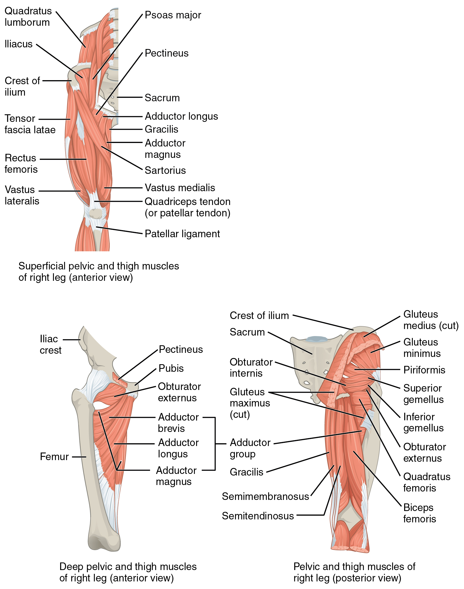
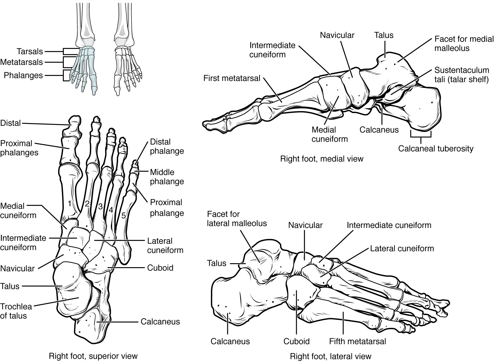
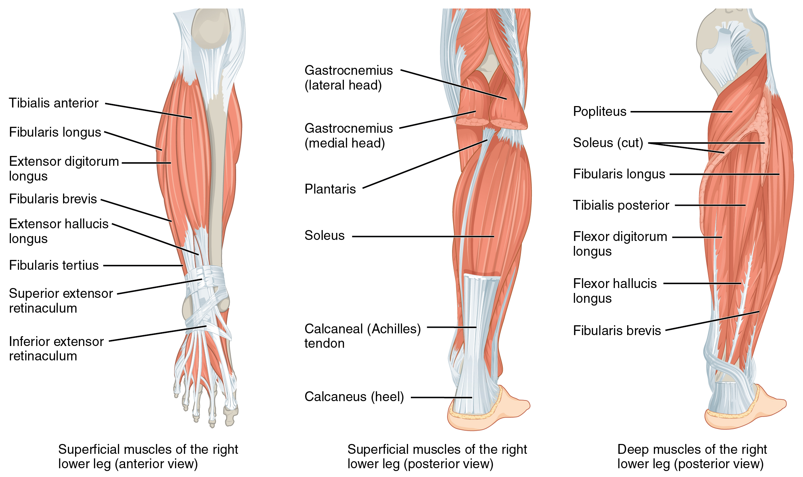

# 第11章 髋到足：承重、步行与足弓

上肢常把物品移动到合适位置，下肢则需要在移动身体的同时把负荷传到地面。下肢的骨面、关节、韧带和肌肉因而有不同安排：髋部连接躯干，膝部在承重中屈伸，踝足接触地面并适应地形。脚并非一块平板，腿也不是三段刚性棍子。[来源：OpenStax，8.4 下肢骨](https://openstax.org/books/anatomy-and-physiology-2e/pages/8-4-bones-of-the-lower-limb)

## 负荷从骨盆进入股骨

股骨头嵌入髋骨的髋臼，共同构成髋关节。股骨颈把球形骨头连接到较长的骨干，大小转子为多块肌肉提供附着位置。股骨并非自髋部完全竖直向下，骨干的方向使膝部位于身体重心更合适的位置；实际角度存在生长与个体差异。

臀大肌形成臀部较表浅的大块肌肉，参与伸髋等动作。臀中肌和臀小肌位于更深、偏外侧的位置，参与外展并在步行单腿支撑时帮助控制骨盆。一个人从坐位站起，除了伸膝，也需要伸髋；人在迈步过程中，支撑侧髋周肌群又承担与坐起时不同的稳定工作。

臀部丰满程度不能直接代表某块深层肌肉的力量。骨盆形状、皮下脂肪与多层肌肉共同决定体表外形，解剖图中切除臀大肌后显示的臀中肌，也不是原本全部裸露在皮下。[来源：OpenStax，11.6 骨盆带与下肢肌](https://openstax.org/books/anatomy-and-physiology-2e/pages/11-6-appendicular-muscles-of-the-pelvic-girdle-and-lower-limbs)

## 大腿肌群围绕不同任务分布

大腿前群以股四头肌最容易识别，包括股直肌、股外侧肌、股内侧肌和位于较深处的股中间肌。它们经共同的肌腱联系髌骨，再经髌韧带把拉力传到胫骨，主要完成伸膝。股直肌还跨过髋关节，其他三块“股肌”则不以同样方式跨髋，因此四者的作用并非完全重合。

大腿后群中，半腱肌、半膜肌和股二头肌构成腘绳肌群的主要部分，参与屈膝，多数部分也参与伸髋。股二头肌短头不跨髋，是理解“同一肌群仍有不同动作范围”的一个例子。大腿内侧的内收肌群，则帮助大腿靠近身体中线，并随具体位置参与其他髋部动作。

筋膜把大腿组织分隔成不同肌间隙，神经血管在这些区域中通行。读横断面时，先找中央股骨，再分清前、后、内侧肌群，比对着一圈肌肉从左到右逐个背名更容易建立空间感。[来源：OpenStax，11.6，Thigh Muscles](https://openstax.org/books/anatomy-and-physiology-2e/pages/11-6-appendicular-muscles-of-the-pelvic-girdle-and-lower-limbs)

### 图 11-01｜髋与大腿肌肉的空间关系

**读图：** 比较前后与浅深层视图，先看臀区肌群，再追踪肌肉跨越髋关节的方向。臀中肌在单腿支撑时参与骨盆稳定。

**标注对应：** gluteus maximus 臀大肌；gluteus medius 臀中肌；iliopsoas 髂腰肌。

*来源：[OpenStax《Anatomy and Physiology 2e》原图 11.29](https://openstax.org/books/anatomy-and-physiology-2e/pages/11-6-appendicular-muscles-of-the-pelvic-girdle-and-lower-limbs)；OpenStax, Anatomy and Physiology 2e; J. Gordon Betts et al.; Rice University；[CC BY-NC-SA 4.0](https://creativecommons.org/licenses/by-nc-sa/4.0/)。*

## 膝前的髌骨与膝内的半月板分属不同层次

膝主要联系股骨、胫骨与髌骨。髌骨位于股四头肌腱装置中，是人体最大的籽骨；它与股骨相接，不与胫骨直接形成关节面。髌骨把伸膝装置的拉力作用线抬离膝关节转轴，有助于伸膝的机械效率。

半月板位于股骨与胫骨之间，改善接触并参与分担负荷；交叉韧带和侧副韧带等共同约束相对位移与旋转。膝关节以屈伸为主要运动，但并不是只允许一个方向运动的简单铰链。是否承重、屈曲到何种程度，都会影响它的运动方式。

小腿的胫骨较粗，位于内侧，是主要的承重骨；腓骨较细，位于外侧，也参与踝部构成并提供肌肉附着。膝后方的腘窝是神经血管等结构通过的区域，不能因它在体表是“软的凹处”，就当作可以随意深压的空隙。[来源：OpenStax，8.4，Femur、Patella、Tibia and Fibula](https://openstax.org/books/anatomy-and-physiology-2e/pages/8-4-bones-of-the-lower-limb)；[9.4 滑膜关节](https://openstax.org/books/anatomy-and-physiology-2e/pages/9-4-synovial-joints)

## 小腿肌肉控制足部，足弓分散负荷

小腿前群包括胫骨前肌等，参与抬起足前部，即背屈；外侧群的腓骨肌参与足外翻等动作；后群包括表浅的腓肠肌与更深的比目鱼肌，二者通过跟腱向跟骨传递力量，参与跖屈。腓肠肌跨过膝和踝，比目鱼肌不跨膝，因此不能把两块肌肉看作完全相同的“小腿肚”。

足骨包括跗骨、跖骨和趾骨。距骨在踝部接受上方传来的负荷，再通过足部结构向前方和后方分配。足弓包括内侧纵弓、外侧纵弓与横弓，内侧纵弓通常更高，外侧纵弓较低。骨形、韧带、足底腱膜和肌肉共同维持其结构，足弓受载时能够发生有限变形，并在卸载后回弹。

| 易混概念 | 区别 |
| --- | --- |
| 髌骨与半月板 | 前者是骨，后者是关节内的纤维软骨结构 |
| 胫骨与腓骨 | 内侧胫骨承担主要负荷，外侧腓骨较细 |
| 踝部背屈与足内翻 | 前者抬起足前部，后者使足底朝向内侧 |
| 足弓外观与功能 | 静态高低只是部分信息，还需考虑受载与运动 |

步行时，足从适应地面的接触结构逐步变成推进身体的支撑。可以观察自己舒适步行时足跟、足底和前足如何先后承受重量，但不要把某种脚印或单张站姿照片当作功能评估的全部依据。下肢承重是整条链的工作，局部外形并不能单独解释动作。[来源：OpenStax，8.4，Arches of the Foot](https://openstax.org/books/anatomy-and-physiology-2e/pages/8-4-bones-of-the-lower-limb)；[11.6，Muscles That Move the Feet and Toes](https://openstax.org/books/anatomy-and-physiology-2e/pages/11-6-appendicular-muscles-of-the-pelvic-girdle-and-lower-limbs)

### 图 11-02｜足骨与足弓的空间关系

**读图：** 先从侧面辨认后足，再顺着跗骨、跖骨到趾骨；足弓还依赖韧带、筋膜和肌腱，骨图不等于全部支撑系统。

**标注对应：** talus 距骨；calcaneus 跟骨；metatarsals 跖骨。

*来源：[OpenStax《Anatomy and Physiology 2e》原图 8.19](https://openstax.org/books/anatomy-and-physiology-2e/pages/8-4-bones-of-the-lower-limb)；OpenStax, Anatomy and Physiology 2e; J. Gordon Betts et al.; Rice University；[CC BY-NC-SA 4.0](https://creativecommons.org/licenses/by-nc-sa/4.0/)。*

### 图 11-03｜小腿的不同肌群

**读图：** 从后侧与前侧分别看肌群，辨认肌腹向远端肌腱过渡；踝的不同运动由多组肌肉共同完成。

**标注对应：** gastrocnemius 腓肠肌；soleus 比目鱼肌；tibialis anterior 胫骨前肌。

*来源：[OpenStax《Anatomy and Physiology 2e》原图 11.32](https://openstax.org/books/anatomy-and-physiology-2e/pages/11-6-appendicular-muscles-of-the-pelvic-girdle-and-lower-limbs)；OpenStax, Anatomy and Physiology 2e; J. Gordon Betts et al.; Rice University；[CC BY-NC-SA 4.0](https://creativecommons.org/licenses/by-nc-sa/4.0/)。*

## 先认骨和筋膜，再读腿部横断面

如果把大腿横切面与小腿横切面放在一起，最明显的区别之一是中央骨骼不同：前者主要围绕股骨组织，后者同时有胫骨和腓骨。深筋膜与肌间隔把肌群分区，血管和神经则在各自通路中联系这些组织。横断面显示的是某一高度的布局，不能把这一层的每块肌肉形状沿全腿原样延长。

继续向踝部移动，会发现一些肌腹逐渐消失，代之以密集肌腱。足趾因此能够接受来自小腿的力量，而足内肌又提供局部调节。跟腱是后方非常显著的结构，其他肌腱则在踝部不同方向通过，并受到支持带约束。外踝和内踝分别属于不同骨的末端，周围肌腱走行也不同，不能把两侧画成完全对称的复制品。

足底还有较厚皮肤、承受压力的软组织以及足底腱膜。足底腱膜是足底的纤维性结构，跟腱则从小腿后方连接到跟骨，二者位置和直接连接关系不同。它们都参与承载，却不能因为在同一只脚附近就合称为“脚筋”。读足部图可先找跟骨、距骨和跖骨，再看足底与足背的软组织；这样既能理解足弓，也能避免把图中为了显示深部而去掉的脂肪和肌肉忘掉。[来源：OpenStax，8.4，Bones of the Foot、Arches of the Foot](https://openstax.org/books/anatomy-and-physiology-2e/pages/8-4-bones-of-the-lower-limb)；[11.6，Muscles That Move the Feet and Toes](https://openstax.org/books/anatomy-and-physiology-2e/pages/11-6-appendicular-muscles-of-the-pelvic-girdle-and-lower-limbs)

足底腱膜的延伸阅读：[StatPearls，Arches of the Foot](https://www.ncbi.nlm.nih.gov/books/NBK587361/)。
