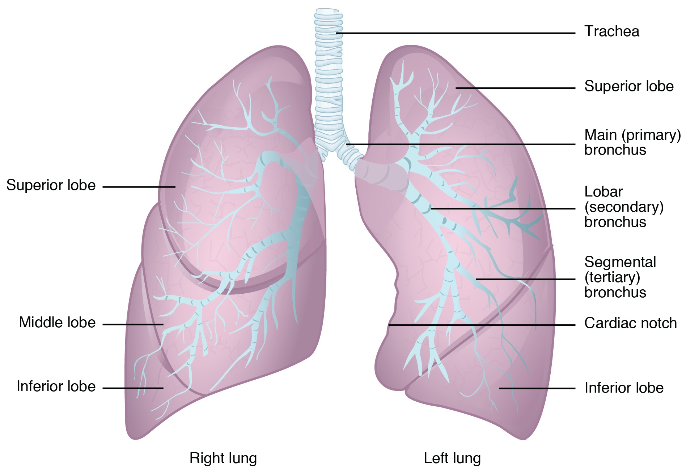
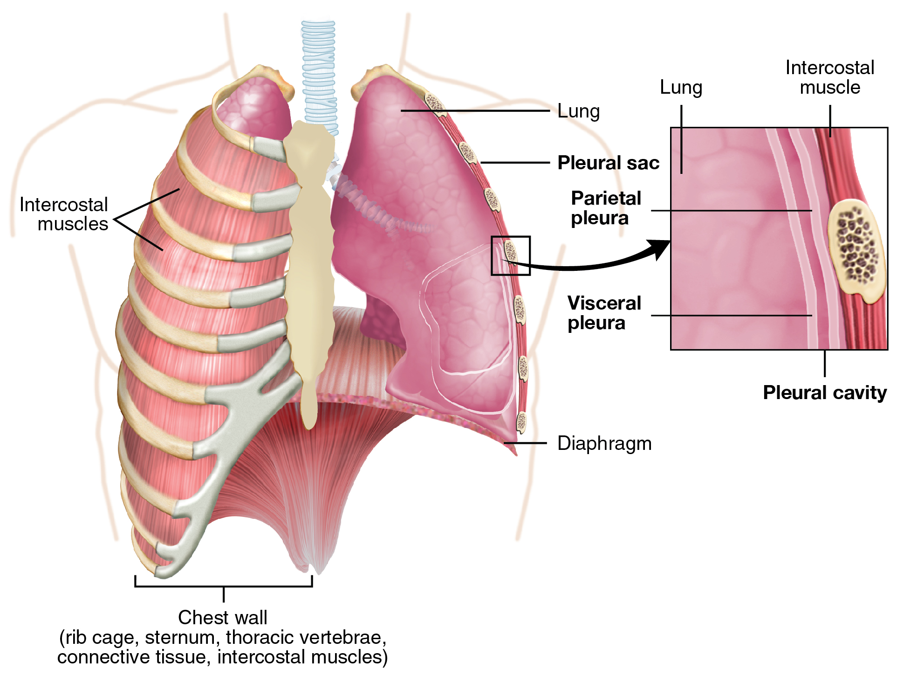
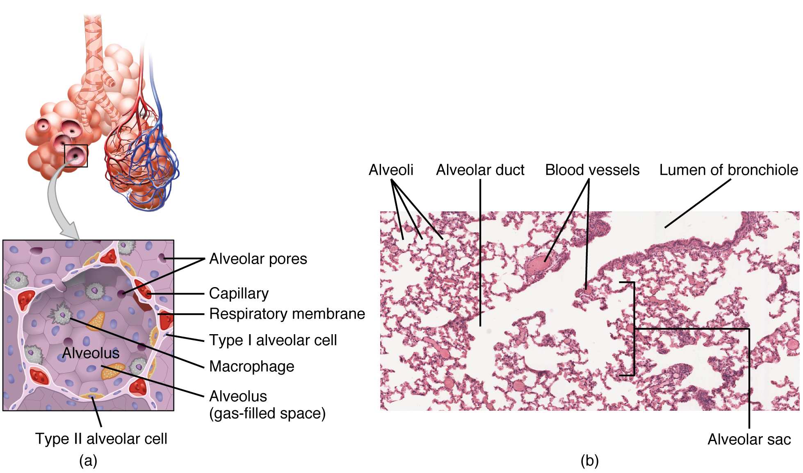

# 第12章 打开胸廓：肺、胸膜与呼吸

胸部外观随呼吸起伏，真正流动的空气却在气道与肺泡内部。胸壁提供可改变容积的骨肌框架，胸膜帮助肺与胸壁的运动耦合，肺泡周围的微小血管再完成气体交换。从外向内阅读胸部，需要区分这些彼此连接、又不是同一回事的结构。[来源：OpenStax，22.1 呼吸系统器官与结构](https://openstax.org/books/anatomy-and-physiology-2e/pages/22-1-organs-and-structures-of-the-respiratory-system)

## 胸壁里面有两个肺区与中央空间

胸廓由胸椎、肋骨、肋软骨和胸骨等共同构成。肋间有多层肌肉和相关神经血管，胸廓下方由穹隆形的膈分隔胸腔与腹腔。胸大肌等较表浅肌肉覆盖在胸壁外侧，并不等同于全部呼吸肌。

左右肺位于胸腔两侧，中央的纵隔容纳心脏、大血管、气管、食管等结构。肺并没有把胸腔填成一整块连通的组织，左右胸膜腔也正常分开。食管经过胸部向下通往胃，说明一个区域中的器官不能只按“呼吸系统”或“循环系统”分组理解，局部空间有自己的邻接关系。

右肺通常分为上、中、下三叶，左肺通常分为上、下两叶，并在靠近心脏的边缘形成心切迹。左右肺的外形并不完全对称。肺尖位于上方，肺底贴近膈；图上的“底部”依附于弯曲的膈面，并非水平平板。[来源：OpenStax，22.2 肺，Gross Anatomy](https://openstax.org/books/anatomy-and-physiology-2e/pages/22-2-the-lungs)

### 图 12-01｜左右肺叶与支气管分支

#### 中文读图说明

这是肺与支气管的前面示意，画面左边是人体右肺，画面右边是左肺；不要直接按看图者左右命名。先比较叶数：右肺上、中、下三叶，左肺上、下两叶，左肺内侧缘可见心切迹。

从中央气管向下追，先分左右主支气管，再到进入肺叶的叶支气管，随后为段支气管。括号中的英文分别表示这几个分支层级，不是三种不同材料的管道。

浅蓝树枝强调空气通路，紫色半透明区域强调肺叶关系；图没有画出完整肺门血管或肺泡网络。肺叶有相互重叠的三维位置，不能按正面投影的面积判断每叶真实体积，也不能把蓝色分支误当肺动脉。

#### 图中英文标注逐项对照

| 图中英文 | 中文名称 | 在图中怎样理解 |
| --- | --- | --- |
| Trachea | 气管 | 中央向下延续并分出左右主支气管 |
| Superior lobe | 上叶 | 两侧肺的上方肺叶并非仅右肺具有 |
| Middle lobe | 中叶 | 位于右肺上叶与下叶之间左肺无此叶 |
| Inferior lobe | 下叶 | 两侧肺均有并有较大部分位于后方 |
| Main (primary) bronchus | 主支气管（一级支气管） | 气管分出的左右主支各进入一侧肺 |
| Lobar (secondary) bronchus | 叶支气管（二级支气管） | 主支气管的分支进入对应肺叶区域 |
| Segmental (tertiary) bronchus | 段支气管（三级支气管） | 叶支气管再分支通向各支气管肺段 |
| Cardiac notch | 心切迹 | 左肺前缘内侧为心脏位置留出的凹缺 |
| Right lung | 右肺 | 位于画面左边通常分上中下三叶 |
| Left lung | 左肺 | 位于画面右边通常分上叶和下叶 |

*来源：[OpenStax《Anatomy and Physiology 2e》原图 22.13](https://openstax.org/books/anatomy-and-physiology-2e/pages/22-2-the-lungs)；OpenStax, Anatomy and Physiology 2e; J. Gordon Betts et al.; Rice University；[CC BY-NC-SA 4.0](https://creativecommons.org/licenses/by-nc-sa/4.0/)。*

## 空气沿着一棵不断分支的气道进入肺内

从鼻进入的空气经过鼻腔，在黏膜、鼻甲等结构帮助下得到温暖、湿润和过滤；随后通过咽、喉、气管，进入左右主支气管。气管位于食管前方，含软骨支持，向下分支后，支气管再逐级变细，成为细支气管。

较大气道的壁有维持通道的支持结构，内面还有黏液与纤毛组成的清除机制。越往远端，管壁结构和功能逐步改变。将所有分支都画成一样粗细的空心管，会掩盖从输送空气到交换气体的转换。

终末细支气管及其近侧部分属于传导区，主要提供气流通道；呼吸性细支气管、肺泡管与肺泡等组成呼吸区。肺不是一个内部中空的大袋，肺泡也不是脱离气道、各自孤立的小球。读分支图时应沿着一条路径走到末端，再回看同一级分支，才能理解尺度变化。[来源：OpenStax，22.1，Conducting Zone、Respiratory Zone](https://openstax.org/books/anatomy-and-physiology-2e/pages/22-1-organs-and-structures-of-the-respiratory-system)

## 胸膜腔不是装空气的空间

脏层胸膜紧贴肺表面，并伸入肺叶间的裂；壁层胸膜衬在胸壁、纵隔与膈的内面。二者在肺根附近相互延续，之间形成胸膜腔。正常情况下，这里只是含少量胸膜液的潜在间隙，并没有供呼吸空气流通的大空腔。

少量液体使两层胸膜能够相对滑动，胸膜系统与胸腔压力变化又使肺能随胸壁扩展。教材常把两层胸膜之间画出较宽的空白，以便分辨标签；真实阅读时必须把这种“为了说明而放大”与实际厚度分开。肺内气道的空气与胸膜腔的液体，位于不同空间。

沿侧胸壁读剖面，可以按“皮肤及皮下组织—胸壁肌肉和肋骨区域—壁层胸膜—胸膜腔—脏层胸膜—肺组织”的顺序定位。经过肋骨或经过肋间隙的切面并不一样，肺根、纵隔侧和膈面也不能照搬同一条直线路线。[来源：OpenStax，22.2，Pleura of the Lungs](https://openstax.org/books/anatomy-and-physiology-2e/pages/22-2-the-lungs)

### 图 12-02｜脏胸膜与壁胸膜

#### 中文读图说明

左图从胸部前方打开胸壁，画面右侧显露肺表面，框选处沿粗箭头放大到右图。左侧保留的肋骨和肋间肌说明胸壁结构，肺下方穹隆形膈把胸腔与腹腔分隔。

在右侧放大框，从右向左依次找肋骨与肋间肌区域、壁胸膜、胸膜腔、脏胸膜、肺。壁胸膜贴胸壁内面，脏胸膜贴肺表面，两者名称依据所贴结构，不能因画面左右互换名称。

两层胸膜之间仅为少量液体润湿的潜在间隙，图为标注把间距放大；这里正常不充呼吸空气。胸膜囊指包绕关系，而气管支气管中的气体走另一条路线，不能把箭头理解成空气由胸壁流入肺。

#### 图中英文标注逐项对照

| 图中英文 | 中文名称 | 在图中怎样理解 |
| --- | --- | --- |
| Lung | 肺 | 放大框左侧为被脏胸膜覆盖的肺组织 |
| Intercostal muscles / Intercostal muscle | 肋间肌 | 位于肋骨之间并参与胸廓运动的肌层 |
| Pleural sac | 胸膜囊 | 胸膜包绕肺并形成封闭潜在间隙的整体 |
| Parietal pleura | 壁胸膜 | 贴胸壁等边界内面并位于放大框靠右侧 |
| Visceral pleura | 脏胸膜 | 紧贴肺表面并随肺裂向深处延伸 |
| Pleural cavity | 胸膜腔 | 两层胸膜之间含少量液体的潜在间隙 |
| Diaphragm | 膈 | 位于胸腔下界的穹隆形骨骼肌结构 |
| Chest wall (rib cage, sternum, thoracic vertebrae, connective tissue, intercostal muscles) | 胸壁（肋廓、胸骨、胸椎、结缔组织与肋间肌） | 下方括线说明胸壁由多种骨与软组织共同构成 |

*来源：[OpenStax《Anatomy and Physiology 2e》原图 22.14](https://openstax.org/books/anatomy-and-physiology-2e/pages/22-2-the-lungs)；OpenStax, Anatomy and Physiology 2e; J. Gordon Betts et al.; Rice University；[CC BY-NC-SA 4.0](https://creativecommons.org/licenses/by-nc-sa/4.0/)。*

## 通气与气体交换发生在不同尺度

吸气时，膈收缩并下降，肋廓运动也有助于增加胸腔容积，肺随之扩张，肺泡内压力降低，空气沿压差进入。安静呼气主要依靠相关组织的弹性回缩；用力呼吸时会有额外肌群参与。肺实质本身没有一层把整个肺主动撑开的骨骼肌。

到达肺泡的空气与血液并不直接混合。肺泡上皮和毛细血管内皮等构成很薄的交换屏障，氧与二氧化碳跨越这一界面扩散。肺泡中的Ⅰ型细胞构成主要交换表面，Ⅱ型细胞产生表面活性物质，帮助降低表面张力。面积较大的交换界面与较短的扩散距离，是肺泡结构的重要意义。

肺动脉把来自右心、氧含量相对较低的血送往肺，肺静脉把经过气体交换的血送回左心。动脉和静脉的名称依据血液相对于心脏的流向，而不由氧含量决定。

| 层次 | 主要发生的事情 |
| --- | --- |
| 胸壁与膈 | 改变胸腔容积，参与通气 |
| 气管、支气管与较近端细支气管 | 输送与处理空气 |
| 肺泡及邻近毛细血管 | 跨薄屏障进行气体交换 |
| 肺动脉与肺静脉 | 把血送来、送回，与心脏连接 |

自然安静呼吸时，可以观察胸部和腹部的轻微位移，理解膈下降会影响腹内结构的位置。外表起伏只能显示整体运动，不能直接看出肺泡交换是否充分，也无须通过屏气或强迫深呼吸来验证图中的原理。[来源：OpenStax，11.4 膈与肋间肌](https://openstax.org/books/anatomy-and-physiology-2e/pages/11-4-axial-muscles-of-the-abdominal-wall-and-thorax)；[22.1，Alveoli](https://openstax.org/books/anatomy-and-physiology-2e/pages/22-1-organs-and-structures-of-the-respiratory-system)；[22.2，Blood Supply](https://openstax.org/books/anatomy-and-physiology-2e/pages/22-2-the-lungs)

### 图 12-03｜从细支气管走到肺泡

#### 中文读图说明

左上先看气道末端与成簇肺泡，红蓝细网表示贴近肺泡的血管；灰箭头把一个肺泡壁区域放大到左下(a)。箭头表示放大关系，不是气流或血流方向，肺泡内腔与血管腔始终分开。

左下扁平Ⅰ型肺泡细胞构成主要交换表面，Ⅱ型细胞分泌表面活性物质，巨噬细胞参与清除。呼吸膜位于肺泡与毛细血管相贴处，肺泡孔则连接相邻肺泡，不是通向血管的洞。

右侧(b)是染色组织切片：大片白色为腔隙，粉红薄隔是肺泡壁等组织。依标签分清肺泡、肺泡管和细支气管腔；截面形状受切割方向影响，不能把每个白洞都当成大小相同的球形肺泡。

#### 图中英文标注逐项对照

| 图中英文 | 中文名称 | 在图中怎样理解 |
| --- | --- | --- |
| Alveolar pores | 肺泡孔 | 相邻肺泡之间的小孔不直接连通血液 |
| Capillary | 毛细血管 | 紧贴肺泡壁的细血管内可见红细胞 |
| Respiratory membrane | 呼吸膜 | 肺泡壁与毛细血管壁构成的薄交换屏障 |
| Type I alveolar cell | Ⅰ型肺泡细胞 | 扁平细胞构成肺泡主要气体交换表面 |
| Macrophage | 巨噬细胞 | 肺泡表面或腔内参与吞噬清除异物 |
| Alveolus (gas-filled space) / Alveolus | 肺泡（含气腔隙） | 左下中央空间容纳空气并与气道相连 |
| Type II alveolar cell | Ⅱ型肺泡细胞 | 较饱满细胞产生表面活性物质帮助稳定肺泡 |
| Alveoli | 肺泡（复数） | 右侧切片中由薄壁分隔的多个含气腔隙 |
| Alveolar duct | 肺泡管 | 右图较大气道末端通道沿壁开放肺泡 |
| Blood vessels | 血管 | 右图实质内有独立管壁的运输血液通道 |
| Lumen of bronchiole | 细支气管腔 | 右图上方较大腔道与周围肺泡腔相区别 |
| Alveolar sac | 肺泡囊 | 多枚肺泡开口相邻所组成的末端集合 |
| (a) / (b) | 示意放大图／组织显微图 | 左下示结构关系右侧示真实切片外观 |

*来源：[OpenStax《Anatomy and Physiology 2e》原图 22.11](https://openstax.org/books/anatomy-and-physiology-2e/pages/22-1-organs-and-structures-of-the-respiratory-system)；OpenStax, Anatomy and Physiology 2e; J. Gordon Betts et al.; Rice University；[CC BY-NC-SA 4.0](https://creativecommons.org/licenses/by-nc-sa/4.0/)。*

*原图显微照片署名：Micrograph provided by the Regents of University of Michigan Medical School © 2012。*

## 识别肺门：空气与血液从同一地区进出

每侧肺朝向纵隔的一面有肺门，支气管、血管和相关神经等在这里进出，连接部分统称肺根。肺门不是在肺表面另开的一条呼吸口，外界空气仍需先经过气管和支气管。肺根中的各结构也不是彼此混成一根管：气道输送空气，动静脉输送血液，神经调节局部活动，淋巴通路参与液体回流与免疫联系。

支气管进入肺后逐级分支，并与肺叶、支气管肺段等分区相联系。肺段有自己的段支气管和相应动脉分支，这让肺内空间具有一定组织性；但肺内所有通道并非处处严格成对重合，不能把一棵气道树简单复制一遍就当作完整血管树。全肺轮廓图、肺门图和肺泡放大图分别服务不同尺度，需要沿着共同的结构名称把它们接起来。

还要区分肺循环血管与营养肺组织的支气管循环。前者承担大量气体交换的血流通路，后者为相关肺部组织提供营养性血供。[来源：OpenStax，20.5 循环通路](https://openstax.org/books/anatomy-and-physiology-2e/pages/20-5-circulatory-pathways)教材为了突出一种循环，经常把另一种省略。读者若在一幅图中没见到某条血管，应先检查图的范围与图例，而不是据此认定该结构不存在。随着视角由整胸深入肺泡，“图省略了什么”与“图画出了什么”同样值得留意。[来源：OpenStax，22.2，Blood Supply and Nervous Innervation](https://openstax.org/books/anatomy-and-physiology-2e/pages/22-2-the-lungs)
