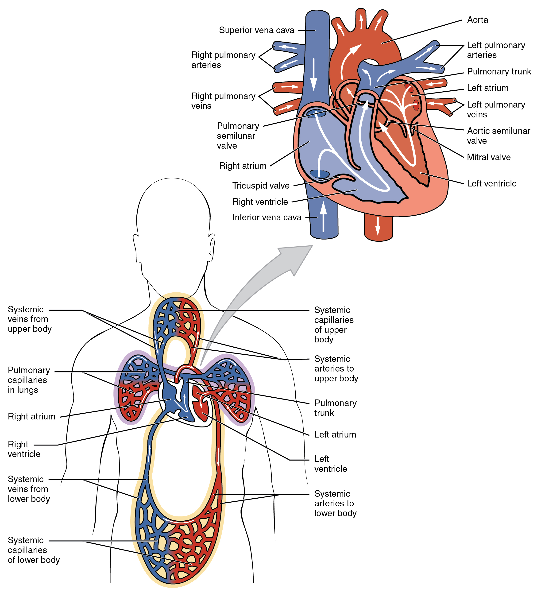
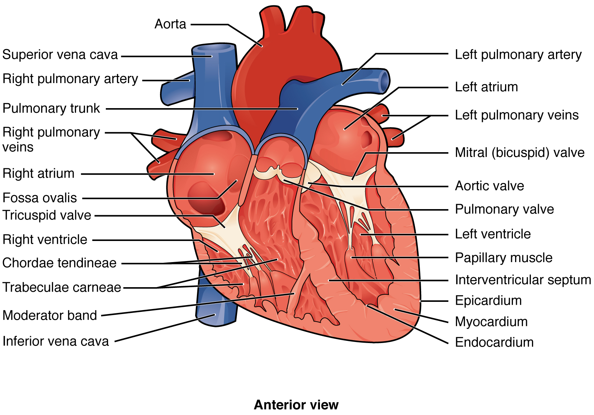

# 第13章 心脏：四个腔室与两条循环

## 在胸骨后方找到一个倾斜的泵

把胸腔看作一个立体空间，心脏位于两肺之间的纵隔内，前方是胸骨和部分肋软骨，下方邻接膈。它并不完全躲在左胸：心脏跨越身体中线，只是较多部分在中线左侧，心尖通常朝向左前下方。教材常把四腔心正面展开，便于认读；真实心脏却是倾斜、旋转着放置的，右心室构成前面的大部分，左心房更靠后。因此“图上左右对半分”不等于实际胸腔中的前后关系。〔[心脏位置与外形，OpenStax §19.1](https://openstax.org/books/anatomy-and-physiology-2e/pages/19-1-heart-anatomy)〕

外面包裹心脏的心包也有层次。较坚韧的纤维心包帮助固定位置；浆膜心包分为壁层和脏层，脏层贴着心表面，又称心外膜。两层浆膜之间的心包腔在正常状态下只是含少量液体的潜在间隙，润滑相对运动。心脏不是一块松散地漂在大水袋里的肌肉，心包腔也不是心腔。

继续向内，心壁主体是心肌，最内侧是心内膜。心肌厚度并不均匀：心房主要把血送入相邻心室，心室则要把血压入循环。左心室要面对体循环较高的阻力，心肌比右心室厚。这种差异首先反映两侧泵送任务不同，而非左侧装血必然更多。

## 四个腔室怎样串起一条连续路线

读心脏剖面，先辨认心房与心室，再沿血流找瓣膜，不要先记红蓝颜色。正常出生后循环可以从右心房起步：上、下腔静脉等带来的血进入右心房，经三尖瓣进入右心室，再经肺动脉瓣进入肺动脉干和肺动脉。血液在肺毛细血管与肺泡交换气体后，经肺静脉回到左心房，通过二尖瓣进入左心室，最后越过主动脉瓣进入主动脉，分送全身。组织毛细血管完成交换后，血液再沿静脉系统回到右心。〔[心腔、瓣膜与循环路径，OpenStax §19.1](https://openstax.org/books/anatomy-and-physiology-2e/pages/19-1-heart-anatomy)〕

肺循环与体循环由心脏串联，并不是两批互不相干的血。稳定状态下，两侧心室在较长时间内泵出的血量应大体相等，否则血液会在某一侧循环持续积聚。它们可以用不同厚度的肌壁产生不同压力，却共同维持同一条闭合路线。

| 观察对象 | 血流去向 | 容易误读的地方 |
| --- | --- | --- |
| 右心室 | 肺循环 | 右心不是把血直接送往全身 |
| 左心室 | 体循环 | 左心室壁厚不表示每搏必然多送一份血 |
| 肺动脉 | 从心脏到肺 | 动脉的定义取决于离开心脏，不取决于含氧高低 |
| 肺静脉 | 从肺到心脏 | 正常成人肺静脉内是含氧较高的血 |

解剖图中的红与蓝是一套功能配色，通常分别代表含氧较高与较低的血，并非血液在体内真的一半鲜红、一半蓝色。静脉血仍是红色，只是色泽更暗。

### 图 13-01｜体循环与肺循环串联

**读图：** 沿箭头走完整圈，确认右心到肺、左心到全身；红蓝色表示含氧状态的教学编码，不是血液的真实蓝色。

**标注对应：** pulmonary circuit 肺循环；systemic circuit 体循环。

*来源：[OpenStax《Anatomy and Physiology 2e》原图 19.4](https://openstax.org/books/anatomy-and-physiology-2e/pages/19-1-heart-anatomy)；OpenStax, Anatomy and Physiology 2e; J. Gordon Betts et al.; Rice University；[CC BY-NC-SA 4.0](https://creativecommons.org/licenses/by-nc-sa/4.0/)。*

## 瓣膜靠压力差工作

瓣膜的主要作用是限制倒流。心室舒张时，心房侧压力足以推动房室瓣开放，血流进入心室；心室收缩、压力超过心房时，房室瓣关闭。随后心室压力超过相应大动脉压力，半月瓣开放，血液被射出；心室压力回落后，动脉内短暂的回流趋势使半月瓣关闭。瓣膜不是由心脏为每一片瓣叶安排一套“开门肌肉”主动拉开，而是随两侧压力变化被动开闭。〔[瓣膜构造，OpenStax §19.1](https://openstax.org/books/anatomy-and-physiology-2e/pages/19-1-heart-anatomy)〕

房室瓣上的腱索连到乳头肌。乳头肌与心室肌一同收缩，拉紧腱索，帮助防止瓣叶在较高的心室压力下翻向心房。腱索负责限制翻转，并不负责把瓣膜拉开。主动脉瓣和肺动脉瓣则没有这套腱索装置，形状近似小袋，借回流充盈而贴合。

心脏的跳动也有电活动顺序。窦房结通常发起节律，兴奋经过心房、房室结和心室传导系统，使收缩按适当时序展开。电信号与机械泵血有关，却不是同一件事：电活动先触发心肌细胞的收缩过程，泵送效果还受充盈、收缩力和血管负荷影响。〔[心脏电活动，OpenStax §19.2](https://openstax.org/books/anatomy-and-physiology-2e/pages/19-2-cardiac-muscle-and-electrical-activity)〕

### 图 13-02｜心脏四腔、瓣膜与大血管

**读图：** 先辨左右心，再沿房室瓣和流出道追踪血液。图中人体左侧通常在画面右侧。

**标注对应：** atrium 心房；ventricle 心室；septum 中隔。

*来源：[OpenStax《Anatomy and Physiology 2e》原图 19.9](https://openstax.org/books/anatomy-and-physiology-2e/pages/19-1-heart-anatomy)；OpenStax, Anatomy and Physiology 2e; J. Gordon Betts et al.; Rice University；[CC BY-NC-SA 4.0](https://creativecommons.org/licenses/by-nc-sa/4.0/)。*

## 心脏也需要自己的供血

心腔中一直有血，不代表心肌能直接从腔内获取足够营养。心壁较厚，需要冠状动脉供应；这些血管从主动脉根部附近发出，沿心脏表面的沟走行，再分支深入心肌。大部分心肌静脉血经冠状窦回到右心房。看外观图时，表面的红蓝分支就是心脏自身的供血与回流系统，不应与进出心腔的大血管混为一谈。〔[冠状循环，OpenStax §19.1](https://openstax.org/books/anatomy-and-physiology-2e/pages/19-1-heart-anatomy)〕

“每分钟送出多少血”由心率与每搏输出量共同决定，关系是心输出量＝心率×每搏输出量。运动时，两者都可能改变，因此只数跳动次数不能完整评价泵血工作。每搏输出量又受心室充盈、收缩能力及射血阻力影响；这些因素解释了心脏为什么需要和肺、静脉回流、动脉系统一起理解。〔[心输出量及影响因素，OpenStax §19.4](https://openstax.org/books/anatomy-and-physiology-2e/pages/19-4-cardiac-physiology)〕

还有一组需要从外形走向剖面的关系：房间隔和室间隔把左右心分开，室间隔并不只是图中一条没有厚度的线。心室内可见肌小梁、乳头肌和腱索，它们让内面呈现起伏；若看到一条白色绳索，应先判断它连接哪一片瓣叶，而不是把所有突起都认作分隔心腔的墙。房室瓣位于心房与心室之间，半月瓣则处在心室的流出端，两者的安装位置已经提示不同的工作条件。

“收缩”和“舒张”也必须说明是在讲哪一部分。心房与心室并非同时开始所有机械活动，心室在舒张时接收血液，在收缩期建立压力并射血；在瓣膜尚未打开的短暂阶段，压力可以变化而腔内容积变化很小。把几个时刻的图按顺序排列，观察瓣膜开闭和血流箭头，比把“整颗心一缩一放”作为唯一模型更接近实际。若只看某一帧，开放的瓣膜和关闭的瓣膜并不是矛盾，它们说明两侧此刻面对不同压力。〔[心动周期，OpenStax §19.3](https://openstax.org/books/anatomy-and-physiology-2e/pages/19-3-cardiac-cycle)〕

重读心脏图时，可做一次不靠颜色的追踪：从任意一个腔室出发，说出下一个瓣膜、下一段血管以及下一处毛细血管。若能沿路线回到原点，同时分清心包、心壁和心腔，平面的“四格心脏”就恢复为胸腔中连续工作的立体器官。
