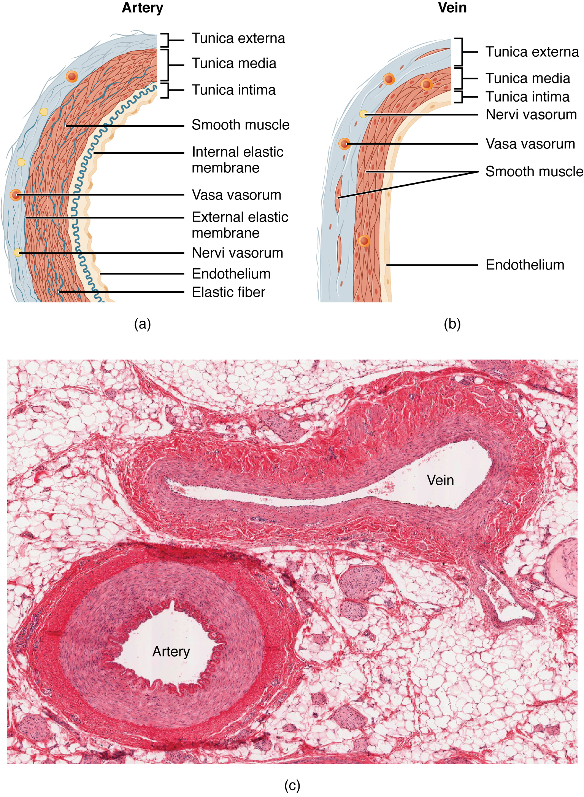
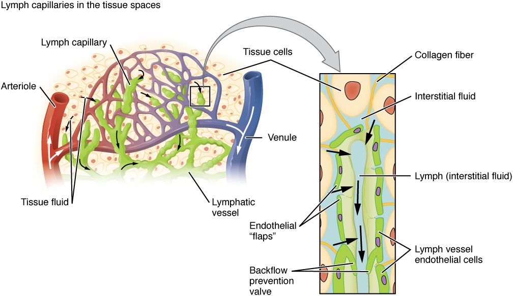
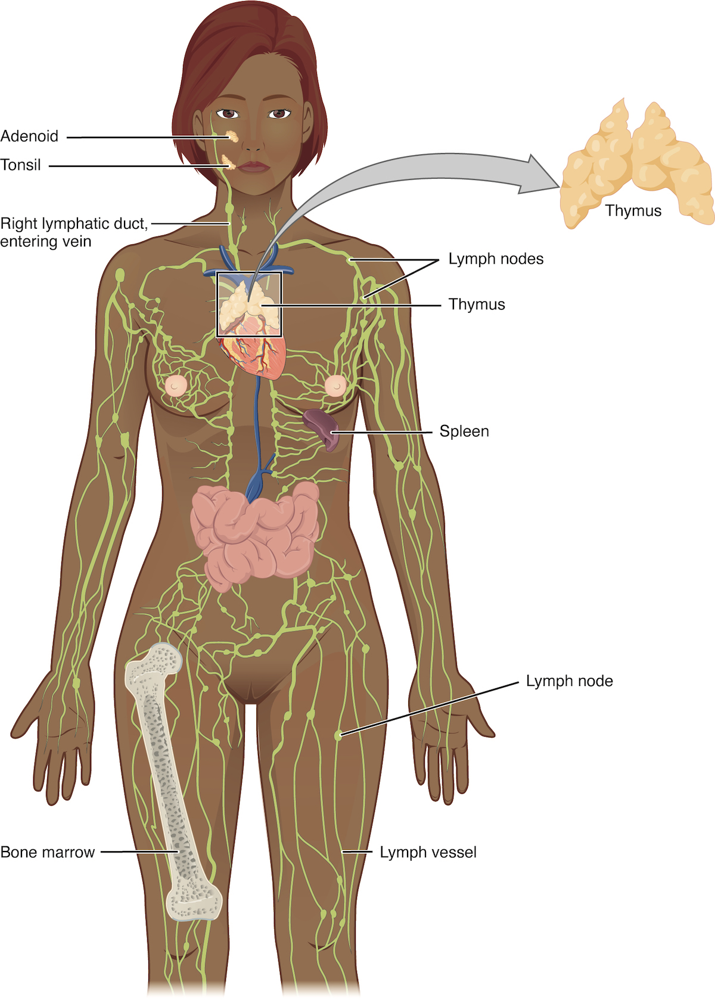

# 第14章 血管与淋巴：遍布层间的运输网

## 血管不是埋在最深处的一套管线

皮肤、肌肉、骨、内脏都需要血液供应，血管因此存在于多个深度。皮下可有浅静脉，深部血管常与神经一起穿过肌间隙或结缔组织通道，器官内还有细密分支。某些组织却有例外：表皮没有血管，主要依靠真皮一侧的扩散获得营养；关节软骨也不是遍布毛细血管的组织。看分层图时，不能把血管统一放成“器官之后再出现”的最内层。

动脉把血带离心脏，静脉把血带回心脏，中间的微循环承担大量交换。沿一般路线，动脉逐渐分为小动脉、微动脉，进入毛细血管网，再汇合成微静脉和静脉。分支不只是把一根大管拆成许多小管，也让血流接近各处细胞；微动脉还能通过平滑肌收缩改变局部阻力，调配进入组织的血流。〔[血管类型与分支，OpenStax §20.1](https://openstax.org/books/anatomy-and-physiology-2e/pages/20-1-structure-and-function-of-blood-vessels)〕

## 同是管道，管壁为什么不同

多数较大的动脉和静脉可分内膜、中膜、外膜。内膜的内皮形成血液接触面；中膜中的平滑肌和弹性成分影响管径与顺应性；外膜的结缔组织与周围结构相连。主动脉等大动脉弹性成分丰富，能在心室射血时扩张、随后回弹，缓和间歇泵血造成的压力波动。较小的肌性动脉更突出地参与分配血流。

静脉承受的压力通常较低，壁相对薄，容纳血液的能力较大。许多四肢静脉有瓣膜，帮助限制逆流；骨骼肌收缩挤压静脉，配合瓣膜把血推向心脏，呼吸产生的胸腹压力变化也有帮助。并非所有静脉都有瓣膜，静脉回流也不是仅凭心脏从远处“吸回来”。〔[血管壁、静脉瓣与回流，OpenStax §20.1](https://openstax.org/books/anatomy-and-physiology-2e/pages/20-1-structure-and-function-of-blood-vessels)〕

| 比较项 | 动脉 | 静脉 | 毛细血管 |
| --- | --- | --- | --- |
| 在一般循环中的任务 | 输送与分配离心血流 | 回流与储血 | 血液与组织间的交换 |
| 结构重点 | 中膜较发达，部分富含弹性组织 | 壁相对薄，部分有瓣膜 | 主要为内皮及相关基底膜，壁很薄 |
| 读图要点 | 留意管壁厚度 | 留意管腔与瓣膜 | 留意邻近细胞及交换界面 |

毛细血管不是完全相同的小管。连续型、窗孔型和血窦样结构的通透性不同，与所在组织任务相配：例如肺和肌肉需要受控交换，肾和某些内分泌器官需要较高的物质通行能力，肝内血窦则有另一种交换环境。“壁薄”不等于什么都能随意漏过去。

### 图 14-01｜动脉与静脉的管壁比较

#### 中文读图说明

上方左图为动脉，右图为静脉，下面是两者的组织切片；这张图没有毛细血管分图。先从白色管腔一侧向外看，依次辨认内膜、中膜、外膜，再比较动脉较厚的中膜。

动脉图中的波浪线是弹性膜，细小交错丝线表示弹性纤维；红色细长细胞是平滑肌。管壁内另有滋养血管与神经，它们服务于血管壁，并非大管腔内的血液分支。

最后看下方切片：动脉较圆、壁厚，静脉管腔较不规则且有塌陷。这是本次切片的形态，不能把圆扁作为唯一鉴别标准；还须一起比较管壁层次与相对厚度。

#### 图中英文标注逐项对照

| 图中英文 | 中文名称 | 在图中怎样理解 |
| --- | --- | --- |
| Artery | 动脉 | 上方左图及下方圆形较厚壁血管 |
| Vein | 静脉 | 上方右图及下方较扁不规则血管 |
| Tunica intima | 内膜 | 面向管腔的一层，包含内皮等结构 |
| Tunica media | 中膜 | 内外膜之间，平滑肌及弹性成分较多 |
| Tunica externa | 外膜 | 最外侧结缔组织层，与周围组织相连 |
| Smooth muscle | 平滑肌 | 红色细长细胞，参与调节血管管径 |
| Internal elastic membrane | 内弹性膜 | 动脉图靠近管腔的波浪状弹性界面 |
| External elastic membrane | 外弹性膜 | 动脉中膜与外膜之间的弹性层次 |
| Elastic fiber | 弹性纤维 | 动脉壁交错细丝，帮助伸展与回弹 |
| Endothelium | 内皮 | 紧贴管腔、直接接触血液的细胞衬里 |
| Vasa vasorum | 滋养血管 | 大血管壁中的小血管，供养管壁组织 |
| Nervi vasorum | 血管神经 | 管壁中的神经，参与血管活动调节 |
| (a) | 分图a：动脉示意 | 对应上方左图，重点比较管壁层次 |
| (b) | 分图b：静脉示意 | 对应上方右图，中膜相对较薄一些 |
| (c) | 分图c：组织切片 | 对应下方照片，比较真实管壁与管腔 |

*来源：[OpenStax《Anatomy and Physiology 2e》原图 20.3](https://openstax.org/books/anatomy-and-physiology-2e/pages/20-1-structure-and-function-of-blood-vessels)；OpenStax, Anatomy and Physiology 2e; J. Gordon Betts et al.; Rice University；[CC BY-NC-SA 4.0](https://creativecommons.org/licenses/by-nc-sa/4.0/)。*

*原图显微照片署名：Micrograph provided by the Regents of the University of Michigan Medical School © 2012。*

## 从血液到组织液，再进入淋巴

血浆中的水和小分子可跨毛细血管壁进入组织间隙，形成细胞周围的组织液。细胞与血液并非都直接接触，中间常隔着血管内皮、基底膜和这层液体环境。组织间隙中的部分液体、蛋白质等由淋巴毛细管收集，进入其中后称为淋巴，随后经过较大的淋巴管回到静脉系统。淋巴并不是另一种由独立心脏不断泵出的血。〔[淋巴来源与毛细淋巴管，OpenStax §21.1](https://openstax.org/books/anatomy-and-physiology-2e/pages/21-1-anatomy-of-the-lymphatic-and-immune-systems)〕

淋巴管也有瓣膜，流动受到管壁活动、身体运动、骨骼肌收缩和呼吸等帮助。大部分身体区域的淋巴经胸导管回到左侧颈根部的静脉交汇区；右上部一部分区域经右淋巴导管回流。教材的全身淋巴图中，四肢的细线汇入躯干，再汇向颈根部，表示的是回流方向，不能当作与动脉一样从中心向外喷出的路线。

小肠绒毛内的乳糜管属于淋巴毛细管，吸收后的一部分脂类由这条路线运输。消化道的吸收因此不只有“进入血管”一种出口：多数水溶性营养物进入门静脉路线，许多长链脂类经加工形成乳糜微粒后先进入淋巴。这也是淋巴系统与营养运输相连的一个具体例子。

### 图 14-02｜组织液如何进入淋巴毛细管

#### 中文读图说明

先看左半幅：红色微动脉分成血毛细管网，再汇入蓝色微静脉；绿色盲端管道夹在组织细胞之间，是淋巴毛细管。黑色小箭头提示组织液在血管外间隙中的移动。

灰色弯箭头把一个局部放大到右侧。那里显示淋巴管壁的内皮细胞彼此重叠，形成可开启的瓣片样边缘；组织液从间隙进入后，才称为管内淋巴。

沿右侧黑箭头向下读，可见防回流的瓣样结构。蓝色胶原纤维把管壁锚定在周围组织中。不要把灰色放大箭头当作液体流向，也不要把绿色管道误认成血管网的另一条静脉。

#### 图中英文标注逐项对照

| 图中英文 | 中文名称 | 在图中怎样理解 |
| --- | --- | --- |
| Lymph capillaries in the tissue spaces | 组织间隙中的淋巴毛细管 | 全图主题，强调管道位于细胞之间 |
| Arteriole | 微动脉 | 左方红色供血小管，接入毛细血管网 |
| Venule | 微静脉 | 左图右侧蓝色小管，汇集毛细血管血流 |
| Lymph capillary | 淋巴毛细管 | 左图绿色盲端小管，收集局部组织液 |
| Lymphatic vessel | 淋巴管 | 左图较大绿色通路，接续淋巴回流 |
| Tissue fluid | 组织液 | 左图血管外、细胞间隙中的液体 |
| Tissue cells | 组织细胞 | 浅黄色带红褐色细胞核的周围细胞 |
| Collagen fiber | 胶原纤维 | 右图蓝色细丝，将淋巴管壁锚定 |
| Interstitial fluid | 组织间液（组织液） | 右图管道外、细胞之间的液体环境 |
| Lymph (interstitial fluid) | 淋巴（进入管内的组织液） | 右图绿色管腔内，已进入淋巴回流路线 |
| Endothelial “flaps” | 内皮瓣片样边缘 | 重叠内皮形成的入口，帮助单向进入 |
| Lymph vessel endothelial cells | 淋巴管内皮细胞 | 构成绿色管壁，图中可见紫色细胞核 |
| Backflow prevention valve | 防回流瓣样结构 | 右图下方，帮助限制淋巴向后倒流 |

*来源：[OpenStax《Anatomy and Physiology 2e》原图 21.3](https://openstax.org/books/anatomy-and-physiology-2e/pages/21-1-anatomy-of-the-lymphatic-and-immune-systems)；OpenStax, Anatomy and Physiology 2e; J. Gordon Betts et al.; Rice University；[CC BY-NC-SA 4.0](https://creativecommons.org/licenses/by-nc-sa/4.0/)。*

## 淋巴结、脾和胸腺各处在哪里

淋巴结像沿淋巴管分布的小型检查站。淋巴进入结内后经过特定通道，免疫细胞在这里接触并识别外来物和相关信号。颈、腋、腹股沟附近存在较集中的淋巴结群，但胸腹深部同样有许多结；只画体表三处，容易把它误读为局限于皮下的系统。一个结的回流区域与所在位置有关，不能只按距离猜测。〔[淋巴结与淋巴器官，OpenStax §21.1](https://openstax.org/books/anatomy-and-physiology-2e/pages/21-1-anatomy-of-the-lymphatic-and-immune-systems)〕

脾位于左上腹、靠近胃的外侧和膈下。它主要面对血液，参与血细胞处理和免疫监测；淋巴结主要处理流经的淋巴。胸腺位于胸骨后上部区域，与T淋巴细胞发育有关，随年龄增长其形态和组织组成会改变。骨髓则是血细胞形成的重要场所。它们同属免疫相关结构，却不能在图上互换名称或功能。

血管的走行还揭示器官与身体层次的关系。进入肌肉或脏器的较大分支，需要在内部继续分配；离开器官的静脉则把分散血流重新汇集。若剖面图中只出现一截圆形管腔，它可能只是同一根弯曲管道被切到的局部，不能据一个圆就推断那里有一根完整独立的短管。把横断面与纵向走行图对照，才能把局部截面连接成真实路径。

读组织切片时，动脉和静脉的形状也会受制片影响：静脉壁较薄，管腔可能塌陷，不能仅凭“圆形就是动脉、扁形就是静脉”判断。管壁层次、相对厚度、管腔及邻近结构需要一起看。同样，淋巴管常较细且壁薄，在普通照片上未必像彩色教材图那样醒目。教材用绿色突出淋巴，只是一种识别约定；现实中的颜色、透明度和可见程度由组织状态和观察方式决定。

还应区分血管与神经：解剖图常把神经画成黄色实线，它由神经纤维及包膜等组成，主要传递信号，并不是输送黄色液体的另一根管道。两者同行有助于器官同时获得供血与神经支配，但结构和内容物各不相同。

把本章叠回肌肉或腹部图，会看见“网络穿过层次”：大血管沿通道走行，细小分支抵达组织，组织液经淋巴返回循环。读这类图应分别追踪血流和淋巴流，再观察它们在哪里汇合，而不是把红、蓝、绿三套线一次性当作相同的管道来背。

### 图 14-03｜淋巴系统的回流路线

#### 中文读图说明

这是从前方看的全身图，人体左侧在画面右边。绿色细线为淋巴管，沿途小结节为淋巴结；先从手足向躯干追踪，再找颈根部淋巴管接入蓝色静脉的位置。

头部另标腺样体和扁桃体，胸前白色组织是胸腺。灰色弯箭头只把胸腺放大到右上角，那里不是淋巴结剖面，也不表示淋巴从胸部流出到身体外。

右侧画面的紫色脾属于人体左上腹；大腿切开的骨显示骨髓。这些器官共同参与免疫相关工作，却不都负责过滤淋巴：淋巴结处理淋巴，脾主要处理血液，骨髓参与血细胞形成。

#### 图中英文标注逐项对照

| 图中英文 | 中文名称 | 在图中怎样理解 |
| --- | --- | --- |
| Adenoid | 腺样体（咽扁桃体） | 头部较上方黄色组织，邻近鼻咽区域 |
| Tonsil | 扁桃体 | 头部较下方黄色组织，位于咽部附近 |
| Right lymphatic duct, entering vein | 右淋巴导管汇入静脉 | 画面左侧颈根部，是人体右侧回流入口 |
| Lymph nodes | 淋巴结群 | 胸肩及其他区域沿淋巴管分布的小结节 |
| Lymph node | 淋巴结 | 右侧大腿引线所指的单个绿色结节 |
| Thymus | 胸腺 | 胸前白色分叶组织，右上为其放大图 |
| Spleen | 脾 | 画面右侧紫色器官，实际位于左上腹 |
| Bone marrow | 骨髓 | 大腿骨切开后露出的内部组织区域 |
| Lymph vessel | 淋巴管 | 四肢与躯干绿色通路，输送淋巴回流 |

*来源：[OpenStax《Anatomy and Physiology 2e》原图 21.2](https://openstax.org/books/anatomy-and-physiology-2e/pages/21-1-anatomy-of-the-lymphatic-and-immune-systems)；OpenStax, Anatomy and Physiology 2e; J. Gordon Betts et al.; Rice University；[CC BY-NC-SA 4.0](https://creativecommons.org/licenses/by-nc-sa/4.0/)。*

