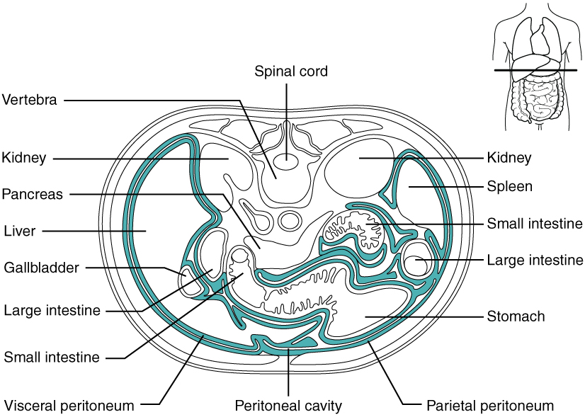
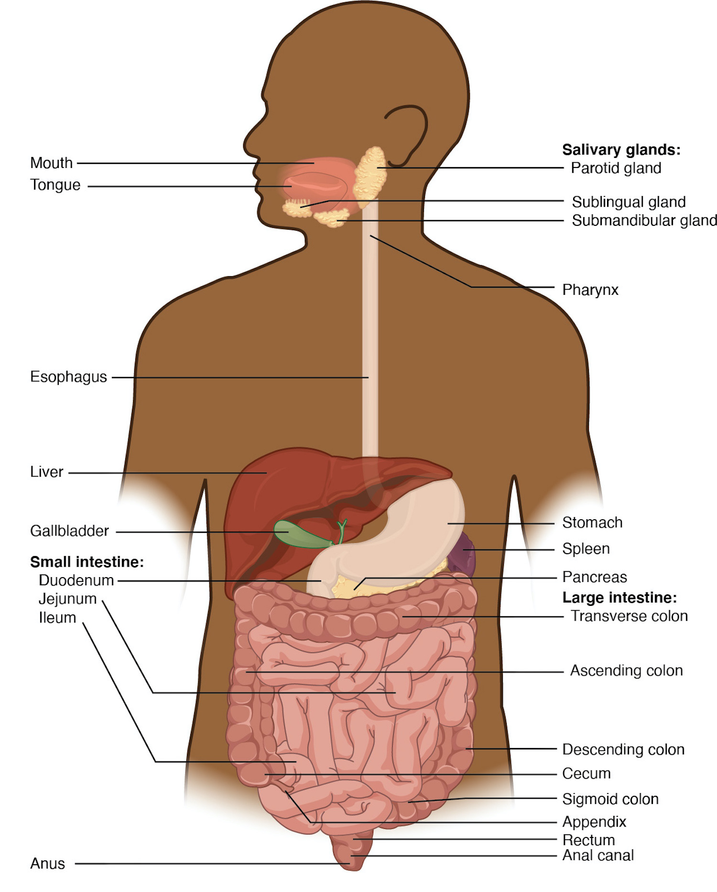

# 第15章 走进腹部：腹壁、腹膜与器官位置

## 先辨腹壁，再辨腹腔

胸廓下方没有与肋骨同样连续的骨性护罩，腹部前外侧主要由肌肉、腱膜和结缔组织构成。由外向内，可以依次遇到皮肤、皮下组织、腹壁肌与其筋膜，再到更深的筋膜、腹膜外组织和壁腹膜。不过这条路线随位置改变：腹直肌所在的前方，与腹外斜肌、腹内斜肌和腹横肌所在的侧方，并不是完全相同的剖面。腱膜在前方共同参与形成腹直肌鞘，使腹壁成为互相连接的整体，而非几片独立覆盖的肌肉。〔[腹壁肌与腱膜，OpenStax §11.4](https://openstax.org/books/anatomy-and-physiology-2e/pages/11-4-axial-muscles-of-the-abdominal-wall-and-thorax)〕

腹腔上界是膈，向下与盆腔连续，两者之间没有一张把器官完全隔开的横膜。我们按骨盆入口等标志分区，便于描述位置；器官和管道仍可以跨区延伸。腹部平面图若只画出胃、肝和肠，往往省掉前腹壁、后腹壁和许多被遮挡结构，所以并不代表从皮肤向内看时，它们会同时完整地露在眼前。

体表分区同样是定位工具。四象限法以穿过脐的水平线和正中线作大致划分，九区法则更细。右上腹常涉及肝和胆囊，左上腹可见胃与脾的投影，下腹多见肠袢和盆腔器官邻近区域；器官大小、呼吸、胃肠充盈及个体差异都会改变具体投影。分区帮助描述，不能仅凭某一区的位置作器官判断。〔[腹盆分区，OpenStax §1.6](https://openstax.org/books/anatomy-and-physiology-2e/pages/1-6-anatomical-terminology)〕

## 腹膜不是把器官装满的一只空袋

腹膜是一层浆膜。壁腹膜贴衬腹壁内面，脏腹膜覆盖许多腹内器官表面；两者在不同位置相续、反折。腹膜腔是这些浆膜表面之间含少量润滑液的潜在间隙，帮助器官随呼吸和消化活动滑动。胃肠等所谓“腹膜内位器官”不是漂浮在这个间隙中的裸露物体，而是由脏腹膜包覆，并通过系膜或其他腹膜褶连向腹壁或相邻器官。〔[腹膜与腹膜褶，OpenStax §23.1](https://openstax.org/books/anatomy-and-physiology-2e/pages/23-1-overview-of-the-digestive-system)〕

系膜由两层腹膜及其间的组织构成，血管、淋巴管和神经可沿其中到达器官。它既提供一定固定，也保留活动余地。空肠、回肠的系膜连到后腹壁；横结肠和乙状结肠各有相应系膜。因此，肠道的弯曲既不是随意堆放，也不是每一段都紧贴腹壁固定。

大网膜从胃大弯附近向下垂，像围在部分肠袢前方的组织帘幕，含有脂肪和血管。小网膜联系肝与胃小弯、十二指肠上部；其中相应区域为通向肝的管道提供通路。“网膜”是腹膜形成的特定结构名称，不是泛指所有包住内脏的白色薄膜。

### 图 15-01｜腹膜与肠系膜的反折

#### 中文读图说明

右上角小人上的横线说明切面高度。主图上方是后方、下方是前方；按常见从足端看的横断显示，人体右侧在画面左边。先用上方椎骨和椎管内脊髓固定方向。

接着沿腹壁内缘找壁腹膜，再沿器官表面找脏腹膜。两层之间的蓝绿间隙表示被夸张放宽的腹膜腔，并非腹腔内真的有这么宽的空水带；膜的反折联系器官与腹壁。

最后比较上方两肾与中下方胃肠：肾在壁腹膜后方，胃肠不同部分与腹膜的关系各异。多个肠管截面属于弯曲肠袢，不代表互不相连的新器官；本图也为教学简化了实际位置。

#### 图中英文标注逐项对照

| 图中英文 | 中文名称 | 在图中怎样理解 |
| --- | --- | --- |
| Vertebra | 椎骨 | 上方后正中骨性结构，用于确定后方 |
| Spinal cord | 脊髓 | 椎管内中央小圆结构，位于后正中 |
| Kidney | 肾 | 上方两侧器官，位于壁腹膜的后方 |
| Pancreas | 胰腺 | 引线指向靠后中央附近的腺性器官 |
| Liver | 肝 | 画面左侧大器官，属于人体右侧区域 |
| Gallbladder | 胆囊 | 邻近肝下缘的小囊，参与胆汁储存 |
| Spleen | 脾 | 画面右上外侧器官，属于人体左侧 |
| Small intestine | 小肠 | 可见带皱褶的多个肠管截面与反折 |
| Large intestine | 大肠 | 两侧较小圆形肠管截面，按引线识别 |
| Stomach | 胃 | 画面右下的较大空腔结构，位于偏前 |
| Visceral peritoneum | 脏腹膜 | 贴着器官表面的浆膜，与壁层相续 |
| Parietal peritoneum | 壁腹膜 | 衬在腹壁内面的浆膜，围出腹膜界面 |
| Peritoneal cavity | 腹膜腔 | 蓝绿间隙为放大表示，正常仅有少量液体 |

*来源：[OpenStax《Anatomy and Physiology 2e》原图 23.4](https://openstax.org/books/anatomy-and-physiology-2e/pages/23-1-overview-of-the-digestive-system)；OpenStax, Anatomy and Physiology 2e; J. Gordon Betts et al.; Rice University；[CC BY-NC-SA 4.0](https://creativecommons.org/licenses/by-nc-sa/4.0/)。*

## 为什么有些器官在腹膜后

肾脏位于腹膜后、靠近后腹壁。胰腺的大部分、十二指肠的大部分，以及升结肠、降结肠，也有较固定的腹膜后关系。这里的“后”描述它们与壁腹膜的关系，不表示它们跑到腹部范围之外。部分器官在发育过程中与后腹壁发生贴合固定，这也是成人空间关系与简单“袋子装器官”模型不同的原因。〔[腹膜后器官，OpenStax §23.1](https://openstax.org/books/anatomy-and-physiology-2e/pages/23-1-overview-of-the-digestive-system)；[肾脏位置，§25.3](https://openstax.org/books/anatomy-and-physiology-2e/pages/25-3-gross-anatomy-of-the-kidney)〕

| 名称 | 描述的是什么 | 典型理解 |
| --- | --- | --- |
| 腹腔 | 膈以下、盆腔以上的身体空间 | 包含多种器官及其周围结构 |
| 腹膜腔 | 壁、脏腹膜表面之间的潜在间隙 | 正常有少量液体，不是填满器官的大空洞 |
| 腹膜内位 | 器官较多表面由腹膜覆盖，并借相应腹膜结构连接 | 胃、空肠和回肠可作入门例子 |
| 腹膜后位 | 位于壁腹膜后方 | 肾脏是容易认读的例子 |

这张对照表不应被理解为所有器官都能无例外地分入两个整齐箱子。十二指肠、胰腺等有部分例外，直肠的腹膜覆盖又随高度改变。初学时先掌握主要空间关系，进一步阅读时再看具体部位，而不要把一个标签推广到器官的每一毫米。

## 用三条路线重建器官邻接

第一条路线是从前向后。以前腹壁正中附近为起点，深部可遇到网膜和肠袢；继续向后，才逐渐接近腹后壁的大血管和脊柱。胃的后方邻近胰腺等结构，教材若把胰腺画在胃的旁边，常是为了展示而移开了遮挡，不能据此认定两者处于同一冠状平面。

第二条路线是从上向下。肝主要位于右上腹、贴近膈，胃主要在左上腹，脾更靠左外上方；小肠袢占据腹部中央与下部相当部分空间，大肠的若干部分从外围绕行。横结肠的位置会变化，乙状结肠可进入盆腔，不能把大肠背成固定不动的方框。〔[肠道区域与系膜，OpenStax §23.5](https://openstax.org/books/anatomy-and-physiology-2e/pages/23-5-the-small-and-large-intestines)〕

第三条路线是沿管道。食管穿膈接胃，胃经幽门接十二指肠，十二指肠弯绕胰头，再续为空肠、回肠。肠道的连续性把平面上分散的器官重新串起；系膜和血管则说明它们如何在可活动的同时得到支持。

脾脏常是腹部识图中被消化器官遮住的一处结构。它邻近胃，却不让食物经过，也不通过导管向肠腔排出消化液；它属于免疫与血液处理相关器官。肾上腺、肾、胰腺和脾在图上可能被摆得很近，却分属不同功能系统。位置相邻解释空间安排，不能自动证明它们执行同一种工作。

横断面尤其能纠正正面展开图的错觉。在同一个腹部高度，前方的腹壁、中央或偏前的肠道、后方的肾和大血管可能共同入镜；不同高度又会出现不同器官截面。一个器官也可能在连续多层切面中重复出现，并随高度改变大小和外形。阅读时先用脊柱固定后方，用身体中线辨左右，再观察器官与腹膜的关系。切面图中显示的是该高度穿过的部分，不能把“这一层没有画到”直接理解为身体里缺少这个结构。

读腹部图最有效的一次练习，是先用手指在图上指出前、后、左、右，再区分“器官本身”“器官表面的浆膜”和“浆膜之间的间隙”。完成这一步后，再观察哪个结构遮住哪个结构。这样，“从外到内”就成为有方向的空间探索，而非把所有器官排成一列深度名单。

### 图 15-02｜腹部消化器官的总体位置

#### 中文读图说明

先从上向下追踪真正让食物经过的路线：口腔、咽、食管、胃、小肠、大肠、直肠与肛管。头部使用侧面示意，腹部则展开为前方视角，因此不是同一张严格切面。

腹部画面左上是人体右侧的肝，画面右上是偏左的胃；胃后的胰被显露，脾画在胃的外侧。唾液腺、肝、胆囊和胰通过分泌物参与消化，食物不会穿过这些腺体。

再沿外周大肠找升、横、降、乙状结肠，中央为弯曲小肠。阑尾从盲肠旁伸出，不是食物必经的主路；脾虽一起画出，却不属于分泌消化液的附属消化器官。

#### 图中英文标注逐项对照

| 图中英文 | 中文名称 | 在图中怎样理解 |
| --- | --- | --- |
| Mouth | 口腔 | 食物入口，图中头部用侧面显示 |
| Tongue | 舌 | 口腔内肌性器官，参与处理与推送食物 |
| Salivary glands: | 唾液腺 | 头部三组腺体的总称，向口腔分泌唾液 |
| Parotid gland | 腮腺 | 耳前附近较大的黄色分叶状腺体 |
| Sublingual gland | 舌下腺 | 口底舌下的小唾液腺，按引线定位 |
| Submandibular gland | 下颌下腺 | 下颌骨下方腺体，分泌进入口腔 |
| Pharynx | 咽 | 口鼻腔后方通道，向下与食管相接 |
| Esophagus | 食管 | 颈胸部纵行管道，将食团送到胃 |
| Liver | 肝 | 腹部画面左上的大器官，产生胆汁 |
| Gallbladder | 胆囊 | 肝下绿色小囊，储存并浓缩胆汁 |
| Stomach | 胃 | 画面右上弯曲囊状器官，连接食管 |
| Spleen | 脾 | 胃外侧紫色器官，主要处理血液 |
| Pancreas | 胰腺 | 胃后方黄色腺体，图中被显露以便观察 |
| Small intestine: | 小肠 | 中央盘曲管道的总称，分为三个区域 |
| Duodenum | 十二指肠 | 接胃幽门的起始段，绕过胰头附近 |
| Jejunum | 空肠 | 小肠中段，与回肠之间无明显外界线 |
| Ileum | 回肠 | 小肠末段，向下连接右下腹的盲肠 |
| Large intestine: | 大肠 | 多从中央小肠外围绕行的较粗管道 |
| Cecum | 盲肠 | 画面左下囊状起始部，接收回肠内容物 |
| Appendix | 阑尾 | 从盲肠旁伸出的小管，不是主通路 |
| Ascending colon | 升结肠 | 画面左侧向上走行，位于人体右侧 |
| Transverse colon | 横结肠 | 腹部上方横向连接左右两侧结肠 |
| Descending colon | 降结肠 | 画面右侧向下走行，位于人体左侧 |
| Sigmoid colon | 乙状结肠 | 下部弯曲结肠，继续连接直肠 |
| Rectum | 直肠 | 下部接近正中的末段，向肛管延续 |
| Anal canal | 肛管 | 直肠之后的末端管道，开口于肛门 |
| Anus | 肛门 | 最下方体外开口，是消化管终点 |

*来源：[OpenStax《Anatomy and Physiology 2e》原图 23.2](https://openstax.org/books/anatomy-and-physiology-2e/pages/23-1-overview-of-the-digestive-system)；OpenStax, Anatomy and Physiology 2e; J. Gordon Betts et al.; Rice University；[CC BY-NC-SA 4.0](https://creativecommons.org/licenses/by-nc-sa/4.0/)。*

