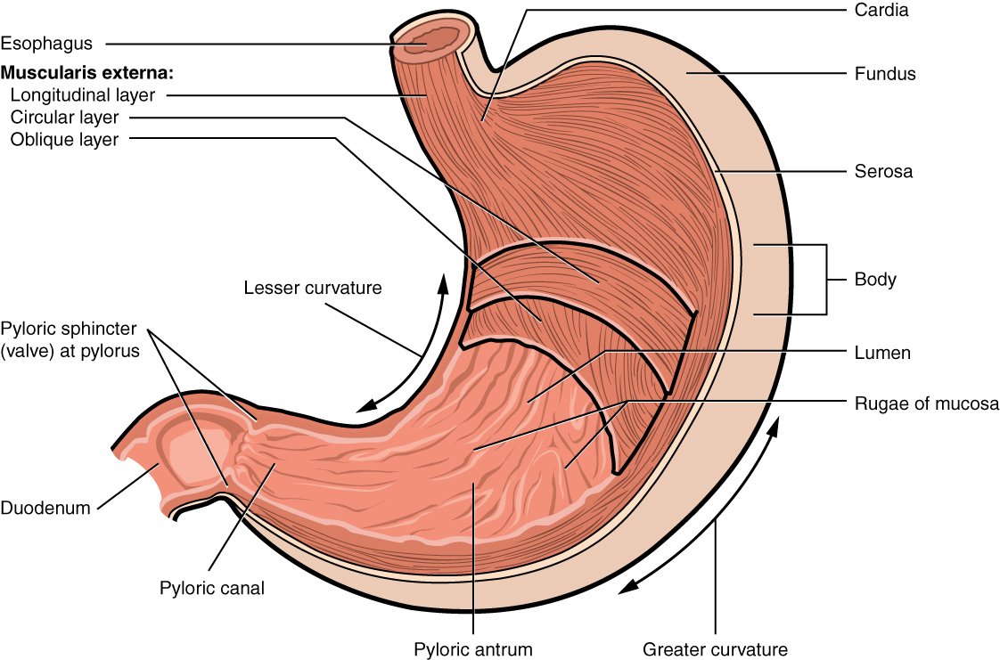
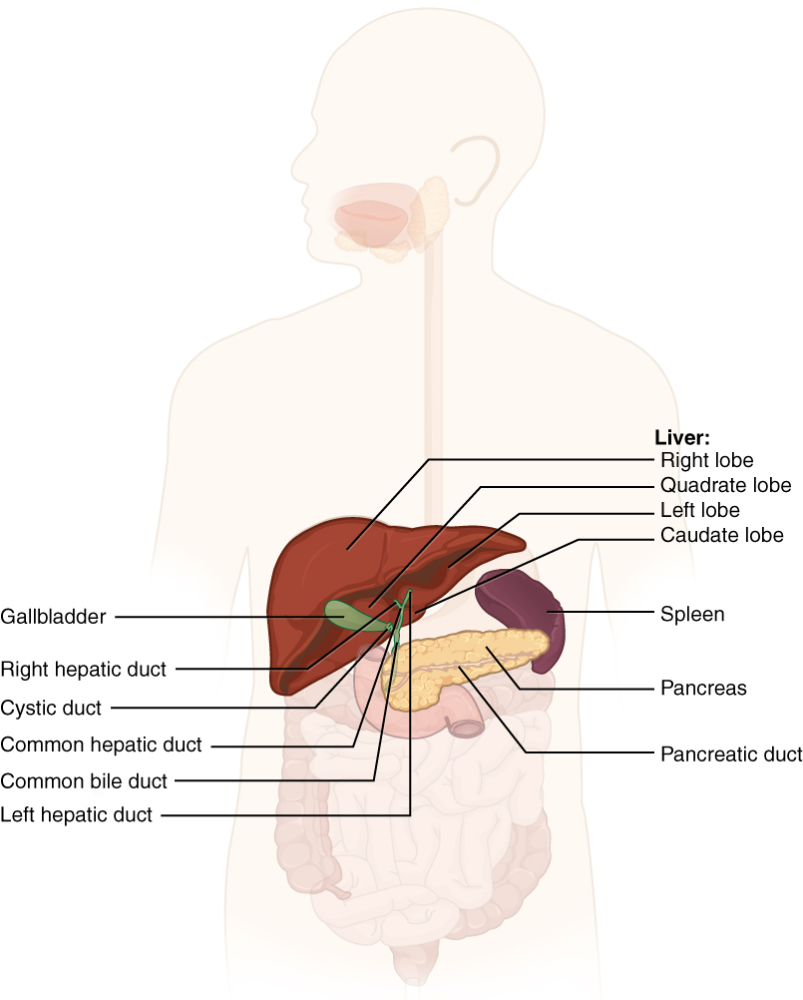

# 第16章 消化管与肝胰：食物在体内的旅程

## 一条贯通的管道，多种不同的工作段

从口腔到肛门，消化管是一条连续通路，却不是材质和任务都相同的软管。口腔以牙齿、舌和唾液参与食物处理；吞咽把食团送过咽进入食管；食管的肌层推动内容物向胃移动。胃负责暂存、搅拌和部分消化，小肠承担大部分消化与营养吸收，大肠继续回收水和电解质，并参与粪便形成。肝、胆囊和胰腺虽不让食物直接穿行，却通过分泌物接入这条路线。〔[消化系统总览，OpenStax §23.1](https://openstax.org/books/anatomy-and-physiology-2e/pages/23-1-overview-of-the-digestive-system)〕

从组织边界看，管腔与体外环境相通。吃进食物不等于其中营养已经进入身体内部环境：营养物必须越过消化道上皮等屏障，进入血液或淋巴，才参与后续运输。这个界面解释了消化与吸收为什么是两个相关却不同的过程。消化把食物处理为适合吸收的成分，吸收则让成分跨过管壁。

消化管的基本壁层常可概括为黏膜、黏膜下层、肌层和最外层的浆膜或外膜。黏膜面对管腔，适应保护、分泌或吸收；黏膜下层容纳血管、神经等结构；肌层推动与混合内容物。不同段在这套基础上作出改变，所以“都有四层”不能替代对各段特殊结构的观察。

## 胃的扩张与搅拌怎样实现

胃位于膈下、主要在左上腹。食管连接处称贲门，向左上方隆起的是胃底，中间较大的部分是胃体，通向十二指肠的出口区为幽门部。胃大弯与小弯描述两侧不同弯曲的边缘；它们在图上有助于定向，也与网膜连接有关。胃的姿态和大小随充盈及体型变化，不是一只永远保持同样外形的袋。〔[胃的大体与组织结构，OpenStax §23.4](https://openstax.org/books/anatomy-and-physiology-2e/pages/23-4-the-stomach)〕

胃内表面可见皱襞，胃扩张时这些褶皱能够展开。胃壁肌层除常见的环行、纵行方向外，还包含斜行肌束，帮助搅拌内容物。幽门括约肌参与控制胃向十二指肠排空，使下游处理能力与上游输送相协调。

胃黏膜中，胃小凹通向胃腺。不同腺细胞分泌黏液、酸、消化相关物质与调节信号。胃酸有助于形成特定化学环境，但胃并不靠“把一切都腐蚀掉”完成消化；黏液等防护机制、上皮连接和血供共同保护胃壁。胃主要开始蛋白质的消化，绝大多数营养物并不在这里完成吸收。

### 图 16-01｜胃的入口、出口和壁层

**读图：** 从食管入口到十二指肠出口，观察弯曲的胃形和肌层。胃襞随充盈改变，图示不是固定折纸结构。

**标注对应：** cardia 贲门；pylorus 幽门；rugae 胃襞。

*来源：[OpenStax《Anatomy and Physiology 2e》原图 23.15](https://openstax.org/books/anatomy-and-physiology-2e/pages/23-4-the-stomach)；OpenStax, Anatomy and Physiology 2e; J. Gordon Betts et al.; Rice University；[CC BY-NC-SA 4.0](https://creativecommons.org/licenses/by-nc-sa/4.0/)。*

## 肝、胆囊与胰腺接入十二指肠

十二指肠绕在胰头周围，形成消化管与附属腺体的重要交汇区。肝制造胆汁，胆囊储存并浓缩胆汁，再通过胆道向十二指肠排放。胆汁中的胆盐有助于脂类乳化和后续吸收；胆汁不是负责把脂肪化学分解为小分子的消化酶。胰腺外分泌部分产生含多种消化酶和碳酸氢盐的胰液，经胰管进入十二指肠，参与消化并帮助中和来自胃的酸性内容物。〔[肝、胆囊与胰腺，OpenStax §23.6](https://openstax.org/books/anatomy-and-physiology-2e/pages/23-6-accessory-organs-in-digestion-the-liver-pancreas-and-gallbladder)〕

胰腺同时有内分泌部分，胰岛把胰岛素等激素释放到血液。读胰腺图时，需要分别寻找通向肠腔的导管和通向循环的毛细血管。一个器官具有两种分泌出口，并不意味着激素也通过胰管进入食物。

肝脏还接收来自消化道等区域的门静脉血。许多吸收后的水溶性营养物先随这条血流到肝，再参与全身分配与代谢；肝动脉则带来另一部分供血。血液经肝内血窦后汇入肝静脉，回到下腔静脉。胆汁另走胆道进入肠道。肝图中“血管汇入”和“胆汁流出”的两条路线应分开追踪，不能把胆管当作门静脉的延长线。

| 容易混淆的结构 | 主要功能与出口 |
| --- | --- |
| 肝 | 生成胆汁，并参与营养处理等多种代谢任务 |
| 胆囊 | 储存、浓缩胆汁；不负责制造胆汁 |
| 胰腺外分泌部分 | 经胰管把消化液送入十二指肠 |
| 胰腺内分泌部分 | 将激素释放至血液 |

### 图 16-02｜肝胆胰与十二指肠的联系

**读图：** 从肝胆和胰分别追踪导管到肠腔，区分胆汁与消化酶的来源。胆囊储存浓缩胆汁，胆汁由肝产生。

**标注对应：** bile duct 胆管；pancreatic duct 胰管；duodenum 十二指肠。

*来源：[OpenStax《Anatomy and Physiology 2e》原图 23.24](https://openstax.org/books/anatomy-and-physiology-2e/pages/23-6-accessory-organs-in-digestion-the-liver-pancreas-and-gallbladder)；OpenStax, Anatomy and Physiology 2e; J. Gordon Betts et al.; Rice University；[CC BY-NC-SA 4.0](https://creativecommons.org/licenses/by-nc-sa/4.0/)。*

## 肠壁为什么要反复增加表面积

小肠分十二指肠、空肠和回肠。其内表面可见不同尺度的结构：环形皱襞涉及黏膜及黏膜下层；绒毛是黏膜向腔内的指状突起；微绒毛位于吸收上皮细胞的顶端，需在更高放大尺度下观察。三者都帮助增加接触与吸收面积，却不是同一突起换了三个名字。绒毛内的毛细血管和乳糜管把吸收后的不同成分接入血液与淋巴运输。〔[小肠与大肠结构，OpenStax §23.5](https://openstax.org/books/anatomy-and-physiology-2e/pages/23-5-the-small-and-large-intestines)〕

回肠末端接盲肠，之后依次为升结肠、横结肠、降结肠、乙状结肠、直肠和肛管。大肠在典型图中较粗，可见结肠袋和沿外面走行的结肠带；与小肠相比，大肠黏膜没有相同的绒毛结构。它仍有吸收和分泌任务，黏液帮助内容物通过，肠道微生物也参与某些成分的代谢。

从胃到肠，还能看到保护与吸收之间的结构变化。食管需要承受食团经过造成的摩擦，其上皮与小肠专门参与吸收的上皮不同；小肠绒毛增大接触面积，大肠则通过另一套黏膜结构完成水与电解质等处理。组织图里的皱襞、腺体和细胞形状，因而不是装饰细节，它们在回答同一个问题：这段管壁必须面对怎样的内容物，并把什么物质送到哪一侧。

阑尾从盲肠附近伸出，常见图画成一小段细管，它并不是小肠通往大肠必须经过的主路。回肠内容物通过回盲部进入盲肠，再向结肠推进；阑尾是相关区域的旁支结构，壁内含丰富淋巴组织。将阑尾画得明显，有助于定位，却容易造成“食物必须先穿过阑尾”的错觉。连续路线上的主通道与侧方附属结构需要分开认读。〔[盲肠、阑尾与结肠，OpenStax §23.5](https://openstax.org/books/anatomy-and-physiology-2e/pages/23-5-the-small-and-large-intestines)〕

蠕动使内容物沿管道推进，分节等局部活动则促进混合与接触。它们由平滑肌、肠神经系统和其他调节机制共同参与，不是食物仅凭重力一路落下。把一顿饭放回解剖图中，应同时追踪三条路线：食物沿管腔前进，营养跨过上皮进入运输系统，消化液从腺体接入管腔。三条路线相交，却各自保持边界，消化系统的空间组织也因此清楚起来。
