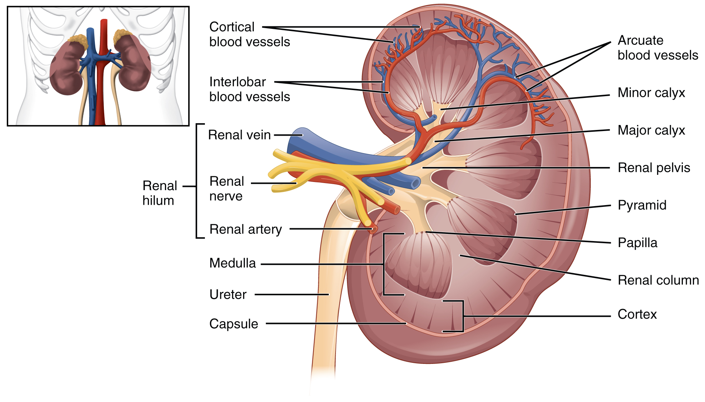
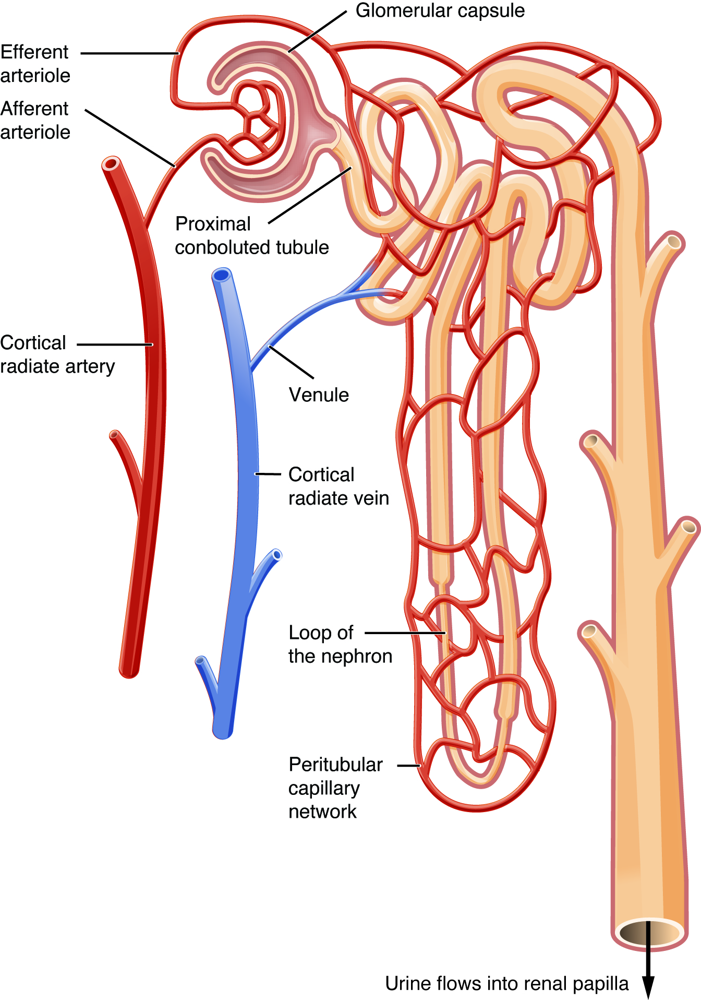

# 第17章 肾与泌尿道：过滤、回收和排出

## 腰后方的肾，不在肠袢之间漂浮

两肾位于脊柱两侧、腹膜后方，邻近后腹壁；右肾通常因肝脏的空间关系比左肾略低。它们不是放在骨盆里的器官，也不是浮在肠袢之间。肾周围有纤维囊、脂肪和筋膜等结构，后上方还受到肋骨及肌肉的部分保护。肾上腺位于肾的上方附近，虽名字相近，却是内分泌器官，不是制造尿液的肾组织。〔[肾的位置与外部结构，OpenStax §25.3](https://openstax.org/books/anatomy-and-physiology-2e/pages/25-3-gross-anatomy-of-the-kidney)〕

在肾的内侧缘，可以找到凹入的肾门，血管、神经、淋巴管和尿液引流通道从附近出入。肾动脉由腹主动脉发出，肾静脉回到下腔静脉；输尿管则向下通往膀胱。这三类管道在示意图里常相邻，却分别运输血液和尿液，不能串成“血从动脉进入后直接变成输尿管中的尿”。

沿额状切面向内看，外围是肾皮质，内部是包含肾锥体的肾髓质；皮质组织还以肾柱伸入锥体之间。锥体尖端称肾乳头，尿液从这里进入肾小盏，再汇入肾大盏、肾盂，最后进入输尿管。肾盂是一处汇集与引流区域，不是血液过滤的主要位置。

### 图 17-01｜肾脏剖面与尿液汇集

**读图：** 从外层皮质进入髓质，再沿肾乳头、肾盏、肾盂到输尿管；这不是血液流动路线。

**标注对应：** cortex 皮质；medulla 髓质；renal pelvis 肾盂。

*来源：[OpenStax《Anatomy and Physiology 2e》原图 25.8](https://openstax.org/books/anatomy-and-physiology-2e/pages/25-3-gross-anatomy-of-the-kidney)；OpenStax, Anatomy and Physiology 2e; J. Gordon Betts et al.; Rice University；[CC BY-NC-SA 4.0](https://creativecommons.org/licenses/by-nc-sa/4.0/)。*

## 两条相邻的路线：血流与小管液

肾单位是理解肾功能的基本单位，包含肾小体和肾小管。肾小体由肾小球与包围它的肾小囊构成；肾小球是一团毛细血管，滤液跨过过滤屏障后进入肾小囊腔，再流向近端小管、肾单位袢和远端小管，随后进入集合管系统。集合管汇集多个肾单位的输出，继续调整液体组成，最终把尿液送向肾乳头。〔[肾单位与过滤屏障，OpenStax §25.4](https://openstax.org/books/anatomy-and-physiology-2e/pages/25-4-microscopic-anatomy-of-the-kidney)〕

血液的路线则不同：入球小动脉进入肾小球，出球小动脉离开肾小球，再形成小管周围毛细血管或相关的直小血管，之后才逐步汇入静脉。这种安排使肾小管旁边仍有血管，便于物质在小管液与血液之间继续转运。肾小球后面接的首先是出球小动脉，并非立即变成一条大静脉。

滤过屏障由有窗孔的毛细血管内皮、基底膜和足细胞相关结构共同组成。足细胞的足突之间形成受调控的裂隙；它不是一层随意漏水的渔网。正常情况下，血细胞和多数大分子蛋白质受到保留，水及许多小分子能够进入滤液。滤液因此也含有身体仍需利用的物质，例如葡萄糖和电解质，不能被称为已经完成的“废水”。

### 图 17-02｜肾单位与周围血管

**读图：** 分别沿血流和小管液走向读图，观察过滤与后续回收发生在不同位置。集合管由多个肾单位汇入。

**标注对应：** glomerulus 肾小球；proximal tubule 近端小管；collecting duct 集合管。

*来源：[OpenStax《Anatomy and Physiology 2e》原图 25.10](https://openstax.org/books/anatomy-and-physiology-2e/pages/25-3-gross-anatomy-of-the-kidney)；OpenStax, Anatomy and Physiology 2e; J. Gordon Betts et al.; Rice University；[CC BY-NC-SA 4.0](https://creativecommons.org/licenses/by-nc-sa/4.0/)。*

## 滤液怎样变成尿液

肾对物质的处理可分为三个互相关联的方向。滤过使一部分血浆成分进入肾小囊；重吸收把小管液中的水和溶质送回血液；分泌则把某些物质从血液等一侧转入小管液。最终排出的数量由这些过程共同决定。只画一张“滤网图”，无法解释身体为什么不会把大量水和营养物直接丢掉。〔[尿形成的基本过程，OpenStax §25.5](https://openstax.org/books/anatomy-and-physiology-2e/pages/25-5-physiology-of-urine-formation)〕

| 过程 | 主要方向 | 对理解结构的提示 |
| --- | --- | --- |
| 滤过 | 肾小球血液→肾小囊腔 | 看肾小体与滤过屏障 |
| 重吸收 | 小管液→组织间隙与血液 | 看小管上皮和旁边毛细血管 |
| 分泌 | 血液等一侧→小管液 | 同样需要跨越细胞或细胞间通路 |
| 排泄 | 尿液离开身体 | 是前述处理后的最终结果 |

近端小管承担大量回收工作，肾单位袢参与形成与利用髓质内的渗透环境，远端小管和集合管等区域继续受激素等机制调节。抗利尿激素可改变集合管等部位的水通透性，使身体在不同条件下调节水的回收。肾由此参与水、电解质和酸碱平衡，工作并不限于排出某种“毒素”。〔[肾小管重吸收，OpenStax §25.6](https://openstax.org/books/anatomy-and-physiology-2e/pages/25-6-tubular-reabsorption)〕

在放大的肾单位图上，皮质与髓质的边界仍有意义：肾小体主要位于皮质，长短不同的肾单位袢向髓质深入程度不同，集合管则朝乳头方向汇行。这些位置关系把微观工作重新放回肾的整体切面。

## 从肾盂到体外：输尿管、膀胱和尿道

输尿管是一对有肌层的管道，沿腹后壁向下进入盆腔，将尿液送入膀胱。尿的移动受到管壁蠕动帮助，不只是靠人直立时的重力。输尿管斜穿膀胱壁，膀胱充盈时这种关系有助于限制尿液反流。两条输尿管与下方尿道内口之间形成的区域称膀胱三角，是读膀胱内面图时常见的定位标志。〔[尿液运输通道，OpenStax §25.2](https://openstax.org/books/anatomy-and-physiology-2e/pages/25-2-gross-anatomy-of-urine-transport)〕

膀胱位于耻骨联合后方，空虚时主要在盆腔内，充盈时可向上扩展。其黏膜和肌壁适应容量变化，逼尿肌的活动与尿道括约肌及神经调节配合，完成储尿和排尿。输尿管把尿送入膀胱，尿道把尿从膀胱送出，这两个名称只差一字，任务和位置却不同。

典型成人男性尿道较长，经过前列腺及阴茎等区域，兼作生殖道分泌物的排出通道；典型成人女性尿道较短，开口与阴道口分开。它们的长度、经过结构和相邻器官不同，因此不能把一张盆腔图仅更换外形后当成另一种解剖。

肾的外形与微观结构之间还有一条容易漏掉的对应：肾锥体的条纹外观与大量相对平行走行的小管、集合管及血管有关，皮质中的许多小体和弯曲小管则呈现另一种纹理。肉眼切面上可见的区域，并非一种细胞单独堆出的色块，而是许多工作单位以特定方向排列后的整体效果。

尿量与滤过量也不是同一个数字。大量滤液中的水会被重吸收，所以最终尿液明显少于起初滤出的液体；尿液颜色和浓度又随水分回收等条件改变。不能从一次排尿量直接倒推某一分钟的肾滤过情况。类似地，“排尿”是膀胱与出口通道协同发生的事件，“产尿”则主要描述肾脏对滤液持续加工的过程，两者在地点和时间上都应分开理解。膀胱储存尿液，不负责把血液过滤成尿；肾产生尿液，却不承担膀胱式的暂存任务。

重读全章图时，可用两个颜色的笔在纸上分别追踪：一条沿肾动脉、肾小球、周围血管回到静脉；另一条沿肾小囊腔、小管、集合管、肾盂、输尿管、膀胱和尿道到体外。两条路线通过屏障和转运发生物质交换，却从来不是一根连通的空管。
