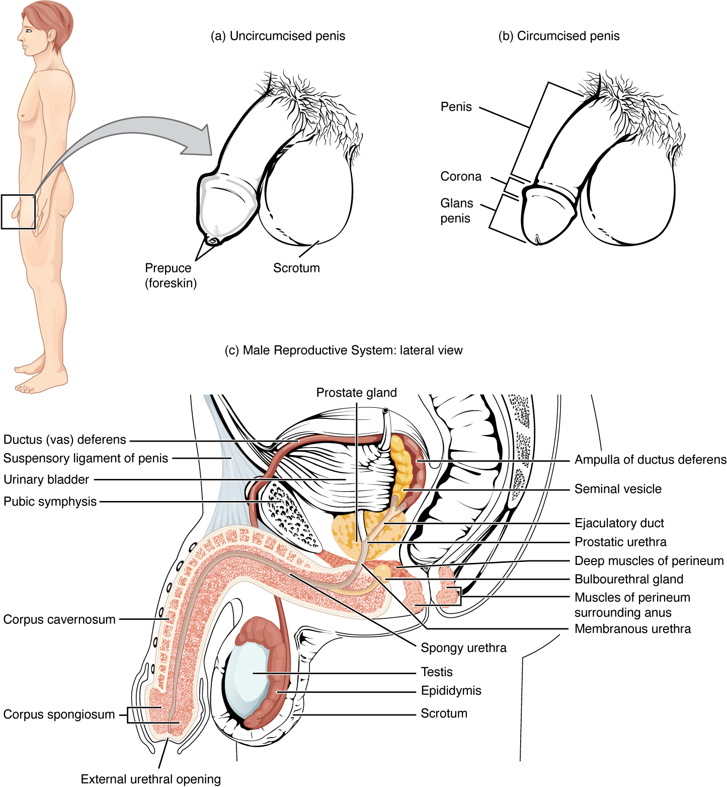
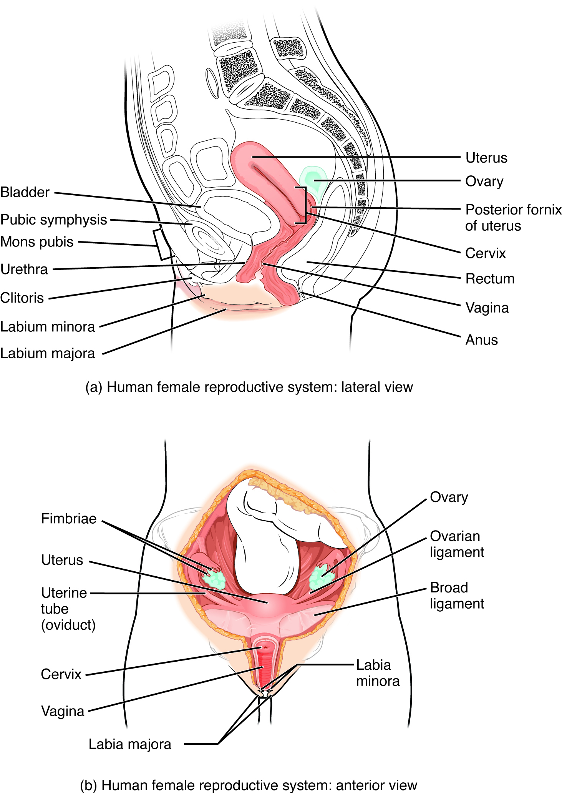

# 第18章 盆腔与生殖：同一空间的不同安排

## 盆底之上，几套管道相邻而行

骨盆由髋骨、骶骨等构成环形支架，小骨盆内安排着膀胱、直肠及生殖相关器官。它的底部不是简单的一块封板：盆底肌与筋膜提供支持，同时必须为尿道、消化道末端及相应生殖通道留下出口。会阴是盆腔下方相关的解剖区域，不能与整个骨盆或外生殖器画等号。〔[盆底与会阴肌，OpenStax §11.4](https://openstax.org/books/anatomy-and-physiology-2e/pages/11-4-axial-muscles-of-the-abdominal-wall-and-thorax)〕

本章以成人两类常见生殖解剖配置为主，使用男性、女性作为相应结构组合的简称。个体的生殖器官、激素与发育特征存在差异，也可能受到手术等因素影响，不能仅凭某个外观推定一个人的全部内部结构。解剖描述说明组织的位置与连接，不替代对个体身份的理解。

读盆腔正中矢状图，先把前方的耻骨、后方的骶骨和直肠找出，再识别膀胱及生殖器官。男性典型图中，膀胱位于前方，直肠在后，前列腺位于膀胱下方、直肠前方。女性典型图中，膀胱与尿道较靠前，子宫和阴道位于其后、直肠之前。图上这些关系比器官被涂成什么颜色更重要。〔[睾丸生殖系统，OpenStax §27.1](https://openstax.org/books/anatomy-and-physiology-2e/pages/27-1-anatomy-and-physiology-of-the-testicular-reproductive-system)；[卵巢生殖系统，§27.2](https://openstax.org/books/anatomy-and-physiology-2e/pages/27-2-anatomy-and-physiology-of-the-ovarian-reproductive-system)〕

## 睾丸、输精管与附属腺体

睾丸位于阴囊内，外面有被膜，内部小叶中排列曲细精管。精子发生在曲细精管内进行，支持细胞参与形成适宜环境，管间的间质细胞产生睾酮等激素。睾丸兼有生殖细胞产生与内分泌任务，这两类产物的去向不同：精子进入生殖管道，激素进入血液。

精子离开睾丸后进入附睾，在这里进一步成熟，并可暂时储存。之后经过输精管向盆腔延伸，输精管与精囊的导管汇合形成射精管，开口于前列腺部尿道。精囊、前列腺及尿道球腺等贡献不同分泌物，形成精液的重要组成。精囊主要提供分泌液，名称虽有“囊”，却不是储存精子的主要仓库；精液也不等同于全部由精子组成的液体。〔[睾丸、附睾与输送管道，OpenStax §27.1](https://openstax.org/books/anatomy-and-physiology-2e/pages/27-1-anatomy-and-physiology-of-the-testicular-reproductive-system)〕

阴囊把睾丸置于体表外侧的相应环境，局部肌肉活动等参与温度调节。输精管及相关血管、神经等构成精索的部分内容，经腹股沟区域通行。这里连接了体表、腹壁和盆腔，说明生殖系统并不全在骨盆腔内。

阴茎内有成对的阴茎海绵体及包绕尿道的尿道海绵体。它们是具有特殊血管空间的勃起组织，尿道海绵体远端形成龟头。读横断面时，可先找尿道这个管腔，再判断围绕它的组织，而不要把整根阴茎当成一条中空软管。

### 图 18-01｜一类常见盆腔矢状解剖

**读图：** 从前向后找膀胱、尿道周围的前列腺与后方直肠；部分生殖结构位于盆腔外。

**标注对应：** bladder 膀胱；prostate 前列腺；rectum 直肠。

*来源：[OpenStax《Anatomy and Physiology 2e》原图 27.2](https://openstax.org/books/anatomy-and-physiology-2e/pages/27-1-anatomy-and-physiology-of-the-testicular-reproductive-system)；OpenStax, Anatomy and Physiology 2e; J. Gordon Betts et al.; Rice University；[CC BY-NC-SA 4.0](https://creativecommons.org/licenses/by-nc-sa/4.0/)。*

## 卵巢、输卵管与子宫并非一根密闭直管

卵巢位于子宫两侧附近，内部卵泡包含卵母细胞及周围支持细胞。卵泡发育、排卵和黄体形成涉及周期性变化，同时伴随激素分泌改变。卵巢周期与子宫内膜的月经周期相互协调，但描述的是不同器官内的事件；图中常用的28天是一种教学模型，实际周期长度和排卵时点存在差异。〔[卵巢及其周期，OpenStax §27.2](https://openstax.org/books/anatomy-and-physiology-2e/pages/27-2-anatomy-and-physiology-of-the-ovarian-reproductive-system)〕

输卵管靠近卵巢的一端具有漏斗和伞，帮助接纳排出的卵母细胞；它并没有像水管接头那样与卵巢表面完全密闭相连。输卵管向内通往子宫，受精通常发生于输卵管的壶腹部。读正面图时，卵巢常被画在管口下方，留有间隙，这处间隙不是漏画了一段管子。

子宫是具有较厚平滑肌壁的器官，上部包括子宫底和子宫体，下部为子宫颈，宫颈管连通子宫腔与阴道。内膜是面向子宫腔的黏膜，肌层提供主要肌性结构；月经脱落涉及内膜的功能层，并不是整个子宫壁剥落。子宫的位置和倾斜角度存在变异，也会随膀胱充盈、妊娠和其他状态改变，不能把某一张矢状图的角度当作人人一致的固定坐标。

阴道连接子宫颈周围区域与体外，是可扩张的肌性管道。典型女性解剖中，尿液经尿道排出，阴道承担另一套通路，两者在外面分别开口。直肠及肛管位于更后方。三套路线相邻而行，但不应在图上被接成同一个出口。〔[子宫、阴道与外生殖器，OpenStax §27.2](https://openstax.org/books/anatomy-and-physiology-2e/pages/27-2-anatomy-and-physiology-of-the-ovarian-reproductive-system)〕

### 图 18-02｜另一类常见盆腔矢状解剖

**读图：** 先辨前方膀胱、中间生殖道、后方直肠。阴道和尿道为不同通道，不能把外阴等同阴道。

**标注对应：** uterus 子宫；vagina 阴道；urethra 尿道。

*来源：[OpenStax《Anatomy and Physiology 2e》原图 27.9](https://openstax.org/books/anatomy-and-physiology-2e/pages/27-2-anatomy-and-physiology-of-the-ovarian-reproductive-system)；OpenStax, Anatomy and Physiology 2e; J. Gordon Betts et al.; Rice University；[CC BY-NC-SA 4.0](https://creativecommons.org/licenses/by-nc-sa/4.0/)。*

## 外观、切面与功能要分别阅读

女性外生殖器合称外阴，包括阴阜、大阴唇、小阴唇、阴蒂及前庭等。阴唇的大小、形态和色泽存在广泛的正常个体差异，不适合把某个教材外形当作唯一标准。阴蒂也不只包含体表可见的阴蒂头，其勃起组织向深部延伸；仅凭正面外观无法看清全貌。

阴道口周围的处女膜组织形态有差异，它不是一张完整密封的膜，外观不能可靠证明一个人的性经历。这里应把可观察的组织与社会推断分开。与本章其他部位一样，解剖学讨论形态和连接，不根据单个结构给人贴标签。〔[外阴与处女膜，OpenStax §27.2](https://openstax.org/books/anatomy-and-physiology-2e/pages/27-2-anatomy-and-physiology-of-the-ovarian-reproductive-system)〕

乳腺位于胸前的皮肤及皮下相关区域，是与生殖生理相连、但不在盆腔内的腺体。其腺叶和导管通向乳头，乳房的体积与轮廓还受到脂肪和结缔组织影响，不能把外观大小直接等同于腺体工作能力。〔[乳腺，OpenStax §27.2](https://openstax.org/books/anatomy-and-physiology-2e/pages/27-2-anatomy-and-physiology-of-the-ovarian-reproductive-system)〕

| 图的类型 | 优先回答的问题 | 常见的展示性处理 |
| --- | --- | --- |
| 正中矢状图 | 前后邻接与管道出口 | 侧方器官可能被省略或移入视野 |
| 正面图 | 左右成对结构和管道连续性 | 卵巢、输卵管可能展开以便认读 |
| 外观图 | 体表结构与开口位置 | 不能显示全部深部勃起组织或腺体 |

同一器官还需要切换尺度理解。睾丸外观图说明它位于哪里，曲细精管图解释精子在哪类结构中形成；卵巢整体图说明与输卵管、子宫的邻接，卵泡图则说明卵母细胞与支持细胞的关系。把放大图重新接回整体图时，应问清它对应哪个位置，而不要把放大后的卵泡或管道直径当作真实器官比例。

把盆腔图与上一章泌尿图并排，沿尿路、消化道和生殖道分别追踪，再确认彼此在哪些位置邻近、在哪些位置保持分离。这样既能理解同一空间中的不同安排，也能避免把一种配置简单翻转或删改成另一种。
