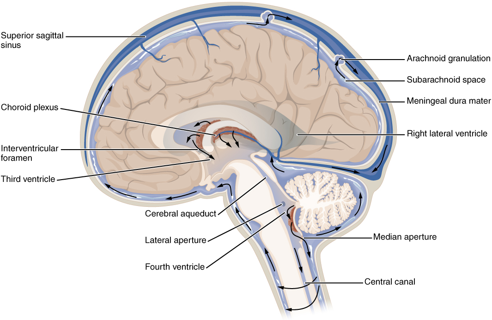
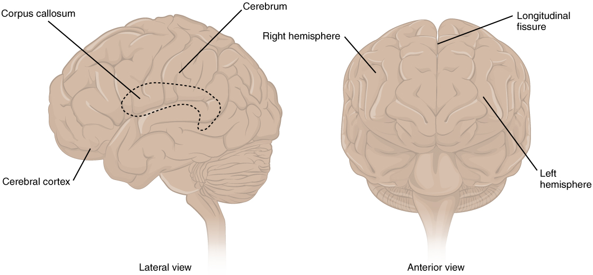
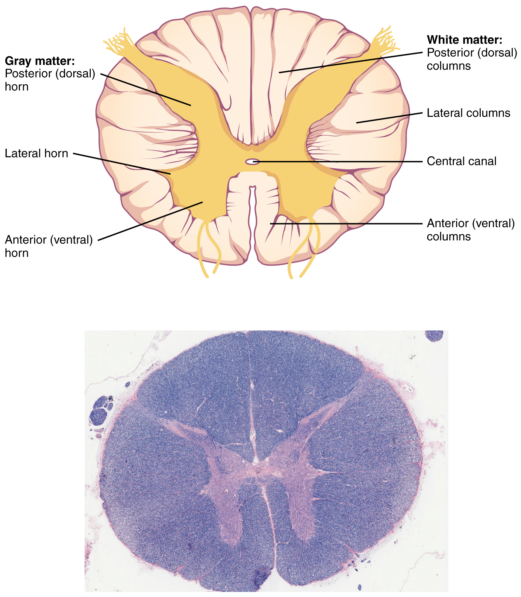

# 第19章 脑与脊髓：骨性保护中的中枢

从皮肤、肌肉和骨向内观察头部，最终到达的不是一块紧贴颅骨的“脑肉”。颅骨内侧还有被膜、血管和含液体的空间；脑本身又有不同的组织区和内部腔隙。沿脊柱向下，也不能把整条椎管都画成同样粗细的一根脊髓。认识中枢神经系统，需要把保护层、神经组织和通行路线分别看清。

## 从颅骨到脑表面，还隔着什么

包围脑与脊髓的三层被膜统称脑脊膜，由外向内是硬膜、蛛网膜、软膜。硬膜较坚韧；蛛网膜跨过脑表面的部分沟隙；软膜则紧贴神经组织表面，随沟回起伏。蛛网膜与软膜之间的蛛网膜下隙含脑脊液和血管，不能把这三层画成三张完全相贴、没有间隔的纸。[来源：OpenStax，13.3 中枢神经系统的循环与被膜](https://openstax.org/books/anatomy-and-physiology-2e/pages/13-3-circulation-and-the-central-nervous-system)

脑膜在颅内和椎管内的关系也有区别。颅内硬膜包含骨膜层与脑膜层，两层在特定位置分开形成硬脑膜静脉窦；椎管内硬膜与椎管壁之间有含脂肪和静脉丛的硬膜外隙。因此，不能把“硬膜外隙”理解成全身中枢周围都同样宽的一圈空腔。教材中为了显示被膜，常将间距夸大，读图时应区分真实存在的空间与为展示而拉开的层次。

脑脊液主要由脑室内的脉络丛产生，经过相连的脑室通道进入蛛网膜下隙，再经包括蛛网膜颗粒在内的途径回流。它参与缓冲与物质环境的维持，但脑的供氧和主要营养运输仍依靠血液。脑脊液循环图与脑动脉图讲的是两套不同通路。

### 图 19-01｜脑脊液的循环路径

**读图：** 从脑室向蛛网膜下腔追踪箭头，区分脑脊液通路和脑血管通路。

**标注对应：** ventricle 脑室；subarachnoid space 蛛网膜下腔。

*来源：[OpenStax《Anatomy and Physiology 2e》原图 13.18](https://openstax.org/books/anatomy-and-physiology-2e/pages/13-3-circulation-and-the-central-nervous-system)；OpenStax, Anatomy and Physiology 2e; J. Gordon Betts et al.; Rice University；[CC BY-NC-SA 4.0](https://creativecommons.org/licenses/by-nc-sa/4.0/)。*

## 大脑、间脑、脑干与小脑的位置

从侧面看，最显眼的是覆盖大片区域的大脑半球；表面的隆起叫脑回，凹下的部分叫脑沟。大脑纵裂分隔左右半球，深部的胼胝体则含大量连接两侧的神经纤维。额叶、顶叶、颞叶和枕叶是常用的定位区域，名称与附近颅骨对应，但每一叶都不是只能做一件事的独立零件。[来源：OpenStax，13.2 中枢神经系统](https://openstax.org/books/anatomy-and-physiology-2e/pages/13-2-the-central-nervous-system)

大脑深部的间脑包括丘脑与下丘脑等结构。丘脑参与许多感觉和运动相关信息的中继与处理；下丘脑与体温、水分平衡、自主神经及内分泌调节联系密切。它们被大脑半球遮住，因此只看完整脑的外侧图，难以认识其位置，需要矢状切面或冠状切面。

脑干由中脑、脑桥和延髓组成，位于大脑与脊髓之间，包含多条上下行通路和许多脑神经相关核团。小脑在脑干后方、大脑后下方，参与运动协调、姿势和平衡等功能。小脑并不是直接替肌肉发出所有随意运动指令，而是与大脑、脑干及感觉反馈共同调整动作。

看一张正中矢状面图，可以先找胼胝体，再向下找丘脑和下丘脑；沿脑干向下追到脊髓，向后辨认小脑。这个顺序比先背所有名称更容易建立三维关系。

### 图 19-02｜大脑的外部结构

**读图：** 比较半球外表的沟与回。外表分区是定位线索，功能依赖多区域连接。

**标注对应：** cerebrum 大脑；gyrus 脑回；sulcus 脑沟。

*来源：[OpenStax《Anatomy and Physiology 2e》原图 13.6](https://openstax.org/books/anatomy-and-physiology-2e/pages/13-2-the-central-nervous-system)；OpenStax, Anatomy and Physiology 2e; J. Gordon Betts et al.; Rice University；[CC BY-NC-SA 4.0](https://creativecommons.org/licenses/by-nc-sa/4.0/)。*

## 灰质和白质，不是“外壳与内芯”的固定组合

灰质包含较密集的神经元胞体、树突、突触等成分，白质含大量轴突，其中许多带有髓鞘。大脑和小脑表面有灰质构成的皮质，深处还存在灰质核团；不能据此说“脑的外面全是灰质，里面全是白质”。[来源：OpenStax，13.2](https://openstax.org/books/anatomy-and-physiology-2e/pages/13-2-the-central-nervous-system)

脊髓横切面呈现另一种安排：中央灰质近似蝶形，外周主要为白质。灰质后角参与感觉信息处理，前角含支配骨骼肌的运动神经元；部分节段另有与自主神经相关的灰质区域。外周白质中的纤维组成不同传导束，在脑、脊髓各节段之间传递信息。

| 观察对象 | 容易辨认的位置关系 | 需要避免的误读 |
| --- | --- | --- |
| 大脑 | 表面皮质、深部白质及灰质核团 | 深部并非只有白质 |
| 小脑 | 表面皮质，内部白质分支及深部核团 | 外形小不代表结构简单 |
| 脊髓 | 中央蝶形灰质，周围白质 | 横切面的一条线不等于一根神经 |

### 图 19-03｜脊髓横断面

**读图：** 先找中央蝶形灰质，再看外围白质，随后辨认前后方向；不要直接套用大脑皮层的内外布局。

**标注对应：** gray matter 灰质；white matter 白质；central canal 中央管。

*来源：[OpenStax《Anatomy and Physiology 2e》原图 13.14](https://openstax.org/books/anatomy-and-physiology-2e/pages/13-2-the-central-nervous-system)；OpenStax, Anatomy and Physiology 2e; J. Gordon Betts et al.; Rice University；[CC BY-NC-SA 4.0](https://creativecommons.org/licenses/by-nc-sa/4.0/)。*

*原图显微照片署名：Micrograph provided by the Regents of University of Michigan Medical School © 2012。*

## 血液与神经组织之间也有边界

脑还需要一套与保护被膜交织的供血系统。颈内动脉与椎动脉系统将血液送入颅内，脑底可见由相关动脉连接构成的大脑动脉环。这个环说明部分血管之间存在交通，但交通支的口径、具体形态和供血条件有个体差异，不能理解为任何一条动脉受阻时都能自动保证足够血流。读血管图时应先判断是从脑底向上看，还是从脑外侧看，否则左右与前后很容易混淆。[来源：OpenStax，13.3](https://openstax.org/books/anatomy-and-physiology-2e/pages/13-3-circulation-and-the-central-nervous-system)

血脑屏障也不等于包在整个脑外的一张防水薄膜。它主要涉及脑微血管内皮细胞及周围支持结构所形成的选择性界面，限制许多物质从血液进入神经组织。屏障不会阻止一切交换：神经组织仍须获得氧和营养，并排出代谢产物。由此可见，颅骨、脑膜、脑脊液和血脑屏障分别解决机械保护、空间包围、液体环境和选择性交换等问题，不能只用一个“保护层”概念替代。

另一个常见误解是按左右脑给人贴性格标签。左右半球确有部分功能侧化，但日常语言、空间活动、注意和情绪都依赖多处结构合作；胼胝体等连接也使两侧持续交换信息。解剖分区有助于定位，不能直接推出“理性的人只用左脑”之类的人格分类。[来源：OpenStax，13.2](https://openstax.org/books/anatomy-and-physiology-2e/pages/13-2-the-central-nervous-system)

## 脊髓比椎管短，神经根继续向下走

成人脊髓下端通常位于上腰椎水平附近，常见描述约为第一至第二腰椎水平，但存在个体差异。其下方椎管内仍有向下行走的腰、骶及尾部神经根，合称马尾。图中若只画脊柱而没有标出脊髓终点，很容易误以为脊髓一直延伸到骶骨末端。

脊髓既是传导通路，也参与局部整合。以牵张反射为例，肌肉长度变化的信息可以进入脊髓并影响运动神经元，同时相关信息也会向上到达脑。反射不能简单等同于“完全不受脑影响”，脑的下行活动可以调整脊髓回路的状态。

阅读中枢结构图时，最终应能回答三个不同问题：神经组织在哪里，被哪些组织保护，信息通过什么连接进出。把这三条线分开，再放回同一张空间图，才能理解头部和脊柱内部的安排。
