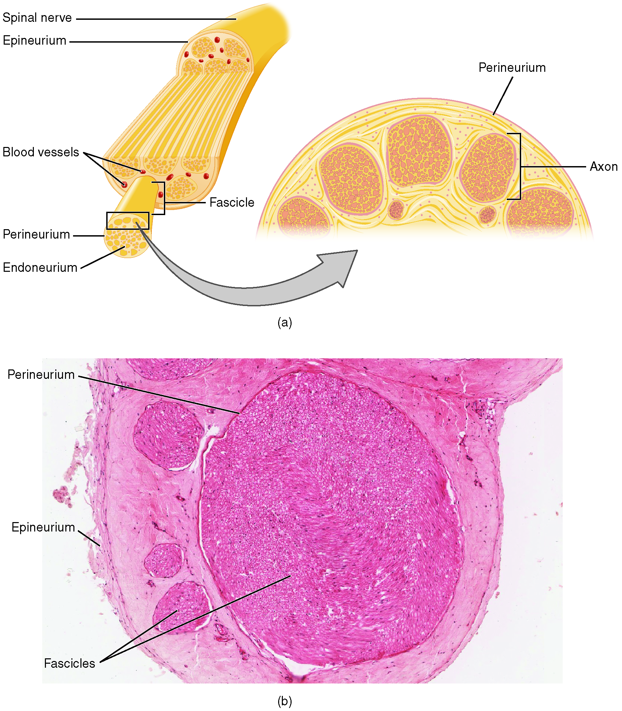
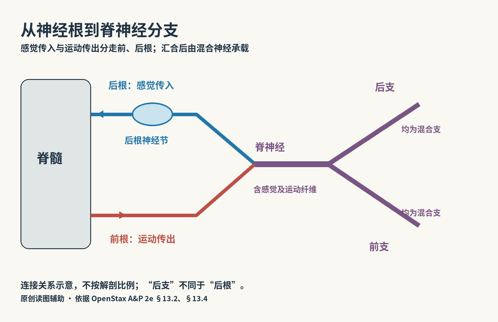
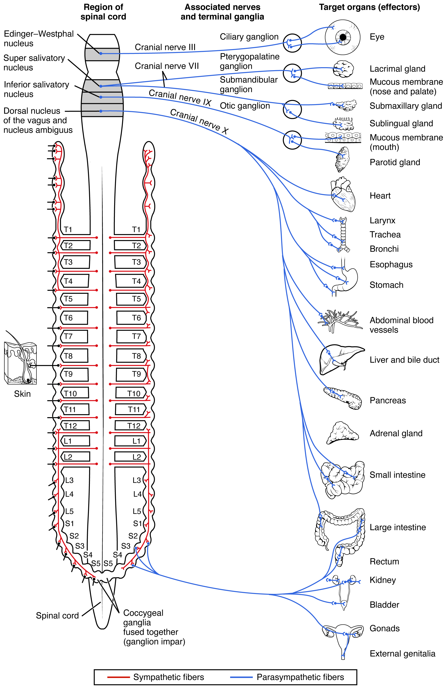

# 第20章 周围神经：感觉、运动与自主调节

从脊髓走向手指，并不存在一根从脑直接接到皮肤的单线。神经纤维先经过神经根、神经丛和不同的周围神经，再进入末梢组织。相反，一块肌肉里的神经也不只负责“让它动”，还会把长度、张力等信息送回中枢。周围神经系统把前面认识的各层组织连接成能够持续交换信息的身体。

## 神经、神经纤维和神经节不是同一尺度

一条周围神经通常由许多轴突及其支持结构组成。轴突可带有施万细胞形成的髓鞘，也可无髓鞘；神经内的结缔组织把纤维分成束，并保护整条神经。肉眼看到的一条神经，尺度远大于单根神经纤维。[来源：OpenStax，13.4 周围神经系统](https://openstax.org/books/anatomy-and-physiology-2e/pages/13-4-the-peripheral-nervous-system)

神经节是周围神经系统中神经元胞体相对集中的结构。感觉神经节与自主神经节的连接方式不同：脊神经后根神经节含感觉神经元胞体，并不是感觉信号必须在此换到另一神经元的“中继站”；自主神经节则通常是节前神经元与节后神经元建立突触联系的位置。仅凭“节”这个名称，无法判断信号是否在这里换接。

在神经横切面里，应先找整条神经的外界，再辨认其中多个神经束，最后才放大看轴突和髓鞘。不能把神经束的圆形截面当成某个独立神经元的胞体。

### 图 20-01｜一条神经中的束与纤维

**读图：** 从整条神经逐级进入神经束、神经纤维，比较它与肌肉成束组织的相似包裹方式；组成和功能并不相同。

**原图样本说明：** 显微部分使用非人灵长类组织样本，供比较通用组织结构；不是人体实测切片。

**标注对应：** epineurium 神经外膜；perineurium 神经束膜；axon 轴突。

*来源：[OpenStax《Anatomy and Physiology 2e》原图 13.21](https://openstax.org/books/anatomy-and-physiology-2e/pages/13-4-the-peripheral-nervous-system)；OpenStax, Anatomy and Physiology 2e; J. Gordon Betts et al.; Rice University；[CC BY-NC-SA 4.0](https://creativecommons.org/licenses/by-nc-sa/4.0/)。*

*原图显微照片署名：Micrograph provided by the Regents of University of Michigan Medical School © 2012。*

## 后根进、前根出，合并后仍会再分支

脊髓后根主要把感觉信息送入中枢，前根将运动相关纤维送出。两者汇合形成短段的脊神经，因此脊神经通常同时含感觉和运动纤维；之后分出的前支、后支也都含这两类纤维。**“后根”与“后支”不能互换名称**，前者按进入脊髓的功能分流，后者按周围行走路线分支。[来源：OpenStax，13.4](https://openstax.org/books/anatomy-and-physiology-2e/pages/13-4-the-peripheral-nervous-system)

人体通常有31对脊神经，包括8对颈神经、12对胸神经、5对腰神经、5对骶神经和1对尾神经。颈椎有7块而颈神经有8对，是常见的计数混淆。周围神经的命名并不总与其来源节段一一对应：进入上肢和下肢的许多神经纤维会先在神经丛中重新组合，再随具名神经走向目标。

例如，手部某条周围神经可以含来自几个脊髓节段的纤维；同一个脊髓节段的纤维也可经不同周围神经到达不同部位。因此，按脊髓节段理解的皮肤感觉区域，与按周围神经理解的皮肤分布区域，是两种重叠但不同的地图。入门时先理解分组原则，远比强记彩色图的每条边界更有用。

### 图 20-02｜神经根、脊神经与前后支

**读图：** 先看两条神经根的不同功能，再看汇合后的脊神经如何分成前后支。后根与后支不是同一结构。此图仅表达连接关系。

**标注对应：** 后根 感觉传入；前根 运动传出；前支与后支 均为混合支。

*来源：[本书原创连接示意，依据 OpenStax 13.2、13.4](https://openstax.org/books/anatomy-and-physiology-2e/pages/13-4-the-peripheral-nervous-system)；本书原创连接示意；结构依据 OpenStax Anatomy and Physiology 2e §13.2、§13.4；[CC BY-NC-SA 4.0](https://creativecommons.org/licenses/by-nc-sa/4.0/)。*

## 躯体运动和自主运动，路径各有安排

躯体运动通路的最后一段，由中枢内的运动神经元将轴突送到骨骼肌，在神经肌肉接头处影响肌纤维。自主神经输出则通常经过两个神经元：节前神经元胞体位于中枢，轴突到自主神经节换接，再由节后神经元走向平滑肌、心肌或腺体。[来源：OpenStax，15.1 自主神经系统的分部](https://openstax.org/books/anatomy-and-physiology-2e/pages/15-1-divisions-of-the-autonomic-nervous-system)

交感神经输出主要起源于胸段和上腰段脊髓，副交感神经输出起源于脑干与骶段。交感神经节常位于脊柱两旁的交感干或腹部大血管附近；副交感神经节常位于目标器官附近，甚至器官壁内。这使两者在许多通路中呈现不同的节前、节后纤维长度比例。

| 比较点 | 躯体运动输出 | 自主神经输出 |
| --- | --- | --- |
| 主要目标 | 骨骼肌 | 平滑肌、心肌、腺体等 |
| 从中枢到目标的典型连接 | 一个运动神经元到肌纤维 | 节前与节后神经元接力 |
| 典型换接位置 | 神经肌肉接头 | 先在自主神经节换接，再到效应器 |

“通常”在这里很重要。肾上腺髓质接受交感节前纤维影响，是这一模式的特殊安排。肠壁内还存在复杂的肠神经回路，能组织部分局部活动，并接受自主神经调节，不能把所有内脏活动都理解为脑逐步下达的单一指令。

感觉信息进入脊髓后，还要区分“到达了中枢”与“形成有意识知觉”。有些输入先参与脊髓局部回路，有些继续经上行通路传向脑。相应地，产生动作也不总是从一次有意识决定开始：姿势维持中许多调整无需逐项思考，却仍受到中枢不同层级的共同调节。把感觉箭头画到脊髓便结束，或把每个动作都画成从大脑皮质直接发出，都会漏掉一部分连接。

牵张反射提供了一个可理解的线路例子。肌肉中的肌梭感知长度及其变化，感觉纤维经后根进入脊髓，可影响支配同一肌肉的运动神经元；运动纤维再经前根离开，返回肌肉。与此相邻的回路还会协调其他肌群。因此，一张反射弧图同时出现肌肉、感觉神经元和运动神经元，并不表示同一根纤维负责双向传送所有信号。它是在同一个任务中串联了不同细胞与不同方向的通路。[来源：OpenStax，14.3 运动反应中的牵张反射](https://openstax.org/books/anatomy-and-physiology-2e/pages/14-3-motor-responses)

走到肢体远端，神经往往继续分成更细的分支进入皮肤与肌肉。解剖图中一条粗黄线末端的“消失”，通常只是绘图选择，并不意味着信息在该点停止。对每一条路线都追问目标组织是什么，可以发现一张简图省略了哪些末梢，也能避免把示意边界误当成真实的绝对边界。

## 交感和副交感不只是油门与刹车

两者常对同一器官产生不同作用，但并非所有器官都受同样的双重支配，也并非所有效应都正好相反。心脏节律可以同时受交感和副交感活动调节；多数血管的神经性张力调节则主要依靠交感神经。把一个系统叫“紧张”、另一个叫“放松”，只能帮助初次记忆，不能代替器官层面的解释。[来源：OpenStax，15.1](https://openstax.org/books/anatomy-and-physiology-2e/pages/15-1-divisions-of-the-autonomic-nervous-system)

神经在肌肉间隙、骨孔和结缔组织通道内行走，经常与血管相邻，但两者不是同一种结构。图中颜色用于分类，不代表活体神经本身呈明亮黄色。阅读解剖图时，可以用“从哪来—在哪里换接—到哪里去”追踪一条线路，再用“送回感觉还是送出运动”标明方向；这样就能把神经从一串名称变成有起止、有功能的连接。

### 图 20-03｜副交感通路的两级连接

**读图：** 先找中枢起点，再看近靶器官的神经节。交感与副交感需要比较，不能由一幅图推出所有器官都有双重支配。

**标注对应：** preganglionic 节前；postganglionic 节后；ganglion 神经节。

*来源：[OpenStax《Anatomy and Physiology 2e》原图 15.4](https://openstax.org/books/anatomy-and-physiology-2e/pages/15-1-divisions-of-the-autonomic-nervous-system)；OpenStax, Anatomy and Physiology 2e; J. Gordon Betts et al.; Rice University；[CC BY-NC-SA 4.0](https://creativecommons.org/licenses/by-nc-sa/4.0/)。*

