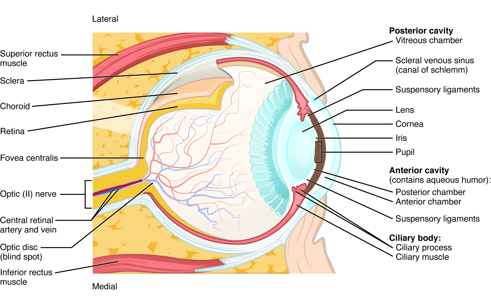
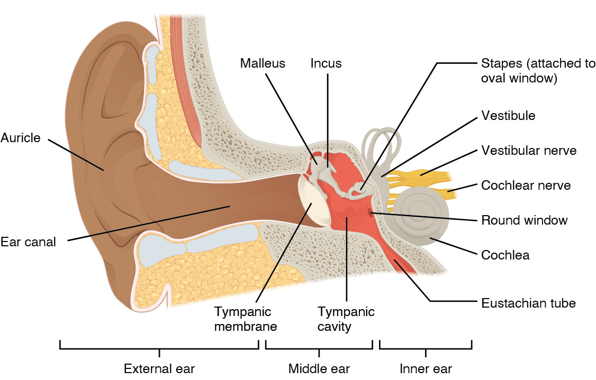
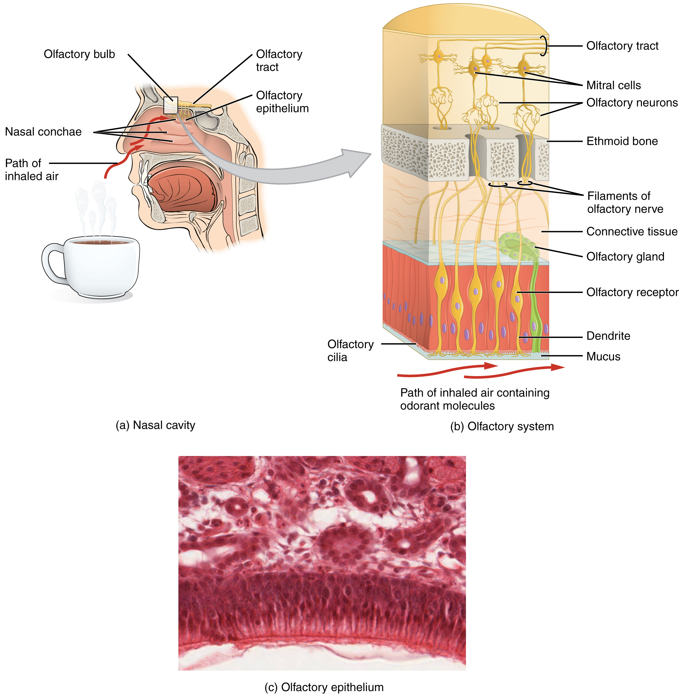

# 第21章 眼耳鼻舌：感觉器官怎样接入神经

眼睛接收光，耳朵接收振动，鼻与舌接触化学物质；这些刺激的物理性质各不相同，进入神经系统时却都需要转变为细胞活动。感觉器官因此同时具有两种结构：外侧是收集、引导或过滤刺激的装置，深处是完成转换的感受结构。看图时沿刺激进入的方向前进，就能理解许多看似繁杂的部件。

## 眼球：光路向后，神经信号再离开

眼球位于眼眶内，周围有肌肉、脂肪等支持组织。眼睑与泪液保护眼表，眼外肌改变注视方向。可见的眼白主要对应巩膜，前方透明的角膜让光进入；虹膜中央的开口是瞳孔，虹膜肌肉改变开口大小。瞳孔本身是孔，不是一块会变色的镜片。[来源：OpenStax，14.1 感觉知觉，视觉部分](https://openstax.org/books/anatomy-and-physiology-2e/pages/14-1-sensory-perception)

光依次经过角膜、房水、瞳孔、晶状体和玻璃体，最终到达眼球后部的视网膜。角膜承担重要的折光作用；晶状体通过形状变化帮助调焦。晶状体前后的空间装着不同介质，不能把眼球内部理解为一个全部灌满同一种液体的空球。

视网膜中的视杆细胞和视锥细胞接收光，经局部神经回路把信息传到神经节细胞；这些细胞的轴突汇集成为视神经。视神经离开眼球的视盘处没有感光细胞，形成生理盲点。黄斑中央的中央凹则与精细视觉有关，两处不是同一位置。

一幅眼球剖面图至少有两条阅读线：一条顺着光的传播到达视网膜，一条沿视网膜神经回路走向视神经。分开画出这两条线，就不会误以为“光直接进入视神经”。

### 图 21-01｜眼球的光路与感光层

#### 中文读图说明

先认前后：图右侧透明角膜是眼球前部，左侧为视神经离开的后部。沿角膜、瞳孔、晶状体、玻璃体腔走向视网膜，理解光的传播；图中黑线是标注引线，并不是光路箭头。原图内外侧字样与上下直肌标签不一致，这里只用角膜和视神经判断前后，不按画面上下推断人体上下或内外。

再看眼球壁，从外向内分辨巩膜、脉络膜和视网膜。中央凹位于视网膜上，视盘则是视神经和血管通过的部位，后者没有感光细胞，不能将两处当成同一点。

最后放大图右前部，虹膜把含房水的眼前部腔隙分成前房与后房；后房仍在晶状体前方附近，不是晶状体后面的玻璃体腔。睫状肌、悬韧带与晶状体联系，眼外直肌则负责转动眼球。

#### 图中英文标注逐项对照

| 图中英文 | 中文名称 | 在图中怎样理解 |
| --- | --- | --- |
| Lateral | 外侧 | 意为外侧；原图与上下直肌方位标注冲突 |
| Medial | 内侧 | 意为内侧；本图不据此推断完整切面方向 |
| Superior rectus muscle | 上直肌 | 图中眼球外上方所画的眼外肌 |
| Inferior rectus muscle | 下直肌 | 图中眼球外下方所画的眼外肌 |
| Sclera | 巩膜 | 形成眼球壁外层大部分的纤维膜 |
| Choroid | 脉络膜 | 位于巩膜与视网膜之间的血管层 |
| Retina | 视网膜 | 眼球壁内层包含感光与神经回路 |
| Fovea centralis | 中央凹 | 视网膜上与精细视觉密切相关的小凹 |
| Optic (II) nerve | 视神经（第二对脑神经） | 将视网膜神经信号传向中枢的通路 |
| Central retinal artery and vein | 视网膜中央动脉与静脉 | 经视神经附近通向视网膜的血管 |
| Optic disc (blind spot) | 视盘（盲点） | 神经纤维汇出且缺少感光细胞的区域 |
| Posterior cavity | 眼后部腔隙 | 晶状体之后主要为玻璃体占据的空间 |
| Vitreous chamber | 玻璃体腔 | 位于晶状体与眼后壁视网膜之间 |
| Scleral venous sinus (canal of Schlemm) | 巩膜静脉窦（施莱姆管） | 位于前房角附近并参与房水引流 |
| Suspensory ligaments | 晶状体悬韧带 | 连接睫状体与晶状体并传递张力 |
| Lens | 晶状体 | 位于虹膜后方并参与眼球调焦 |
| Cornea | 角膜 | 眼球前部透明并有重要折光作用 |
| Iris | 虹膜 | 位于晶状体前方并围成中央瞳孔 |
| Pupil | 瞳孔 | 虹膜中央供光线通过的可变大小开口 |
| Anterior cavity (contains aqueous humor) | 眼前部腔隙（含房水） | 角膜与晶状体之间含前房和后房 |
| Posterior chamber | 后房 | 虹膜后方与晶状体前方之间的窄隙 |
| Anterior chamber | 前房 | 角膜后方与虹膜前方之间的空间 |
| Ciliary body | 睫状体 | 前部血管膜的增厚部分包含睫状肌 |
| Ciliary process | 睫状突 | 睫状体向内的突起并参与房水形成 |
| Ciliary muscle | 睫状肌 | 借悬韧带张力变化影响晶状体形状 |

*来源：[OpenStax《Anatomy and Physiology 2e》原图 14.15](https://openstax.org/books/anatomy-and-physiology-2e/pages/14-1-sensory-perception)；OpenStax, Anatomy and Physiology 2e; J. Gordon Betts et al.; Rice University；[CC BY-NC-SA 4.0](https://creativecommons.org/licenses/by-nc-sa/4.0/)。*

## 耳：把空气中的振动传到内耳液体

耳分外耳、中耳和内耳。外耳包括耳廓与外耳道，声音到达鼓膜后引起振动；中耳的锤骨、砧骨和镫骨把振动传向内耳的卵圆窗。中耳腔通过咽鼓管与鼻咽部相通，这条管道与内外压力平衡有关，不能画成通向脑内的管子。[来源：OpenStax，14.1，听觉部分](https://openstax.org/books/anatomy-and-physiology-2e/pages/14-1-sensory-perception)

内耳耳蜗是弯曲盘绕的结构，内部有液体空间与膜性分隔。振动引起基底膜相应部位运动，带动听觉毛细胞相关结构发生相对位移，把机械变化转换为电活动，再经听觉神经通路传入中枢。耳蜗不同位置对频率的响应存在规律，声音高低的信息并不是靠整条耳蜗“统一振得更快”来表示。

看耳部图应先确认骨性颞骨的包围关系，再找鼓膜和三块听小骨；最后放大耳蜗横切面，寻找基底膜与毛细胞。外耳图讲收集声音，中耳图讲传递振动，耳蜗放大图才讲感觉转换，三个尺度解决的是不同问题。

### 图 21-02｜外耳、中耳与内耳

#### 中文读图说明

沿图下方括号先把耳分成外耳、中耳、内耳，再从左侧耳廓向右沿外耳道找到鼓膜。鼓膜把外耳道与含气的中耳鼓室隔开，不应把整条通道都看成通向内耳的空管。

继续追到与鼓膜相接的锤骨，再到砧骨与镫骨；镫骨底部接在卵圆窗，把振动传向内耳。耳蜗像盘绕的小壳，与上方前庭相邻；耳蜗神经与前庭神经传送的信息不同。

右下斜向下方的咽鼓管连接鼓室与鼻咽部，参与压力平衡，不通入脑内。圆窗位于耳蜗邻近的骨壁，和镫骨所接的卵圆窗是两个不同的膜性窗口，不能混为同一出口。

#### 图中英文标注逐项对照

| 图中英文 | 中文名称 | 在图中怎样理解 |
| --- | --- | --- |
| Auricle | 耳廓 | 外侧可见并帮助收集声音的部分 |
| Ear canal | 外耳道 | 将声音从耳廓附近传向鼓膜的通道 |
| Tympanic membrane | 鼓膜 | 外耳道内端随声音振动的薄膜 |
| Malleus | 锤骨 | 与鼓膜相连的第一块听小骨 |
| Incus | 砧骨 | 位于锤骨与镫骨之间的听小骨 |
| Stapes (attached to oval window) | 镫骨（连接卵圆窗） | 其底部将听小骨振动传向内耳 |
| Tympanic cavity | 鼓室 | 位于鼓膜内侧并容纳听小骨的含气腔 |
| Vestibule | 前庭 | 内耳中连接半规管与耳蜗邻近的区域 |
| Vestibular nerve | 前庭神经 | 传送与头位和运动相关的平衡信息 |
| Cochlear nerve | 耳蜗神经 | 将耳蜗产生的听觉信息传向中枢 |
| Round window | 圆窗 | 耳蜗邻近由膜封闭的另一窗口 |
| Cochlea | 耳蜗 | 内耳中盘绕并完成听觉转换的结构 |
| Eustachian tube | 咽鼓管 | 连接鼓室与鼻咽部以帮助平衡压力 |
| External ear | 外耳 | 图下左侧括号划定耳廓到鼓膜的部分 |
| Middle ear | 中耳 | 图下中部括号包含鼓室与听小骨 |
| Inner ear | 内耳 | 图下右侧括号包含耳蜗与前庭结构 |

*来源：[OpenStax《Anatomy and Physiology 2e》原图 14.5](https://openstax.org/books/anatomy-and-physiology-2e/pages/14-1-sensory-perception)；OpenStax, Anatomy and Physiology 2e; J. Gordon Betts et al.; Rice University；[CC BY-NC-SA 4.0](https://creativecommons.org/licenses/by-nc-sa/4.0/)。*

## 平衡、嗅觉与味觉，各有入口

内耳同时含前庭和平衡相关结构。椭圆囊、球囊的感受结构参与感知重力方向及直线加速度；三个大致处于不同平面的半规管，主要参与感知头部旋转。它们与耳蜗相邻，功能却不同，不能因为都属于内耳就把耳蜗解释为维持平衡的主要部件。平衡还需要视觉和肌肉关节等处的感觉信息共同参与。[来源：OpenStax，14.1，平衡部分](https://openstax.org/books/anatomy-and-physiology-2e/pages/14-1-sensory-perception)

嗅觉感受神经元位于鼻腔上部的嗅上皮。气味分子到达这里并溶入黏液后，可与感受结构发生作用；神经纤维穿过筛板小孔到达嗅球，随后联系更广泛的脑区。鼻腔中大量普通呼吸上皮承担清洁、加温、湿润等功能，并非整个鼻腔内表面都同样负责嗅觉。

味觉受体细胞集中在味蕾中，味蕾分布于部分舌乳头以及口咽的相关部位。舌表面可见的乳头不全都含味蕾。甜、酸、咸、苦、鲜是通常讲解的基本味质，不存在“舌尖只尝甜、舌根只尝苦”的严格分区。实际风味还包含嗅觉、温度、质地及三叉神经相关的刺激感觉；辣的灼热感不能直接列为与甜咸相同的基本味质。[来源：OpenStax，14.1，味觉与嗅觉部分](https://openstax.org/books/anatomy-and-physiology-2e/pages/14-1-sensory-perception)

### 图 21-03｜嗅上皮与嗅觉通路

#### 中文读图说明

先看左上鼻腔侧面图，红箭头是吸入气流，嗅上皮只位于鼻腔顶部的一小片区域。灰色大箭头将这个局部放大到右图，既不是气流，也不是神经信号的传播方向。

右图由下向上读：气味分子随气流到达黏液，接触嗅纤毛及嗅觉感受神经元。它们的轴突汇成嗅神经细丝，穿过筛骨筛板小孔，在嗅球内与后续神经元建立联系，之后接入嗅束。

右图的嗅腺与结缔组织位于上皮的深面，不能把嗅腺当成感受神经元。最下方是染色嗅上皮的显微照片，对照模式图找排列密集的细胞层；原材料来自动物组织，并非人体鼻腔实拍。

**原图样本说明：** 显微部分使用非人灵长类组织样本，供比较通用组织结构；不是人体实测切片。

#### 图中英文标注逐项对照

| 图中英文 | 中文名称 | 在图中怎样理解 |
| --- | --- | --- |
| Olfactory bulb | 嗅球 | 位于鼻腔顶部骨板上方的嗅觉中继结构 |
| Olfactory tract | 嗅束 | 由嗅球向后联系其他脑区的纤维通路 |
| Olfactory epithelium | 嗅上皮 | 鼻腔上部含嗅觉感受神经元的上皮 |
| Nasal conchae | 鼻甲 | 鼻腔侧壁向内突出的卷曲骨性结构 |
| Path of inhaled air | 吸入空气的路径 | 左图红箭头表示空气进入鼻腔方向 |
| Mitral cells | 僧帽细胞 | 嗅球内接收输入并参与输出的神经元 |
| Olfactory neurons | 嗅觉神经元 | 原图引线指向嗅球下部的轴突汇聚区 |
| Ethmoid bone | 筛骨 | 图中多孔骨板属于筛骨的筛板部分 |
| Filaments of olfactory nerve | 嗅神经细丝 | 嗅觉感受神经元轴突穿筛板形成的细束 |
| Connective tissue | 结缔组织 | 位于嗅上皮深面并支持血管和腺体 |
| Olfactory gland | 嗅腺 | 位于上皮深面并向表面分泌的腺体 |
| Olfactory receptor | 嗅觉感受神经元 | 黄色细长细胞负责感受气味刺激 |
| Dendrite | 树突 | 从感受神经元胞体伸向表面的突起 |
| Mucus | 黏液 | 覆盖嗅上皮表面并溶解气味分子 |
| Olfactory cilia | 嗅纤毛 | 位于上皮表面黏液中并承载感受结构 |
| Path of inhaled air containing odorant molecules | 含气味分子的吸入气流路径 | 右图底部红箭头表示气流经过上皮表面 |
| Nasal cavity | 鼻腔 | 左侧分图显示嗅觉区域的整体位置 |
| Olfactory system | 嗅觉系统 | 右侧分图显示从上皮到嗅球的局部连接 |

*来源：[OpenStax《Anatomy and Physiology 2e》原图 14.4](https://openstax.org/books/anatomy-and-physiology-2e/pages/14-1-sensory-perception)；OpenStax, Anatomy and Physiology 2e; J. Gordon Betts et al.; Rice University；[CC BY-NC-SA 4.0](https://creativecommons.org/licenses/by-nc-sa/4.0/)。*

*原图显微照片署名：Micrograph provided by the Regents of University of Michigan Medical School © 2012。*

## 感觉转换之后，还需要处理与整合

听到声音与判断声音来自哪里，是不同层次的任务。耳蜗先把振动转换为神经活动，脑干及更高级的通路继续比较和整合来自两耳的信息。眼睛也是如此：视网膜不是一块只记录亮暗的被动屏幕，其内部已经包含信息处理；进一步识别物体、空间和运动，还需要脑内多条连接参与。“感受器感到了什么”与“这个人最终知觉到什么”应当分开讨论。

眼球调焦也能体现结构间的间接作用。睫状肌通过改变悬韧带的张力，影响晶状体形状；晶状体不是靠自身肌肉把自己拉长或压扁。眼外肌负责转动眼球，睫状肌参与调焦，虹膜肌肉调节瞳孔，三组都与看东西有关，位置和工作对象却各不相同。读图时若把它们统一称为“眼睛的肌肉”，就难以解释为什么转向近物与看清近物是相互配合而不同的过程。[来源：OpenStax，14.1，视觉部分](https://openstax.org/books/anatomy-and-physiology-2e/pages/14-1-sensory-perception)

泪液还有一条独立的流动路线：由眼眶外上方附近的泪腺分泌，经过眼表到内侧，再进入泪道并通向鼻腔。这解释了为什么流泪可伴随鼻部液体增加；它与光路、视神经通路和房水的眼内流动都不是同一回事。一张眼部总图同时容纳这些路线时，应依照具体任务分别追踪。

## 感觉远不止传统的“五感”

体表触觉、温度、痛觉，以及肌肉、肌腱、关节相关的本体感觉，都参与身体对外界和自身状态的感知。闭眼时仍能大致知道手臂在哪里，正说明身体位置的信息不全来自视觉。不同感觉都需要中枢处理，但它们的感受器、周围通路和中继安排并不完全相同。

| 刺激到达的位置 | 关键转换结构 | 首先应看清的关系 |
| --- | --- | --- |
| 眼球后壁 | 视网膜感光细胞及其回路 | 光路与视神经出路不同 |
| 耳蜗内部 | 听觉毛细胞 | 空气振动经中耳传入液体 |
| 鼻腔上部 | 嗅觉感受神经元 | 嗅上皮范围小于整个鼻腔黏膜 |
| 部分口咽部位 | 味蕾内受体细胞 | 乳头、味蕾与单个细胞尺度不同 |

感觉器官的外形只是第一层。继续追踪刺激怎样被引导、由什么细胞转换、又沿哪条神经离开，才能把眼、耳、鼻、舌放回全身的信息网络。
