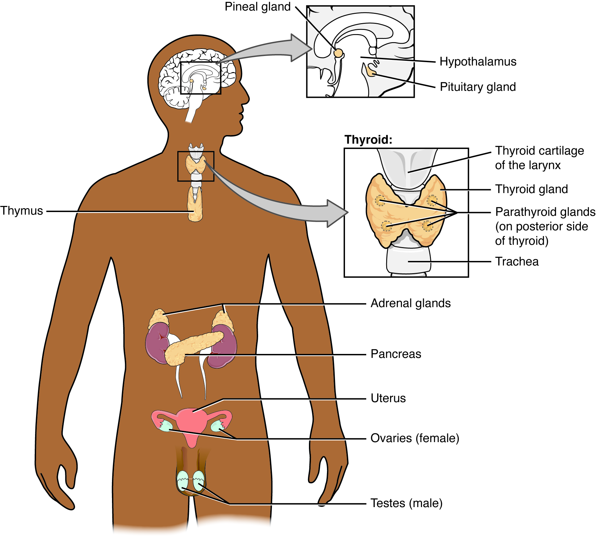
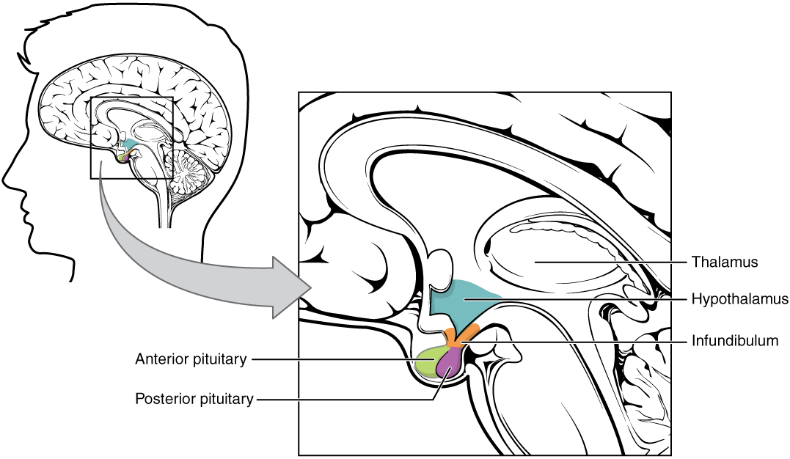

# 第22章 内分泌：分散在身体里的化学信号站

内分泌系统难以像骨骼那样在一张图上画成连续的整体。它包括脑下方的垂体、颈部的甲状腺、肾上方的肾上腺，以及胰腺和性腺内的相关细胞；心脏、肾和消化道等器官也能产生激素。它们在空间上分散，却借助血液与受体联系起来。认识内分泌，需要同时看分泌位置、运输方式和目标细胞。

## 腺体是否有导管，是一个重要区别

汗腺和胰腺外分泌部等多细胞外分泌腺，通常通过导管把分泌物送到体表或器官腔内；杯状细胞等单细胞外分泌腺则直接向上皮表面分泌，不具有独立导管。内分泌细胞则将激素释放到周围组织液，再进入血液运输，不需要一条通向目标器官的分泌管。[来源：OpenStax，17.1 内分泌系统概述](https://openstax.org/books/anatomy-and-physiology-2e/pages/17-1-an-overview-of-the-endocrine-system)

激素随血液到达许多地方，但只有具备相应受体、并能作出反应的细胞才是它的目标。受体可以位于细胞膜上，也可以位于细胞内，取决于激素的性质及信号机制。因此，激素作用图中的箭头通常表示调节关系，不代表腺体和目标器官之间存在一根专用导管。

同一个器官可以兼有外分泌和内分泌功能。胰腺是清楚的例子：胰腺外分泌部分与导管相连，胰岛则含多种分泌激素的细胞。把整块胰腺统称为“只产生胰岛素的器官”，既忽略了消化功能，也忽略了胰岛内部不同细胞的分工。

[补充来源：OpenStax 4.2，腺上皮](https://openstax.org/books/anatomy-and-physiology-2e/pages/4-2-epithelial-tissue)

### 图 22-01｜内分泌结构分散在全身

**读图：** 从头部到颈、胸腹与盆部定位腺体。胰等器官兼有内分泌和其他功能，不能只按外形归类。

**标注对应：** pituitary 垂体；thyroid 甲状腺；adrenal 肾上腺。

*来源：[OpenStax《Anatomy and Physiology 2e》原图 17.2](https://openstax.org/books/anatomy-and-physiology-2e/pages/17-1-an-overview-of-the-endocrine-system)；OpenStax, Anatomy and Physiology 2e; J. Gordon Betts et al.; Rice University；[CC BY-NC-SA 4.0](https://creativecommons.org/licenses/by-nc-sa/4.0/)。*

## 下丘脑与垂体：两种不同的连接

垂体位于颅底蝶骨的垂体窝内，通过垂体柄与下丘脑相连。外观看来像一块小腺体，垂体前叶与后叶却有不同的组织来源和调节方式。前叶的内分泌细胞能合成并分泌多种激素，其活动受下丘脑释放或抑制信号影响；这些信号经过垂体门脉系统，从一组毛细血管到达另一组毛细血管，不必先绕全身体循环一周。[来源：OpenStax，17.3 垂体与下丘脑](https://openstax.org/books/anatomy-and-physiology-2e/pages/17-3-the-pituitary-gland-and-hypothalamus)

垂体后叶则含来自下丘脑神经元的轴突末梢。抗利尿激素和催产素在下丘脑相关神经元中合成，沿轴突运输，在后叶相关末梢储存并释放入血。说“后叶释放激素”是合适的，说“这些激素都在后叶合成”则混淆了生产位置与释放位置。

| 连接方式 | 从下丘脑到垂体走的主要路线 | 垂体这一端做什么 |
| --- | --- | --- |
| 前叶调节 | 释放或抑制激素经门脉血管运输 | 前叶细胞据此调整自身激素的分泌 |
| 后叶释放 | 神经元轴突延伸到后叶 | 末梢将下丘脑合成的激素释放入血 |

读垂体图时，可先把血管与轴突涂成心中不同的两条路线，再检查激素名称写在合成端还是释放端。这样比把所有箭头统一叫作“控制”更能说明结构差异。

### 图 22-02｜下丘脑与垂体的连接

**读图：** 比较前后部与下丘脑的不同连接；神经联系和垂体门脉系统不是同一条通路。

**标注对应：** hypothalamus 下丘脑；anterior pituitary 腺垂体；posterior pituitary 神经垂体。

*来源：[OpenStax《Anatomy and Physiology 2e》原图 17.7](https://openstax.org/books/anatomy-and-physiology-2e/pages/17-3-the-pituitary-gland-and-hypothalamus)；OpenStax, Anatomy and Physiology 2e; J. Gordon Betts et al.; Rice University；[CC BY-NC-SA 4.0](https://creativecommons.org/licenses/by-nc-sa/4.0/)。*

## 分泌器官的名字，不能代替内部结构

甲状腺位于颈前部、气管上段附近，由左右叶与连接部分组成；甲状旁腺通常位于甲状腺后侧附近，是独立的内分泌结构，不能因名称相似就看作甲状腺的一种细胞。肾上腺位于两侧肾上方，皮质与髓质产生的激素类型和调节方式不同；它的位置靠近肾，也不意味着它是肾脏过滤尿液的一个部件。[来源：OpenStax，17.1](https://openstax.org/books/anatomy-and-physiology-2e/pages/17-1-an-overview-of-the-endocrine-system)

卵巢和睾丸既参与生殖细胞形成，也有内分泌作用。内分泌图为了让腺体位置醒目，常省略邻近器官，这容易造成“每种激素都对应一个独立小球”的印象。实际情况包含独立腺体、器官中的细胞团、分散在组织里的内分泌细胞等多种形式。

结构不同也会影响信号的组织方式。某些激素由垂体激素调节，形成多级内分泌轴；另一些主要响应血液中某种物质的浓度变化，或直接受神经影响。不能把垂体称为完全不受反馈限制、指挥全身每个腺体的唯一“总司令”。

腺体体积与作用范围也没有简单的正比关系。激素浓度、受体数量、目标细胞状态以及信号持续时间都影响结果；同一种激素在不同组织中可以引出不同反应。血液把信号带到全身，并不意味着每个组织都以相同强度、相同方式响应。把所有目标画成等粗箭头，是一种简化，不能据此比较实际效应大小。

还有一些信号主要作用于附近细胞，称为旁分泌；一些影响分泌它们的细胞自身，称为自分泌。它们与经血液远距离作用的典型内分泌不同，却可能在同一组织中同时出现。分类依据是信号到达目标的方式，而不是分子有没有一个听起来熟悉的名字。这使“一个细胞只能属于一种调节系统”的想象不再成立。[来源：OpenStax，17.1](https://openstax.org/books/anatomy-and-physiology-2e/pages/17-1-an-overview-of-the-endocrine-system)

内分泌图中的位置与比例应分开读。甲状旁腺等较小结构往往被放大显示，垂体与下丘脑也可能通过局部放大框呈现。如果把放大框里的大小直接与腹部腺体比较，就会误判器官比例。先看标注的解剖位置，再读局部结构，最后沿箭头追踪反馈，才是这类跨尺度图的合适顺序。图上的一条“促分泌”箭头还不表示该通路始终以相同强度工作，实际调节会随身体状态而改变。

## 负反馈让分泌保持在可调整的范围

以甲状腺相关调节为例，下丘脑信号影响垂体前叶，前叶分泌促甲状腺激素，后者影响甲状腺激素分泌；甲状腺激素又会反馈影响上游。这里既有促进作用，也有抑制作用。如果图上只保留从上到下的箭头，就会丢失稳定调节的重要部分。[来源：OpenStax，17.3](https://openstax.org/books/anatomy-and-physiology-2e/pages/17-3-the-pituitary-gland-and-hypothalamus)

神经调节与激素调节也不是“快与慢”的绝对二分。神经信号适合沿特定连接迅速传递；某些激素可在较短时间内参与反应，另一些效应则需要更久。下丘脑、垂体后叶和肾上腺髓质都显示了两套调节系统之间的紧密连接。

在全身图上找腺体，只完成了空间定位。下一步应选一条具体路线，依次辨认刺激、分泌细胞、血液运输、目标受体与反馈；这样才能解释为什么一个体积不大的结构，可以影响相距很远的组织。
