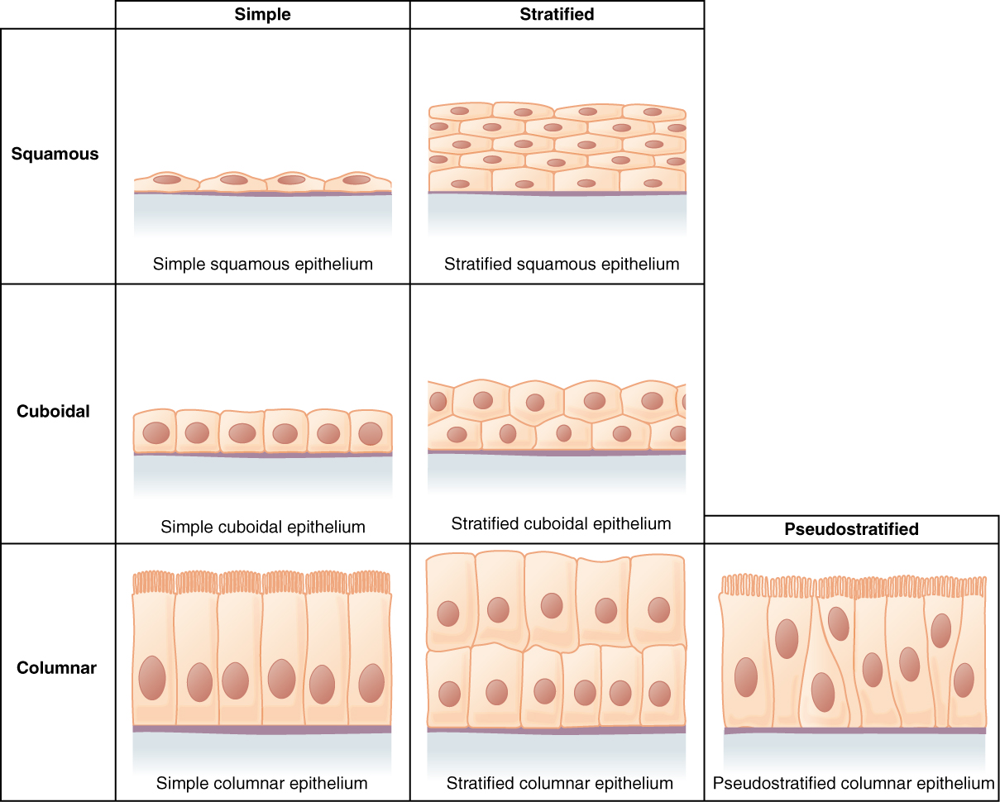
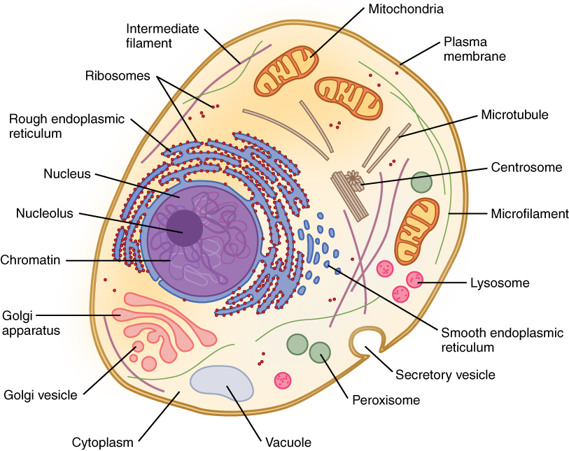

# 第23章 从器官走到细胞：结构如何跨越尺度

看完整个身体以后，再进入显微尺度，许多宏观差异会获得新的解释：肺适合交换气体，肠适合吸收，皮肤适合抵御摩擦，不只是因为它们位于不同地方，也因为细胞的形状、排列和细胞外成分不同。“从外到内”在这一章变成从器官表面进入组织，再进入细胞内部，但观察尺度始终需要单独标明。

## 一张切片，显示的是三维结构的一部分

组织切片将立体结构转成薄层。管道被横切时常呈圆形或椭圆形，纵切则可能表现为平行的两条壁；同一组织的斜切又会产生不同形状。因此，切片上的圆不一定是“球形细胞”，也可能是管腔、血管或腺体的横截面。细胞核只是细胞的一部分，并不等于整个细胞。

普通光学显微镜可显示细胞与组织的许多关系，电子显微镜则能展示更细的内部结构。染色用于增加成分间的对比，切片里的紫色细胞核和粉红色基质通常不是组织在活体中的原色。看显微图时应同时读比例尺、染色方式和组织来源；若来源是其他动物，就不能把图注擅自改成人体实拍。[来源：OpenStax，4.2 上皮组织](https://openstax.org/books/anatomy-and-physiology-2e/pages/4-2-epithelial-tissue)

显微图的教学价值不在于“看起来更复杂”，而在于回答某个可见问题。观察上皮时先找腔面与基底侧，观察肌肉时先判断切面方向，观察神经时先分清胞体与纤维；不同组织需要不同的起点。

## 上皮：面向哪里，决定怎样工作

上皮细胞排列紧密，常形成覆盖表面或衬在管腔内的连续层。靠近自由表面的一端叫顶端，接近基底膜的一端叫基底端，两端的结构和功能可以明显不同。这种方向性称为极性。肠上皮朝向肠腔的一侧与朝向下方组织的一侧承担不同运输步骤，不能把细胞想成四周完全等效的小方块。[来源：OpenStax，4.2](https://openstax.org/books/anatomy-and-physiology-2e/pages/4-2-epithelial-tissue)

单层上皮只有一层细胞，复层上皮则有多层。薄的单层鳞状上皮适合某些交换界面；较高的立方或柱状细胞常与吸收、分泌活动有关；复层鳞状上皮适合抵抗摩擦。表皮的角化层与口腔黏膜的非角化上皮，就是在不同环境下采用不同保护方式的例子。功能与形态有关，但不能仅凭“薄”或“厚”就推断一个组织的全部作用。

假复层上皮的细胞核位于不同高度，看起来像多层，但所有细胞都与基底膜相接。移行上皮则见于尿路的特定部位，其外观随器官充盈程度改变。两者都提醒读者：分类要依据细胞与基底膜的关系及表层细胞特征，不能只数切片上看到几排细胞核。

| 显微观察线索 | 可联系的结构功能 | 不能直接推出什么 |
| --- | --- | --- |
| 一层扁平细胞 | 薄的交换或衬里界面 | 所有薄壁处都能自由通透 |
| 多层细胞覆盖 | 对摩擦的保护 | 层数越多就越健康 |
| 顶端有微绒毛 | 扩大吸收表面积 | 微绒毛会像纤毛一样主动摆动 |
| 表面有活动纤毛 | 参与推动表面物质 | 所有上皮都有纤毛 |

### 图 23-01｜上皮细胞的排列方式

#### 中文读图说明

这是一张按两个维度排列的分类表，不是连续剥开身体的步骤图。先横看列标题：左列单层，中列复层；再竖看行标题：从上到下依次为鳞状、立方状、柱状，组合起来才是上皮类型的名称。

各小格底部紫色细带表示细胞附着的基底侧，顶部为自由表面。比较同一行的左右两格可看清层数差异，比较单层一列的上下三格则能看清细胞由扁到高的形状变化。

右下单独的小格是假复层柱状上皮，细胞核高度不齐，但所有细胞都接触基底膜。复层上皮按最表层细胞形状命名，不能用底层细胞形状或细胞核的排数代替分类判断。

#### 图中英文标注逐项对照

| 图中英文 | 中文名称 | 在图中怎样理解 |
| --- | --- | --- |
| Simple | 单层 | 列标题表示上皮只有一层细胞 |
| Stratified | 复层 | 列标题表示上皮由多层细胞构成 |
| Squamous | 鳞状（扁平） | 行标题表示表层细胞呈扁平形态 |
| Cuboidal | 立方状 | 行标题表示细胞高度与宽度较接近 |
| Columnar | 柱状 | 行标题表示表层细胞高度明显较大 |
| Pseudostratified | 假复层 | 看似多层但所有细胞均接触基底膜 |
| Simple squamous epithelium | 单层鳞状上皮 | 左上格为一层扁平细胞覆盖的表面 |
| Stratified squamous epithelium | 复层鳞状上皮 | 右上格有多层且表层细胞较扁平 |
| Simple cuboidal epithelium | 单层立方上皮 | 左中格为一层近立方形细胞排列 |
| Stratified cuboidal epithelium | 复层立方上皮 | 右中格由多层近立方形细胞构成 |
| Simple columnar epithelium | 单层柱状上皮 | 左下格为一层较高柱形细胞排列 |
| Stratified columnar epithelium | 复层柱状上皮 | 中下格的表面一层呈较高柱形 |
| Pseudostratified columnar epithelium | 假复层柱状上皮 | 右下格细胞核高低不齐但不是真复层 |

*来源：[OpenStax《Anatomy and Physiology 2e》原图 4.6](https://openstax.org/books/anatomy-and-physiology-2e/pages/4-2-epithelial-tissue)；OpenStax, Anatomy and Physiology 2e; J. Gordon Betts et al.; Rice University；[CC BY-NC-SA 4.0](https://creativecommons.org/licenses/by-nc-sa/4.0/)。*

## 细胞内部有分工，也有连续的运输

典型人体细胞示意图常将细胞膜、细胞核、内质网、高尔基体、线粒体和多种囊泡放在同一个细胞内。这是方便学习的综合模型，不代表任一种人体细胞都具有同样数量、大小和位置的细胞器。成熟红细胞缺少细胞核及多数细胞器，成熟骨骼肌纤维有多个细胞核，已经说明“每个细胞一个居中圆核”并非通则。[来源：OpenStax，18.3 红细胞](https://openstax.org/books/anatomy-and-physiology-2e/pages/18-3-erythrocytes)；[3.2 细胞质与细胞器](https://openstax.org/books/anatomy-and-physiology-2e/pages/3-2-the-cytoplasm-and-cellular-organelles)

细胞核保存主要遗传信息；核糖体参与蛋白质合成；粗面内质网表面附有核糖体，与许多分泌蛋白和膜蛋白的生产加工有关。产物可装入囊泡送到高尔基体，进一步修饰、分类，再去往细胞膜、胞外或其他细胞内位置。理解这条路线，比单独背诵每个细胞器像什么更有用。

线粒体参与能量转换，其内膜折叠形成嵴，为相关反应提供表面。细胞骨架则由不同类型的蛋白质纤维组成，参与维持形态、胞内运输和运动。骨架并不等于僵硬不变的支撑杆，许多组成会持续调整。微绒毛与纤毛都从细胞表面突出，但内部骨架和主要功能不同，不能因形状相近而视为同物。

细胞膜由脂质与多种蛋白质共同构成，是具有选择性的边界。某些小分子可较容易地跨过膜，另一些物质需要通道、载体或囊泡运输。所谓“吸收”因此不是营养物质从细胞之间任意漏入，而是包含跨膜运输、细胞连接和组织内后续转运的协调过程。屏障也不等于完全封闭，不同组织会调节允许通过的种类和数量。[来源：OpenStax，3.1 细胞膜](https://openstax.org/books/anatomy-and-physiology-2e/pages/3-1-the-cell-membrane)

同样的道理适用于细胞之间的连接。紧密连接有助于限制细胞间隙的通透，黏着连接与桥粒等承担不同形式的机械连接，缝隙连接允许某些小分子和离子在相邻细胞之间交流。它们并非每种组织都有同样数量和同样排列，也不能把所有细胞连接概括为“把细胞粘牢的胶”。在同一个上皮里，限制漏过、承受牵拉与传递信息可以由不同结构共同完成。[来源：OpenStax，4.2](https://openstax.org/books/anatomy-and-physiology-2e/pages/4-2-epithelial-tissue)

显微图与模式图还应互相补充：前者保留真实材料的复杂性和切面限制，后者选择性强调关系，常会把细胞器画大或把细胞间距拉开。如果某结构在模式图上十分醒目，却在普通组织切片中找不到，不一定是切片有问题，也可能是它超出了当时放大倍数与成像方式的辨认能力。

### 图 23-02｜一个概括性的人体细胞示意

#### 中文读图说明

先沿外圈找到细胞膜，再把内部紫色大圆的细胞核与周围细胞质分开。核内深色核仁和细线状染色质是不同成分；这是一张综合模式图，不代表每种人体细胞都长成同样外形。

沿细胞核外围蓝色折叠膜找粗面内质网，红色小点是核糖体；再向左下找到粉色高尔基体及附近囊泡，理解部分蛋白质从合成、加工到分拣运输的联系，图中并未画出完整运输箭头。

最后找橙色线粒体、粉色溶酶体、绿色过氧化物酶体及三类细胞骨架。图中比例和数量为便于识别而简化，浅蓝液泡也不是人体细胞普遍具有的植物式大中央液泡。

#### 图中英文标注逐项对照

| 图中英文 | 中文名称 | 在图中怎样理解 |
| --- | --- | --- |
| Intermediate filament | 中间丝 | 图中较细纤维之一参与承受细胞牵拉 |
| Ribosomes | 核糖体 | 红色小点参与细胞内的蛋白质合成 |
| Rough endoplasmic reticulum | 粗面内质网 | 细胞核附近附有核糖体的蓝色膜网 |
| Nucleus | 细胞核 | 包含主要遗传信息的紫色大结构 |
| Nucleolus | 核仁 | 细胞核内较深色并与核糖体生成相关 |
| Chromatin | 染色质 | 细胞核内由遗传物质与蛋白构成 |
| Golgi apparatus | 高尔基体 | 左下粉色扁囊参与分拣加工细胞产物 |
| Golgi vesicle | 高尔基体囊泡 | 高尔基体附近用于运输的膜性小泡 |
| Cytoplasm | 细胞质 | 细胞膜内而位于细胞核之外的部分 |
| Vacuole | 液泡（概括性囊泡） | 原图浅蓝囊泡并非植物式大中央液泡 |
| Mitochondria | 线粒体 | 橙色双膜结构参与细胞能量转换 |
| Plasma membrane | 细胞膜 | 围住整个细胞并形成选择性交换界面 |
| Microtubule | 微管 | 较粗的骨架管状成分参与运输和分裂 |
| Centrosome | 中心体 | 细胞内与微管组织相关的结构区域 |
| Microfilament | 微丝 | 细胞骨架成分并参与形态和运动 |
| Lysosome | 溶酶体 | 粉色囊泡内的酶参与分解与回收 |
| Smooth endoplasmic reticulum | 滑面内质网 | 无表面核糖体的膜网参与脂质等代谢 |
| Secretory vesicle | 分泌囊泡 | 图右靠近细胞膜并将产物送往胞外 |
| Peroxisome | 过氧化物酶体 | 绿色小体参与脂质与过氧化物的代谢 |

*来源：[OpenStax《Anatomy and Physiology 2e》原图 3.13](https://openstax.org/books/anatomy-and-physiology-2e/pages/3-2-the-cytoplasm-and-cellular-organelles)；OpenStax, Anatomy and Physiology 2e; J. Gordon Betts et al.; Rice University；[CC BY-NC-SA 4.0](https://creativecommons.org/licenses/by-nc-sa/4.0/)。*

## 从组织回到器官，找共同完成的任务

器官功能来自多种组织合作。肠壁的上皮负责选择性吸收与屏障，下面的结缔组织提供支持与运输通路，平滑肌推动内容物，神经回路协调活动。若只把器官放大到一个“代表细胞”，就会漏掉层间连接；若只停留在整器官轮廓，又解释不了交换与收缩为何能够发生。

细胞与细胞之间还存在连接结构，细胞外基质也影响组织的机械性质。皮肤能承受拉扯、肌腱能传递张力，不能只归功于某个细胞内部的“强壮骨架”；胶原纤维及其排列等细胞外成分同样关键。由此再回看本书的浅层与深层，细胞、组织、器官不再是三份独立名单，而是在不同尺度上描述同一个身体。
