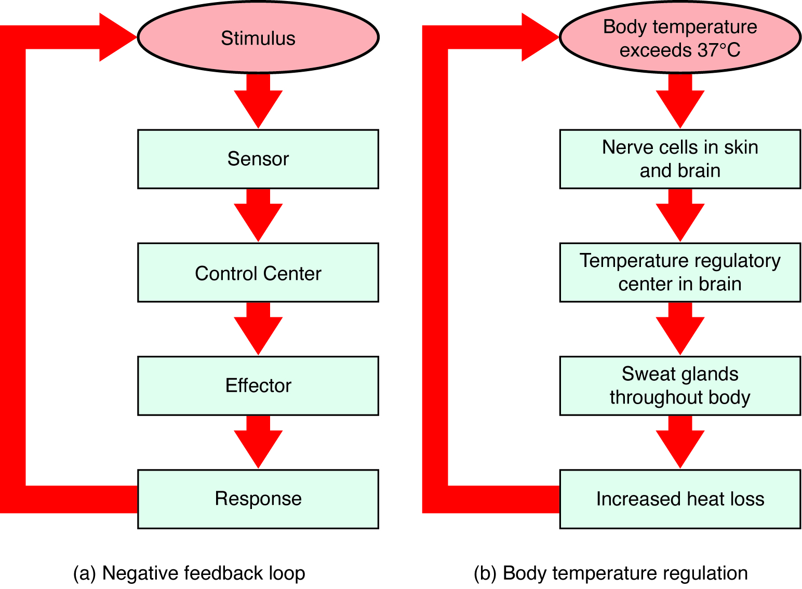

# 第24章 把身体重新连起来：动作、呼吸与稳态

分层学习让结构变得清楚，也容易产生另一种错觉：仿佛人体可以由互不干扰的系统独立运转。实际活动总在跨越这些边界。起身走几步需要骨与肌肉，也需要感觉、神经、循环和呼吸。最后一章不再增加一批孤立的器官名称，而用几件熟悉的事情，把位置、连接与功能重新连起来。

## 从椅子上站起：力量要有支点，动作要有反馈

站起之前，身体需要把重心移向能够支撑的位置。躯干前倾、髋膝逐渐伸展、踝和足部调整，不是某一块“起立肌”独自完成的动作。髋周肌群、股四头肌及其他肌群共同产生和调节关节力矩；骨与关节提供杠杆和运动约束，足底则与地面交换支撑力。[结构旁读：第7、10、11章；OpenStax，9.5 身体运动类型](https://openstax.org/books/anatomy-and-physiology-2e/pages/9-5-types-of-body-movements)

肌肉收缩产生的力通过肌腱等结构传到骨，关节面的形状、韧带及周围肌群共同限制不需要的位移。与此同时，来自足底、肌肉和关节的感觉信息持续进入神经系统，视觉与前庭信息也参与姿势调节。脑和脊髓不是先算好一次动作便停止工作，而是在运动中不断利用反馈修正输出。

沿着一条具体的线阅读，会比一口气复述所有系统更清楚：先看脚与地面的接触，再沿小腿、大腿追到骨盆和躯干；随后将产生力的肌肉加回图中，最后补上感觉输入和运动输出。图中每增加一层，应解决一个新问题，而不是只增加名称。

## 呼吸加深：胸廓运动要接上气体交换

活动时，肌肉对能量的需求增加，也产生更多二氧化碳。通气改变需要呼吸肌工作：膈和肋间肌等改变胸腔容积，胸膜的结构关系使肺随胸廓变化而扩张或回缩，空气沿气道移动。气体真正跨越的交换界面却在肺泡与毛细血管之间，而不是胸廓外形本身。[结构旁读：第12章；OpenStax，22.2 肺](https://openstax.org/books/anatomy-and-physiology-2e/pages/22-2-the-lungs)

氧进入血液后，需要循环系统运到组织；组织中的二氧化碳又随血液返回肺。右心、肺循环、左心和体循环构成相接的路线。把“深呼吸”直接等同于“每个细胞立即得到更多氧”，会略去通气、交换、灌注、血液携带和组织利用之间的多个条件。各环节互相配合，才能完成整体任务。

这里还跨越了尺度：胸廓是可见的宏观运动，肺泡壁是微观交换界面，线粒体则参与细胞内的能量转换。它们不能画在同一比例尺上，却可以用有明确含义的连接线放在同一页，让读者理解一口气与一块肌肉之间的实际联系。

## 吃下一口食物：腔内消化与体内运输分开看

食物进入口腔后，通过咀嚼和吞咽进入消化管。消化管腔在拓扑上仍与外界相通；食物并不是一进胃就进入血液。消化过程使许多营养物质变为更适合吸收的形式，再跨过肠上皮进入血液或淋巴运输路线。[结构旁读：第15、16章；OpenStax，23.1 消化系统概述](https://openstax.org/books/anatomy-and-physiology-2e/pages/23-1-overview-of-the-digestive-system)

肠壁的运动把内容物混合和推进，胰液与胆汁通过各自的通道参与小肠内的消化。许多水溶性吸收产物经门静脉系统先到肝；许多膳食脂质则经肠内处理形成乳糜微粒，进入乳糜管，再经淋巴回到血循环。胃、肝、胰和小肠因此不是按名称依次把食物“接过去”的流水线，食物路线、分泌路线和血液路线必须分别辨认。[来源：OpenStax，23.7 化学消化与吸收](https://openstax.org/books/anatomy-and-physiology-2e/pages/23-7-chemical-digestion-and-absorption-a-closer-look)

胰岛等内分泌结构再根据身体状态参与调节营养物质的处理与储存。一个器官可以同时出现在消化图和内分泌图里，因为这两张图选择的是不同功能联系，并非其中一张画错了。

这些日常过程也说明，身体内的“内”和“外”不止一种含义。手臂深处的肌肉相对皮肤更深，这是解剖深浅；胃肠管腔中的食物尚未跨过上皮进入内部运输环境，这是界面关系；从器官图放大到细胞，则是观察尺度变化。三种变化可以出现在同一页，但应使用不同文字说明，不能统统叫作“再往里面一层”。

例如，拿一杯水送到口边，可以从手指屈伸、前臂旋转和肩肘位置阅读，也可以从视觉引导、本体感觉和动作修正阅读，还可以从吞咽后水经过消化道上皮参与体液平衡阅读。它们不是互相竞争的解释，而是针对同一活动提出不同问题。读者无需记住每一条微小分支，先能保持每幅图的视角、尺度和箭头含义一致，就可以逐渐叠加细节。

年龄、体型、器官充盈程度和姿势，还会改变外观与部分结构关系。腹部器官不总像标准正面图那样平铺，膀胱会随充盈改变形态，肌肉轮廓也受皮下组织覆盖影响。因此，标准人体图应作为共同定位框架，而不能当成每个人某个时刻的精确复印件。这也解释了全书为何反复使用剖面、局部放大与层次图：单一外形视图无法承担全部教学任务。

## 稳态是持续调节，不是完全不变

稳态指机体将内部条件维持在适合生命活动的范围内。体温、血液成分等会随昼夜、活动和环境变化，不能把健康状态理解为所有数值永远停在同一个点。许多调节通过负反馈完成：感受环节检测变化，整合环节影响效应器，使变化受到抵消。[来源：OpenStax，1.5 稳态](https://openstax.org/books/anatomy-and-physiology-2e/pages/1-5-homeostasis)

以散热为例，体内热量增加后，神经调节可影响皮肤血流与汗腺活动；汗液在能够蒸发的条件下带走热量。皮肤、血管、腺体和神经共同参与，一个“皮肤散热”的简单结论背后包含多个层次。负反馈中的“负”表示抵消变化方向，并不表示效果不好；正反馈表示加强变化，也不等于对身体更有益。分娩等有明确终点的过程可包含正反馈，不能把它推广成日常调节的通用方式。

| 阅读层次 | 此时要回答的问题 | 示例 |
| --- | --- | --- |
| 空间 | 结构在哪里，与谁相邻 | 肺在胸廓内，肾位于腹膜后 |
| 机械 | 力量或物质怎样通过 | 肌腱传力，血管输送血液 |
| 信号 | 谁检测变化，谁调整活动 | 感觉输入、神经输出和激素反馈 |
| 尺度 | 图中放大了什么 | 胸廓、肺泡与细胞器比例不同 |

回到一张完整人体图，可以尝试选一个日常动作，追踪它需要的空间、力、物质和信号。知道结构的名字，是识别身体的起点；能说明这些结构为什么这样排列、怎样共同完成任务，才是这次从外到内阅读获得的能力。

### 图 24-01｜负反馈如何维持动态稳定

**读图：** 按箭头追踪偏离、检测、调节与结果，理解负反馈抵消偏离趋势；稳态不是所有指标永远固定。

**标注对应：** stimulus 刺激；receptor 感受器；control center 控制中心；effector 效应器。

*来源：[OpenStax《Anatomy and Physiology 2e》原图 1.10](https://openstax.org/books/anatomy-and-physiology-2e/pages/1-5-homeostasis)；OpenStax, Anatomy and Physiology 2e; J. Gordon Betts et al.; Rice University；[CC BY-NC-SA 4.0](https://creativecommons.org/licenses/by-nc-sa/4.0/)。*

